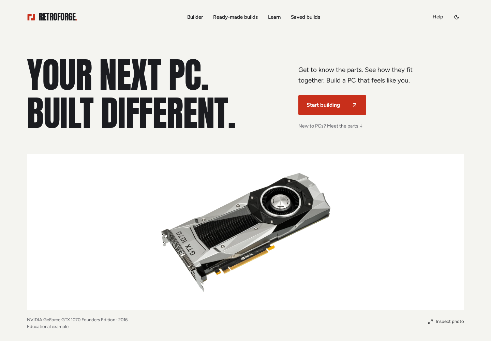
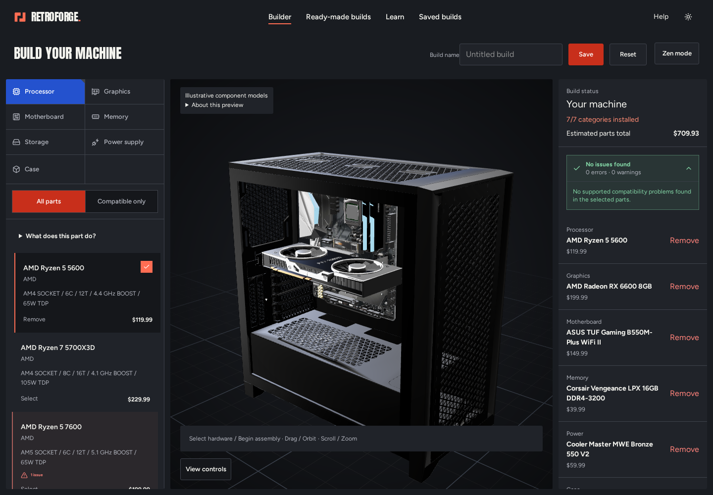
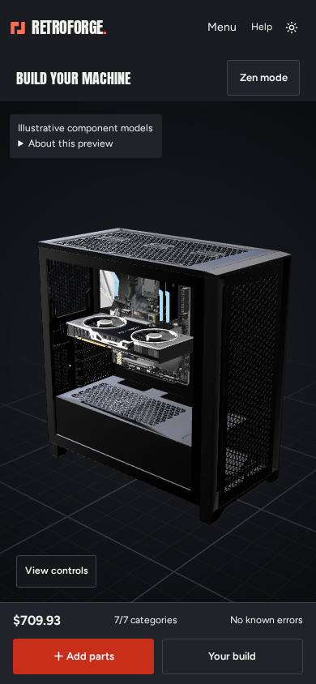
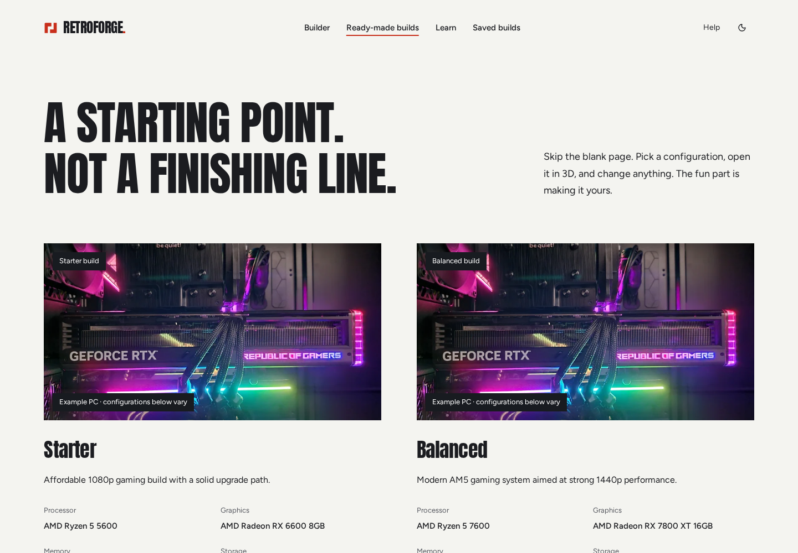
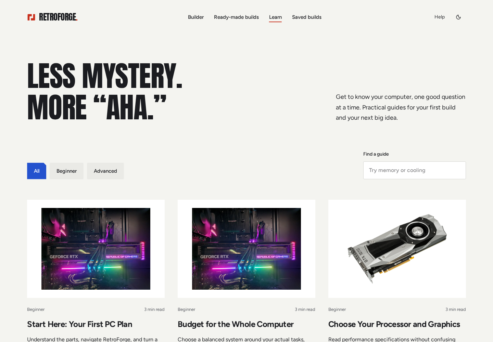

<div align="center">

# RetroForge

### Your next PC. Built different.

Plan your parts. Check the conflicts. Explore your build in 3D.

**[Try RetroForge](https://retroforge-iota.vercel.app/)** · **[Open the builder](https://retroforge-iota.vercel.app/#/build)** · **[Read the guides](https://retroforge-iota.vercel.app/#/guides)**

React · TypeScript · React Three Fiber · Zustand · Vite

</div>



RetroForge is an interactive PC planning tool built for people who want to
understand their hardware before buying it. Choose components, review known
compatibility conflicts and power requirements, inspect an illustrative 3D
assembly, and save configurations in your browser.

Start from a blank configuration or customize a prebuilt. Learn what each part
does as you go, without losing access to the specifications that matter.

## The latest RetroForge

The **Redline** redesign brings the home page, builder, prebuilt gallery, and
guides together with bold typography, generous spacing, red accents, and credited
hardware photography. The update also goes deeper than the interface:

| Area                        | What's available now                                                                                                                                  |
| --------------------------- | ----------------------------------------------------------------------------------------------------------------------------------------------------- |
| **Desktop builder**         | Component specifications, a saved-build bar, a selected-part readout, and an installed-parts panel around the 3D stage.                               |
| **Phone builder**           | An expanding **Add parts / Your build** dock keeps the assembly in view, with panels that expand for reading.                                         |
| **Compatibility and power** | Actionable errors and warnings, compatibility-aware candidate filtering, storage-capacity checks, estimated system load, and recommended PSU wattage. |
| **Learning**                | An interactive hardware explainer and **14 linked guides** covering first builds, component selection, troubleshooting, tuning, and maintenance.      |
| **3D experience**           | Independent component assets, animated installation, immediate removal, Auto / High / Low quality, and recovery when a model fails to load.           |
| **Help and controls**       | A first-visit welcome, a replayable six-step builder tour, Zen mode, keyboard navigation, camera buttons, and reduced-motion support.                 |

## Build it before you buy it



- Choose from **60 sample catalogue products** across seven categories: CPU,
  GPU, motherboard, RAM, storage, PSU, and case.
- Search components by name or brand, inspect specifications, and filter for
  supported compatibility checks.
- Replace components, install multiple storage drives, and watch the assembly
  update. Fresh builds and Reset start with a Corsair 4000D Airflow case.
- Orbit, zoom, and reset the camera with pointer controls, buttons, or the
  keyboard. Use Zen mode to give the assembly more room.
- Name, save, and reload builds in the same browser.
- Switch between light and dark themes.

### Made for a smaller screen, too

The phone layout keeps the 3D stage visible while parts and build details open in
an expandable dock. Desktop Zen panels can be revealed by hover, keyboard focus,
or their edge buttons.

<p align="center">
  
</p>

## Check the important connections

The same build assessment powers the installed-build summary, candidate
selection, saved-build loads, and prebuilt configurations.

| Check                     | What RetroForge evaluates                                                                             |
| ------------------------- | ----------------------------------------------------------------------------------------------------- |
| **CPU ↔ motherboard**     | Socket matching.                                                                                      |
| **RAM ↔ motherboard**     | Memory generation.                                                                                    |
| **GPU ↔ case**            | Listed graphics-card length against case clearance.                                                   |
| **Motherboard ↔ case**    | Supported motherboard form factor using the catalogue's size model.                                   |
| **Storage ↔ motherboard** | Connector and protocol support, plus aggregate M.2 / SATA capacity across installed drives.           |
| **PSU ↔ selected system** | CPU package-power budget, GPU board power, allowances for other components, and recommended headroom. |

Errors are excluded from the compatible-only filter and require acknowledgement
before installation. Warnings remain visible and selectable, so a sizing or data
warning does not silently hide a candidate.

Power guidance distinguishes an undersized PSU from insufficient recommended
headroom. The recommendation uses the greater of **125% of estimated load** and
the GPU vendor's published whole-system PSU recommendation, rounded up to a whole
watt. Incomplete configurations show a partial estimate and missing categories.
See the [power policy](./docs/power-policy.md) for the inputs, sources, and limits.

Compatibility is planning guidance. Confirm exact-model specifications and
manufacturer manuals before purchasing; supported checks do not prove that an
entire real-world build will fit or work.

## Start with a build. Make it yours.



Preconfigured gaming and workstation systems provide a starting point. Open one
in the builder, inspect its components, then replace whatever you want while
compatibility checks stay active. Displayed totals use sample catalogue prices.

## Learn the parts as you plan



The home page introduces the role of each component through hardware photographs,
plain-language explanations, and buying considerations. The field manual expands
that into 14 searchable guides with beginner and advanced filters, checklists,
sources, related reading, and links into the relevant builder category.

Topics include budgeting, CPU/GPU selection, sockets and memory, power, storage,
cooling, assembly, first boot, troubleshooting, tuning, custom loops, and upgrades.

## A lighter 3D pipeline

The six optimized GLB assets total **1.65 MB**, down from **18.07 MB** in the
source set: **90.9% less model data**. This is an asset-size comparison, not a
promise of the same speedup in every browser.

The builder loads selected models with a two-asset concurrency limit, reuses
cached geometry and materials, and lets component selection and saving remain
usable while the scene loads. Individual model failures have recovery controls.
Settled scenes render on demand; hidden tabs suspend rendering. Auto quality
adjusts resolution and shadow cost, with manual High / Low overrides.

Read the [performance notes](./docs/performance.md) for measurements and their
limitations, and [model assets and fidelity](./docs/model-assets.md) for provenance,
licences, and placement details.

## Run locally

Use **Node.js 22.12+** and **npm**. CI and Vercel both install from
`package-lock.json` with `npm ci`.

```bash
git clone https://github.com/Nihar-potdar/retroforge.git
cd retroforge
npm ci
npm run dev
```

Open the address printed by Vite and select **Start building**.

| Command                   | Purpose                                            |
| ------------------------- | -------------------------------------------------- |
| `npm run dev`             | Start the development server.                      |
| `npm run build`           | Type-check and create the production build.        |
| `npm run preview`         | Serve the production build locally.                |
| `npm run lint`            | Run ESLint.                                        |
| `npm test`                | Run Vitest in watch mode.                          |
| `npm run test:run`        | Run unit and component tests once.                 |
| `npm run test:coverage`   | Run tests with coverage thresholds.                |
| `npm run test:browser`    | Run the Playwright browser suite.                  |
| `npm run models:optimize` | Regenerate optimized models.                       |
| `npm run models:measure`  | Measure optimized model assets.                    |
| `npm run perf:browser`    | Compare production baseline and optimized servers. |

Before running browser tests, install the browser binaries:

```bash
npx playwright install chromium firefox
npm run test:browser
```

The browser suite builds and serves the app automatically. It covers desktop,
phone-sized Chromium, and targeted Firefox interaction checks. Pull-request CI
runs lint, test coverage, a production build, and browser tests.

## Under the hood

| Layer                            | Tools                                     |
| -------------------------------- | ----------------------------------------- |
| Interface                        | React 19, TypeScript, Tailwind CSS        |
| 3D                               | Three.js, React Three Fiber, Drei         |
| State and saved-build validation | Zustand, Zod                              |
| Navigation and motion            | React Router, Motion, GSAP                |
| Development and testing          | Vite, Vitest, Testing Library, Playwright |
| Deployment                       | Vercel                                    |

```text
src/
├── Logic/Compatibility/  # Build assessment, compatibility rules, power sizing
├── Pages/                # Home, builder, prebuilts, guide index and articles
├── components/           # 3D viewport, assembly, onboarding and shared UI
├── data/                 # Component catalogue, prebuilts and learning content
├── models/               # Model registry, component assets and loading
├── stores/               # Zustand build state
└── zod/                  # Saved-build schemas
docs/                     # Power policy, model credits and performance evidence
e2e/                      # Browser regression tests
tools/                    # Asset optimization, inventory and benchmarks
```

## Current boundaries

- **Catalogue and pricing:** a limited sample dataset; prices are static and
  there is no checkout or live retailer integration.
- **Model fidelity:** the Corsair 4000D Airflow is the one product-identified
  model. Other catalogue products use illustrative fallbacks; storage uses
  schematic geometry. The 3D view does not verify mounting or physical clearance.
- **Compatibility:** BIOS support, shared PCIe / M.2 / SATA lanes, exact slot
  layouts, cooler and radiator fit, PSU connectors, and PSU dimensions need
  separate verification.
- **Power:** a stock-configuration sizing estimate, not measured consumption or
  a guarantee of transient compliance, cooling, or overclocking support.
- **Saved builds:** browser `localStorage`, without accounts, cloud sync, or
  shareable build links. Clearing browser data can remove saves.
- **Performance:** the lazy 3D scene still triggers Vite's chunk-size warning;
  software-GPU benchmarks do not establish real-device frame rates.

## What's next

- [x] Redesign the home page, builder, prebuilt gallery, and field manual.
- [x] Add actionable compatibility issues and selected-system power guidance.
- [x] Add a phone builder dock, guided onboarding, Zen mode, and camera controls.
- [x] Publish 14 linked guides for beginners and experienced builders.
- [x] Optimize model assets and add automated browser regression coverage.
- [ ] Expand exact-product model coverage with verified rights and dimensions.
- [ ] Add cooler, fan, radiator, RAM-slot, and detailed slot/clearance checks.
- [ ] Expand catalogue coverage and establish an updated pricing source.
- [ ] Add budget, performance, brand, and use-case filters.
- [ ] Add accounts, cloud saves, shareable links, and build comparisons.
- [ ] Continue bundle, real-device performance, and accessibility improvements.

---

Built by **[Nihar Potdar](https://github.com/Nihar-potdar)**.
Hardware photography is credited in the app; 3D asset creators and licences are
documented in [model assets](./docs/model-assets.md).
