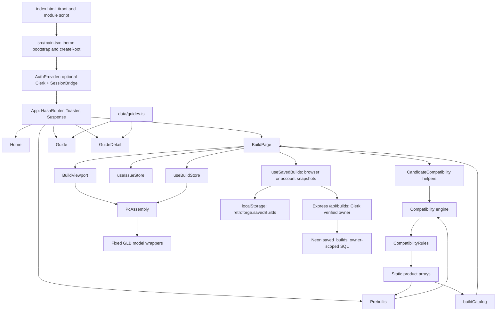
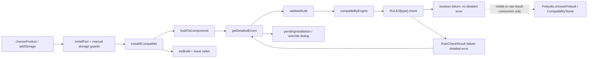
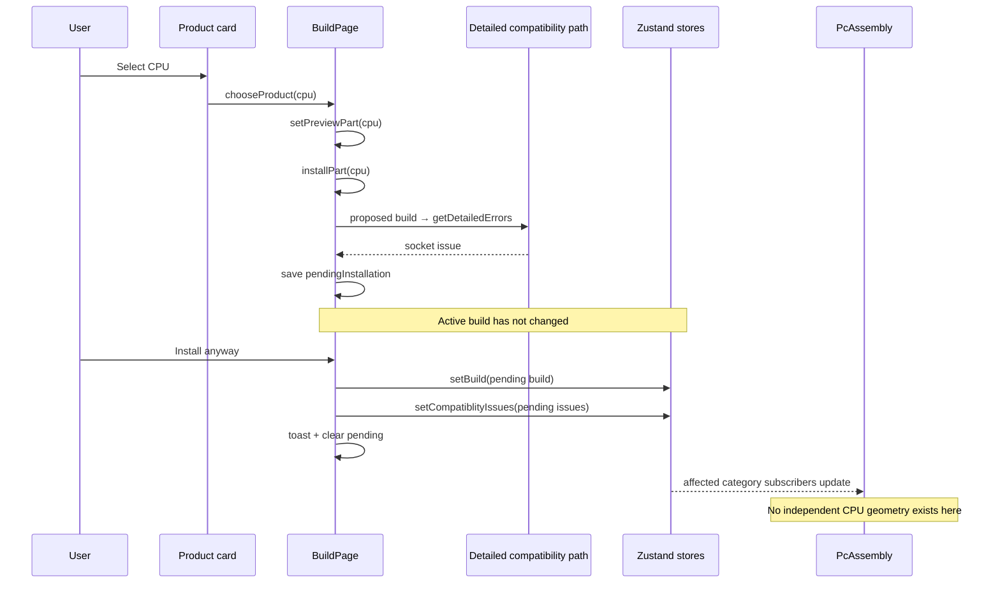

# RetroForge: complete `og-code` architecture and function reference

> **Read this file before making any meaningful change to this project.** Then inspect the current implementation of the affected files. Keep this reference accurate when behavior, ownership, dependencies, or data contracts change.

## Current integration update — 2026-10-28

This reference now includes Clerk authentication and Neon cloud saves implemented locally on `og-code`, based on `deaace8`. Sections marked **Current authentication integration** and Appendix D supersede baseline persistence/server/tooling statements and old line anchors. Unchanged compatibility, catalogue, and 3D descriptions still apply. See [private configuration and verification steps](AUTH_SETUP.md). No external application/database was provisioned and no branch was pushed.

## 1. Scope, evidence, and how to use this reference

- **Analyzed branch:** `og-code`.
- **Analyzed commit:** `deaace8c928c4efb04ee82331088335740c7c48e` (`images`).
- **Analysis date:** 2026-10-28.
- **Scope:** all 90 files tracked by this branch: application source, configuration, sample server/tests, data, media, and generated artifacts. The TypeScript/JavaScript inspection covered 61 files and 310 function implementations, including nested functions and anonymous callbacks. Of those implementations, 147 are function declarations or functions assigned directly to named variables/object properties.
- **Evidence:** direct source reading, a TypeScript syntax-tree inventory of imports/functions, reference searches, GLB metadata inspection, and the baseline commands in section 18. This is an implementation map, not an assurance that every feature is correct.
- **Excluded from the architecture:** untracked `.impeccable/`, `.taste-skill/`, `.local-db/`, `test-results/`, installed `node_modules/`, and ignored/generated local files. These can remain on disk after switching branches; their presence does not mean this branch uses them. Private database/environment contents were not inspected.
- **Other-branch work:** the Redline redesign and its later compatibility/test improvements belong to `main`/`ui-redesign`, not this snapshot. The uncommitted backend/account work saved before switching branches is also not part of this architecture. Do not import assumptions from those versions.
- **Meaning of “unused”:** no runtime import path from `src/main.tsx` in this snapshot, or no source consumer found for the named export. This is evidence for investigation, not permission to delete a public helper or scaffold without checking the intended change. Type-only dependencies are essential even though erased at runtime.
- **Source links:** links below are repository-relative. Line references in the symbol index are starting lines in this exact commit; search by symbol after code moves.

The detailed prose explains intent and behavior. The appendices provide exhaustive file/import/function coverage so small callbacks and library scaffolding do not disappear behind a high-level diagram. A direct-call list is syntactic evidence, not a fully resolved dynamic call graph: a callback such as `onChooseProduct` only acquires its actual implementation through the parent props described here.

### Navigation

- [Application and startup](#2-what-the-application-actually-is)
- [Data contracts](#4-data-contracts-types-catalogue-identities-and-schemas)
- [State ownership](#5-state-ownership-and-communication-boundaries)
- [Every builder action](#6-buildpage-the-application-controller-and-every-action)
- [Compatibility internals](#7-compatibility-rule-outputs-adapters-and-blind-spots)
- [3D internals](#10-the-3d-path-model-helpers-and-hidden-side-effects)
- [Dormant and extra functions](#14-dormant-ui-system-and-other-extra-functions)
- [Non-obvious coupling](#16-non-obvious-coupling-and-existing-limitations)
- [Change-impact map](#19-change-impact-map-and-pre-change-reading-rule)
- [All tracked files](#appendix-a-every-tracked-file-and-its-purpose)
- [Direct module connections](#appendix-b-direct-local-module-connections)
- [All functions and callbacks — baseline](#appendix-c-exhaustive-function-and-callback-index)
- [Current auth/save API and updated module/function index](#appendix-d-current-authentication-and-cloud-save-integration)

### Reading order

1. Sections 2–5 establish the execution path and data/state contracts.
2. Sections 6–10 trace the builder, compatibility, persistence, and 3D paths.
3. Sections 11–15 explain pages, shared components, dormant scaffolding, and tooling.
4. Sections 16–19 record hidden coupling, limitations, baseline verification, and change guidance.
5. Appendices A–C locate every tracked file, direct module connection, and function implementation.

### Maintaining this document

Treat the source as authoritative if it disagrees with this document. Identify whether you are on the analyzed branch before applying these conclusions. If changing a route, store, schema, callback contract, compatibility rule, model path, persistence key, or build/deployment setup, update the relevant sections and inventory entries in the same change. Refresh the analyzed commit/date when re-auditing a different snapshot; do not silently present this `og-code` audit as an audit of `main`.

## 2. What the application actually is

RetroForge is a client-side React/TypeScript single-page application built with Vite. It offers five routed views: landing page, PC builder, preconfigured builds, guide library, and individual guide articles. Product specifications and prices are static TypeScript arrays. The current integration adds optional Clerk accounts and a same-origin Express API backed by Neon Postgres for private cloud snapshots. All routes remain public; guests retain browser saves. There is no payment flow. Accounts require private environment configuration before activation.

The builder combines three mostly independent systems:

1. A **logical build** stored in Zustand: selected product records and installed-drive instances.
2. A **compatibility workflow** that proposes changes, evaluates rules, and optionally records detailed issues after an override.
3. A **3D illustration** that renders four fixed GLB assets and conditionally shows three of them based on selected product categories.

These systems communicate, but they are not equivalent. A populated catalogue category does not guarantee a corresponding 3D model. An empty detailed-issue list does not guarantee that every boolean rule passed. A visible case in the canvas does not guarantee that `build.CASE` is selected. Understanding these distinctions is necessary before extending the project.

## 3. Startup, routing, and module loading

### `index.html`

This is the source HTML entry, not a React component. It supplies language/viewport metadata, the product title/description, `
`, and the module script `/src/main.tsx`. The root element is the mounting contract expected by `createRoot`.

### `src/main.tsx`: top-level initialization

**Current authentication integration:** `main` wraps `App` in `AuthProvider`. A missing/placeholder publishable key retains guest mode through the default `AuthContext`; a configured key enables Clerk and `SessionBridge`. Theme bootstrap still runs first and independently. No existing environment file was read to discover credentials.

This module imports the global stylesheet and `App`, reads `localStorage['retroforge-theme']`, reads `prefers-color-scheme: dark`, and toggles the `dark` class on `<html>` before rendering. Doing this before React mounts reduces a wrong-theme first frame.

The startup rule is explicit choice first, system preference only when the saved value is `null`. A non-null invalid saved value is not handled identically here and in `getInitialTheme()`; see section 16. Storage access is unguarded and can throw before the app renders. The `!` on `document.getElementById('root')!` is a TypeScript assertion, not a runtime fallback. There is no `StrictMode` wrapper in this file.

### `src/App.tsx`

| Function or callable                               | Purpose and connections                                                                                                                                                                                                                                                             |
| -------------------------------------------------- | ----------------------------------------------------------------------------------------------------------------------------------------------------------------------------------------------------------------------------------------------------------------------------------- |
| Five `lazy(() => import(...).then(...))` factories | Defer each page module until its route is rendered. Each `.then` converts a named page export into `{ default: module.PageName }`, which is the shape `React.lazy` expects. The original page exports can stay named. These are necessary adapters, not redundant promise wrapping. |
| `PageLoader()`                                     | Renders the route-loading placeholder supplied to `Suspense`. This covers lazy page loading; the 3D model loader has its own boundary further down.                                                                                                                                 |
| `App()`                                            | Creates the `HashRouter`, global Sonner `Toaster`, shared route `Suspense`, and route table. Exports both named `App` and a default export; `main.tsx` consumes the default.                                                                                                        |

| Hash route             | Page/behavior                                                   | Important state                                                          |
| ---------------------- | --------------------------------------------------------------- | ------------------------------------------------------------------------ |
| `/#/`                  | `Home`                                                          | No build selection is created here.                                      |
| `/#/build`             | `BuildPage`                                                     | Local builder UI state plus shared Zustand stores.                       |
| `/#/build?panel=build` | Same `BuildPage`; initializes its mobile-panel state to `build` | The query is read for initial state, not synchronized through an effect. |
| `/#/BuildPage`         | Redirects to `/build` with `replace`                            | Backward-compatible bookmark alias.                                      |
| `/#/guides`            | `Guide`                                                         | Static guide list.                                                       |
| `/#/guides/:slug`      | `GuideDetail`                                                   | Slug selects the shared guide record.                                    |
| `/#/prebuilts`         | `Prebuilts`                                                     | Can replace the shared active build.                                     |
| Any other route        | Redirects home with `replace`                                   | Recovery instead of an empty screen.                                     |

The fragment is client-side routing state and is not sent as a server pathname. This is why hash-route refreshes do not require a server rewrite for `/guides/...`. It does not fix asset-base configuration: model/bundle URLs still depend on Vite's `base`.

No application error boundary wraps lazy imports, the canvas, or data construction. `Suspense` provides loading fallbacks; it is not general exception recovery.

## 4. Data contracts: types, catalogue identities, and schemas

### `src/data/type.ts`

This is the common compile-time vocabulary for the builder, rules, stores, catalogue, and saved-build schema consumers. Its type-only role is not dead code.

| Type | What it represents and why it matters |
| --- | --- |
| `BUILD` | Optional `CPU`, `GPU`, `RAM`, `PSU`, `CASE`, `MOTHERBOARD` product records, and mandatory `STORAGE: InstalledDrive[]`. Missing singular categories represent empty selections. An empty build is `{ STORAGE: [] }`. |
| `CPU` | Identity/display/price plus socket, cores, threads, clocks, TDP, integrated graphics, and performance score. Only the socket participates in this branch's CPU compatibility rule. |
| `GPU` | Identity/display/price plus chipset, VRAM, TDP, length, and performance score. Length feeds clearance; TDP feeds the PSU's GPU-only calculation. |
| `RAM` | Memory generation, capacity, speed, module description, RGB, and CAS latency. The generation is the compatibility input. One record represents a kit; the builder does not model individual DIMM slots. |
| `Motherboard` | Socket, chipset, size, RAM generation, Wi-Fi, M.2/SATA counts, supported M.2 protocols. Socket, RAM generation, size, and storage capability fields influence checks. CPU BIOS/support lists are absent. |
| `PSU` | Wattage, efficiency, modularity, size plus standard product fields. The existing rule uses wattage only; connectors and physical fit are not evaluated. |
| `STORAGE` | Drive product, with connector, protocol, physical form factor, capacity, and transfer speeds. This is a product, not an installed copy. |
| `InstalledDrive` | `{ instanceId, product }`; separates one physical installation from its catalogue product. Multiple identical products can coexist with distinct installation IDs. |
| `CASE` | Case product with board size, maximum GPU length/cooler height, radiator support, color, RGB and glass. GPU length and board-size hierarchy participate in rules; the remaining fit fields do not imply implemented checks. |
| `ComponentType` | Exact discriminants: `CPU`, `RAM`, `GPU`, `PSU`, `Motherboard`, `Case`, `Storage`. Mixed capitalization is part of the current contract. |
| `CompatibleComponent` | Union of the seven product types, discriminated by `componentType`. |
| `Category` | Singular **build keys**: `GPU`, `CPU`, `RAM`, `PSU`, `CASE`, `MOTHERBOARD`. Storage is deliberately excluded because its operations are array/instance based. |
| `CompatibilityResult` | Pair-level result containing selected/target names, `isCompatible`, and optional detailed `error`. Boolean-only failures are representable here. |
| `CompatibilityCheck` | Function type defined using the `bivarianceHack` method-type pattern. It permits narrower typed check functions inside a generic rule table. It does not validate runtime argument types; matching the table's target arrays to each function remains important. |
| `CompatibilityRule` | A `check` callable and a catalogue `target` array. |
| `DetailedErrors` | Structured issue with severity, rule ID, title, explanatory text, source/target references, and a suggested replacement category. It is singular data despite the plural type name. |
| `ComponentRefernce` | Internal issue identity/value summary. The misspelling is present in source. This is not the full product object. |
| `CompatiblityRule` | Issue-code union: socket, RAM generation, PSU wattage, GPU clearance. `PSU_WATTAGE` is declared but no detailed PSU issue is produced. Storage/board-size codes are not declared here. |
| `RuleCheckResult` | Discriminated union: success, or failure with a required `DetailedErrors` object. Some rule implementations bypass this richer result by returning a boolean. |
| `SavedBuild` | `{ id, name, build }`; a named saved snapshot, separate from an active draft. |
| `preBuild` | Static preset ID, name, description, tier, use cases, and a `BUILD`. Lowercase type name is historical. |
| `StorageProtocol` | `NVMe` or `SATA`; distinct from physical connector and form factor. |
| `CompatibilityFilter` | Shared-looking `all | compatible` alias with no current source consumer; the UI defines its own `CompatibilityFilterMode`. |
| `PsuCompatibility` | Unused alternate shape containing `check1`, `check2`, target, result, and wattage. It is not the rule table's active PSU contract. |

A stray literal `3` follows the `CASE` type declaration (`};3`, line 121). It is a real top-level expression with no useful effect and causes the baseline lint failure. It was documented, not removed during this analysis.

### Three category namespaces that must not be conflated

| Meaning | Examples | Owner |
| --- | --- | --- |
| UI category ID | `cpu`, `motherboard`, `ram`, `storage`, `case` | `buildCatalog` and `BuildPage.catalogCategory` |
| Product discriminant | `CPU`, `Motherboard`, `RAM`, `Storage`, `Case` | Product `componentType` |
| Build slot | `CPU`, `MOTHERBOARD`, `RAM`, `CASE`; storage via `STORAGE[]` | `BUILD` |

`chooseProduct()` converts singular product discriminants to uppercase build keys. `componentKey()` deliberately uses the original discriminant plus numeric ID. `ComponentGroup.name` is a display label and can be `MEMORY` or `POWER`; those are not valid build keys.

### Static catalogue modules

Each file imports its product type and exports one array; there are no business functions hidden in these files. IDs are unique within an array, not across all categories. All seven arrays feed `buildCatalog` and preset construction; four also supply rule targets directly.

| File / export | Records | Data consumed by other layers |
| --- | ---: | --- |
| `src/data/cpu.ts` / `cpus` | 10 | CPU choices, preset lookup, socket checks, price/spec display. |
| `src/data/gpu.ts` / `gpus` | 10 | GPU choices/presets; also the PSU rule's target database. |
| `src/data/motherboard.ts` / `motherboards` | 10 | Board choices/presets; CPU/RAM/storage/case rule targets; manual storage guards. |
| `src/data/ram.ts` / `ramKits` | 10 | Memory choices/presets; the reverse motherboard-to-RAM rule target array. |
| `src/data/psu.ts` / `psus` | 10 | PSU choices/presets and wattage/price display. |
| `src/data/case.ts` / `cases` | 10 | Case choices/presets; GPU rule targets and board-size limits. |
| `src/data/storage.ts` / `storageDevices` | 20 | Drive choices/presets, storage capability checks and installed-drive totals. |

The catalogue therefore contains 80 product records. Their `/images/...` fields are strings; the referenced product-image files are not among this branch's tracked public assets. Current builder cards primarily display text/specs rather than those images. Do not assume an image field proves that an asset exists or that a renderer uses it. Prices/performance scores are static sample values, not fetched market data.

### `src/Pages/build/buildCatalog.ts`

- `ComponentGroup` ties an ID, display name/label, Lucide icon constructor, and product array together.
- `componentGroups` orders the seven categories and is the source for desktop category buttons, mobile category buttons, and active catalogue selection. It binds the raw product arrays into one UI vocabulary.
- `categoryNames` maps IDs to decorative viewport titles such as “Processor bay.” It does not choose a product, model, or compatibility rule.
- `activeGroup` in `BuildPage` falls back to the first group when a category ID is unknown; that fallback changes the list, not the stored `catalogCategory` itself.

### `src/zod/buildSchema.ts`: validation objects, not compatibility functions

| Schema | Contract / use |
| --- | --- |
| `basePartSchema` | Positive integer product ID, nonempty trimmed name/brand/image, nonnegative price. Common base for all parts. |
| `cpuSchema` | CPU literal/brand enum and required positive numeric CPU attributes; score may be zero. |
| `gpuSchema` | GPU literal/brand enum, nonempty chipset, positive VRAM/TDP/length, nonnegative score. |
| `ramSchema` | RAM literal, DDR generation enum, positive capacity/speed/latency, nonempty modules, boolean RGB. |
| `psuSchema` | PSU literal, positive wattage, exact efficiency/modularity/form-factor enums. |
| `caseSchema` | Case literal, supported form-factor enum, positive clearances, nonempty radiator/color, boolean RGB/glass. |
| `motherboardSchema` | Board literal, nonempty socket/chipset, size/RAM enums, boolean Wi-Fi, integer nonnegative slot/port counts, protocol array. |
| `storageSchema` | Private drive schema with connector/protocol/type/physical-form enums and capacity/speed constraints. It is used through installed drives. |
| `installedDriveSchema` | Nonempty installation ID plus a valid storage product. |
| `buildSchema` | Optional singular part schemas plus required array of installed drives. |
| `savedBuildSchema` | Nonempty saved ID/name and a valid build. |
| `savedBuildListSchema` | Array of complete saved-build records; the builder's localStorage entry point uses `safeParse`. |

These schemas validate shape and scalar constraints, not catalogue membership, socket compatibility, unique installation IDs, slot occupancy, names being unique, or trustworthy prices. They accept valid-looking product snapshots even when the catalogue later changes. A single invalid saved item makes the entire array parse fail. The builder currently recovers with `[]`, then its persistence effect can write that empty array back over the original stored data.

## 5. State ownership and communication boundaries

**Current authentication integration:** `BuildPage` no longer owns or directly persists the saved-build array. `useSavedBuilds` owns browser and remote collections, request state, session scopes, abort controllers, and mutation locking. `AuthContext` supplies configured/loaded/userId/getToken. `SessionBridge` clears global active-build and compatibility state on sign-out/account change; the builder also clears pending overrides, preview, and name. The guest draft survives sign-in. See Appendix D for current modules and symbols; the original table below describes baseline state ownership where not superseded.

| State | Owner / lifetime | Writers / readers | Meaning |
| --- | --- | --- | --- |
| `build` | `useBuildStore`, module singleton | Builder actions and preset selection write; `BuildPage`, `Prebuilts`, and `PcAssembly` read | Active in-memory configuration. Survives route changes within the running app, not page reload by itself. |
| `CompatiblityIssues` | `useIssueStore`, module singleton | Builder install/remove/reset/override and preset selection write; desktop viewport issue panel reads | Last explicitly stored detailed issue list. Not a computed subscription to `build`. |
| `catalogCategory` | `BuildPage` local state | Category controls and suggested actions | Active catalogue tab; starts at `cpu`. |
| `previewPart` | `BuildPage` local state | `chooseProduct`, category changes, successful load/remove | Readout/inspection candidate, not a separate global product selection. It can differ from the installed build. |
| `searchQuery` | `BuildPage` local state | Mobile search input and category reset | Name/brand search applied to the active group. Desktop has no corresponding search input in this snapshot. |
| `compatibilityFilter` | `BuildPage` local state | Either filter-toggle view | Shared `all/compatible` choice; persists across category changes while the page remains mounted. |
| `pendingInstallation` | `BuildPage` local state | Guarded install/load and dialog actions | Proposed build plus issues and optional success continuation; keeps unconfirmed changes out of the active build. |
| `mobilePanel` | `BuildPage` local state | Query initializer, buttons, gesture handlers | `parts`, `build`, or closed. It is not a responsive global drawer store. |
| `savedBuilds` | `BuildPage` local state + localStorage | Hydration, save/delete, persistence effect | Named local snapshots. This is distinct from the active Zustand draft. |
| `buildName` | `BuildPage` local state | Input and save handler | Next save's name, not a persistent active-build title. |
| Issue-panel `isOpen` | `CompatibilityIssuesPanel` local state | Panel toggle | Disclosure visibility only; does not affect validation. |
| Theme | `<html>.dark`, localStorage, each `ThemeToggle` state | Startup and theme toggle | Theme state spans DOM and React, without a central store or cross-tab subscription. |
| `expandedCategory` | Dormant `useSidebarStore` | No routed consumer | Separate earlier sidebar experiment; does not control the active builder. |
| Generic sidebar open state | Dormant `SidebarProvider` context | Generic sidebar controls only if mounted | Separate UI scaffold, not the active builder sidebar. |

### Store functions

**`src/stores/BuildStore.ts`**

- `useBuildStore`: the Zustand hook created by `create`; initializes `build` to `{ STORAGE: [] }`.
- `setBuild(update)`: accepts either a complete `BUILD` or `(previousBuild) => nextBuild`. Replaces the store's `build` field; it does not merge missing product categories, validate, persist, or refresh issues. The functional form prevents a caller from having to close over a stale build, but current application handlers mainly pass whole objects.
- `setPart(category, part)`: immutably spreads the current build and changes one singular build key. Its generic `K extends Category` couples the key to `BUILD[K]`; it cannot add a storage drive. This helper has no current application caller and would bypass compatibility issue synchronization if used directly.

**`src/stores/ComptiblityIssuesStore.ts`**

- `useIssueStore`: holds `CompatiblityIssues: []`. Both file/property spelling are historical; importing the correctly spelled English word would not reference this file/property.
- `setCompatiblityIssues(update)`: accepts a replacement array or updater function. It stores the supplied list; it does not validate the build itself.
- `clearCompatiblityIssues()`: replaces the list with `[]`. `Prebuilts.choosePrebuilt()` uses this after validation; builder handlers sometimes call the setter with `[]` instead.

**`src/stores/expandedCategory.ts`**

- `useSidebarStore`: dormant Zustand hook with initial `expandedCategory: 'cpu'`.
- `openCategory(id)`: directly selects a category in that dormant store.
- `toggleCategory(id)`: selects a different ID, or sets the field to `null` when toggling the already-open ID.

The last two functions share conceptual names with builder category handling but are not called by `BuildPage`. Do not wire a new feature to the dormant store assuming the visible category buttons will follow it.

## 6. `BuildPage`: the application controller and every action

`src/Pages/BuildPage.tsx` is the largest orchestration module. Child panels are mostly presentation and callback forwarding. Changing an install/remove/save button's appearance does not change its behavior unless the callbacks here change.

### Initialization and derived values

**Current authentication integration:** replace the baseline saved-build `useState` initializer and persistence `useEffect` with `useSavedBuilds`. `savedBuilds` is selected from browser or account scope; writes to localStorage occur only on successful guest operations. The old unconditional persistence effect was removed, preventing cloud saves from overwriting guest saves or corrupt local data from being overwritten merely by mounting. Current `saveBuild` and `deleteSavedBuild` await hook operations and report failures. Save names must have 1–120 characters. `importBrowserBuilds` confirms an explicit copy and reports imported/skipped counts. Other installation/removal/compatibility actions remain unchanged.

- `BuildPage()` creates UI state, subscribes to the two stores, constructs all handlers, and renders one responsive workspace.
- `useDragControls()` supplies the drawer's manually started vertical drag. Its ref/controller is not build state.
- `buildNameInput` and `savedBuildsBar` are DOM refs. They let navigation focus saved controls on desktop instead of navigating away or creating a second save interface.
- The lazy `savedBuilds` state initializer reads `retroforge.savedBuilds` once on mounting. It parses JSON and validates the whole array with `savedBuildListSchema.safeParse`; missing, malformed, or invalid data becomes `[]`. Its `try/catch` protects this read only.
- The `useEffect([savedBuilds])` writes the entire array to localStorage after initialization and whenever saves change. It does not persist the unsaved draft. This write is unguarded, so disabled storage/quota exhaustion can throw even when hydration was safely caught.
- `activeGroup` finds the group for `catalogCategory`, falling back to CPU's group. `installedPart` separately maps the category ID to its singular build field. Storage has no singular `installedPart`.
- `selectedPartKey` identifies the installed singular product. It is independent of `previewPart`, which may be an unconfirmed candidate.
- `candidateIssues` is a memoized `Map<componentKey, DetailedErrors[]>` computed for **every item in the active group** against the current build. Both desktop and mobile consume the same map. Memoization avoids recomputing for unrelated UI updates; this is not cached across changed builds.
- `filteredParts` lowercases/trims the search query, matches product name or brand, then optionally requires the candidate's detailed-issue array to be empty. It does not inspect boolean-only validation failures. The search result and issue map are derived state, not independent editable stores.
- `completedParts` counts six singular categories plus one truthy marker for at least one drive. Ten drives still count as one completed category. This is completion, not compatibility or actual model coverage.
- `totalPrice` sums six selected-product prices and every installed-drive product price. Duplicate drive instances each contribute their price. It does not fetch, tax, discount, or validate prices.

### Action-by-action reference

| Function | Inputs → output | Behavior, callers, and reason for its existence |
| --- | --- | --- |
| `openCategory(id)` | UI ID → no return value | Changes the active group, clears `previewPart`, and clears search. Called from category controls, storage guards, and issue suggestions. It does not reset the compatibility filter, select a part, or synchronize the dormant sidebar store. |
| `installIfCompatible(proposedBuild, onInstalled?)` | Complete proposal plus optional continuation → boolean | Flattens the proposal, obtains **detailed** errors, logs them, and either records a pending transaction or commits the proposal. On a clean detailed-issue list it clears stored issues, calls `setBuild`, then invokes the continuation. `false` means a dialog is pending; `true` means committed. It is a workflow gate, not a universal validator. |
| `confirmIncompatibleInstallation()` | Reads pending transaction → no return value | If none exists, does nothing. Otherwise commits the saved proposal, stores its issue snapshot, calls its continuation, shows a warning toast, and clears the pending transaction. Its explicit override is what allows deliberate incompatibility. It does not rerun rules at confirmation time. |
| `installPart(part)` | Product union → no return value | Dispatches by `componentType`. Singular products replace their corresponding slot through the gate. Motherboard/storage take additional guarded paths detailed below. Called by `chooseProduct` and “Add another” drive controls. |
| `chooseProduct(part)` | Clicked product → no return value | Acts as a toggle, not just an inspect action. For an already-installed singular product it calls `removePart`; for an installed drive product it removes the **first matching instance**. Otherwise it sets the preview and attempts installation. A failed/pending install can leave the preview showing an uninstalled part. |
| `removePart(category)` | Singular build key → boolean | Refuses to remove a motherboard while any drive remains, with a toast. Otherwise spreads the build, sets the slot to `undefined`, updates the active store, recomputes detailed issues, and returns `true`. The return value lets `chooseProduct` clear the preview only when removal actually succeeded. |
| `removeDrive(instanceId)` | Installed-instance ID → no return value | Filters out only that installation, updates the build, and recomputes detailed issues. Product ID would remove the wrong quantity when several copies exist. |
| `resetBuild()` | No arguments → no return value | Sets `{ STORAGE: [] }` and clears issues. Does not delete saves, clear the name/search/filter, clear the preview, or reset camera position. Those states have different owners. |
| `saveBuild()` | Reads name/build → no return value | Trims and rejects an empty name; appends a new `{ id: crypto.randomUUID(), name, build }` snapshot to local saves; clears the input; shows a toast. It creates another save even if a save has the same name. Does not validate compatibility or invoke Zod before saving. |
| `loadBuild(savedBuild)` | Saved snapshot → no return value | Proposes the saved build through the same installation gate. Supplies a success continuation that clears the preview and shows “Loaded …”. If the dialog is canceled, neither callback nor build replacement occurs. It does not restore the saved name into the name field. |
| `deleteSavedBuild(id)` | Save ID → no return value | Removes that snapshot from the saved array. Persistence follows from the effect. It does not remove or reset the active build, even if that build was loaded from the deleted save. |

### `installPart`: motherboard-specific guards

1. Count installed M.2 drives and SATA drives independently.
2. Reject a replacement board with fewer M.2 slots than used; tell the user to remove excess drives and switch to the storage catalogue.
3. Do the equivalent check for SATA ports.
4. Reject a replacement board if any installed M.2 product protocol is unsupported. This path shows a toast but does not switch category.
5. Otherwise propose the replacement through `installIfCompatible`.

These guards enforce aggregate drive occupancy when replacing a motherboard. They are **not** inside `CompatibilityRules`, so not every path that sets a build benefits from them. They do not check real slot positions, shared lanes, drive physical lengths, or all combinations of connectors.

### `installPart`: storage-specific guards

1. Require a selected motherboard; otherwise switch to the board category and show a toast.
2. Count current M.2 and SATA installations.
3. Refuse an M.2 addition at or over the M.2 count, or a SATA addition at or over the SATA count.
4. For M.2, require the board's `supportedM2Protocols` to include the product protocol.
5. Create `{ instanceId: crypto.randomUUID(), product: part }`, append it immutably, and run the detailed-error gate.

The type/schema permit a broader set of connector/protocol combinations than the catalog normally supplies. The manual storage guard does not independently reject a SATA-connector product with an invalid protocol, whereas the boolean storage rule would. Catalogue data consistency therefore matters.

### Important inline callbacks and effects

| Callback location | Role and less obvious consequence |
| --- | --- |
| Zustand selector callbacks | Select `build`, `setBuild`, or issue setters from their store; do not perform validation or mutation themselves. `PcAssembly` uses separate selectors further down. |
| Candidate-map `.map` | Evaluates a proposed whole build per product, then keys each result by category plus product ID. This is why changing an unrelated installed part can change multiple cards' compatibility badges. |
| Search/filter predicates | Filter presentation only. An item disappearing from “Compatible only” does not remove it from the active build. |
| `NavBar.onOpenSaved` | At `min-width: 1024px`, focuses the first saved-build button or the name input if no save exists; on smaller screens opens the build drawer. Ref-based focus preserves the mounted page. |
| Dialog `onCancel` | Drops `pendingInstallation`. It does not revert the preview; no proposal was committed in the first place. |
| `onRemovePart` adapter | Casts the viewport's string callback ID back to `Category`; correctness relies on the viewport sending actual singular build keys. |
| `onSuggestedAction` adapter | Lowercases the issue's build-key category, calls `openCategory`, then sets the mobile panel to `parts`. It highlights where to look; it does not replace a product by itself. It also sets panel state on desktop, where drawer markup is CSS-hidden. |
| Name input `onChange` | Changes local save-name state, not a product or saved record. |
| Saved-build `.map` callbacks | Create load/delete controls capturing the particular saved record/ID. The callbacks bind a generic handler to an item. |
| Mobile category `.map` callbacks | Bind each group ID to `openCategory`; the icon constructor is promoted to a capitalized local `Icon` for JSX. |
| Drawer backdrop/close-button callbacks | Set panel state to `null`; do not modify the build. |
| Drawer `onDragEnd` | Closes when downward offset is over 80px, or offset over 20px combined with downward velocity over 500. These thresholds make a fast flick easier than a slow drag. |
| Drawer header `onPointerDown` | Starts `panelDragControls` unless the pointer originated inside a button. With `dragListener={false}`, the whole drawer body is not automatically a drag handle. |
| `PullDownToClose.onClose` | Lets the scroll wrapper close the same drawer through touch scrolling. It is a second close gesture with different thresholds, not a duplicate state owner. |

### Layout and lifecycle contracts

Only **one** `BuildViewport`/React Three Fiber `Canvas` is mounted by `BuildPage`; desktop/mobile styling adapts around it. Duplicating it for responsive layouts would create multiple WebGL contexts, loaders, scene trees, and subscriptions.

The workspace uses Tailwind `lg` (1024px) for the desktop catalogue and summary. The dormant generic sidebar uses a different 768px mobile boundary. Do not interchange these breakpoints without checking all controls.

Changing routes unmounts `BuildPage`, so its search, filter, preview, pending dialog, name, and drawer state reset. The active Zustand build and issues survive because their stores live outside the page. Saved snapshots reload from localStorage when the page mounts again. Only `panel=build` is consumed from query parameters; there is no `category` deep-link handler in this version.

## 7. Compatibility: rule outputs, adapters, and blind spots

### Actual call chain

### `src/Logic/Compatibility/CompatibilityRules.ts`

`compatibilityRules()` is a factory that creates nested check functions and returns the `RULES` dispatch table. `Compatibility.ts` calls it once at module initialization. Normal validation does not recreate the entire table per product.

| Nested function / constant | Inputs → output | Actual responsibility |
| --- | --- | --- |
| `formFactorSize` | Named board size → rank | `Mini ITX = 1`, `Micro ATX = 2`, `ATX = 3`; gives the board/case comparison an explicit ordinal meaning rather than lexicographic string comparison. |
| `motherboardCpuCompatibility(motherboard, cpu)` | Board and CPU → `RuleCheckResult` | Exact socket-string equality. On failure, constructs a detailed socket issue, identifies the CPU as source/board as target, and suggests replacing `MOTHERBOARD`. Does not check chipset, BIOS, or a CPU support list. |
| `ramMotherboardCompatibility(ram, motherboard)` | RAM and board → `RuleCheckResult` | Exact DDR generation equality. Failure includes values and suggests the motherboard. The wording says “sockets” even though the actual comparison is memory type. |
| `gpuCaseCompatibility(gpu, pcCase)` | GPU and case → `RuleCheckResult` | Requires maximum supported GPU length to be at least the card length. Equality passes. Does not account for radiators, front fans, slot thickness, or exact geometry. |
| `storageCompatibility(storageDevices, motherboards)` | One drive product and board → boolean | Requires at least one matching connector type; M.2 also needs supported protocol, while a SATA connector needs SATA protocol. Parameter names are plural, but each is one product. Does not count already occupied ports. |
| `calculatePsuHeadroom(psu, gpu)` | PSU and GPU → number | Returns `psu.wattage - gpu.tdp`. Separating arithmetic from the threshold makes the existing policy readable; it is not total-system load estimation. |
| `psuCompatibility(psu, gpu)` | PSU and GPU → boolean | Requires the preceding difference to be at least 200W. Ignores CPU, drives, board, fans, connectors, transient draw and PSU quality. |
| `motherboardCaseCompatibility(pcCase, motherboard)` | Case and board → boolean | Compares size ranks, allowing a smaller board in a larger nominal case size. This is a broad declared-size policy, not a mounting-hole/physical simulation. |

The seven `check` arrow functions in the returned table are adapters. Their argument order must align with `compatibilityEngine(selected, target)`:

| Selected discriminant | Target catalogue | `check` delegates to |
| --- | --- | --- |
| `CPU` | `motherboards` | `motherboardCpuCompatibility(motherboard, cpu)`; reverses the incoming argument order. |
| `Motherboard` | `ramKits` | `ramMotherboardCompatibility(ram, motherboard)`; reverse direction exists but is excluded from whole-build validation sources. |
| `RAM` | `motherboards` | `ramMotherboardCompatibility(ram, motherboard)`. |
| `GPU` | `cases` | `gpuCaseCompatibility(gpu, pcCase)`. |
| `Storage` | `motherboards` | `storageCompatibility(storage, motherboard)`. |
| `PSU` | `gpus` | `psuCompatibility(psu, gpu)`. |
| `Case` | `motherboards` | `motherboardCaseCompatibility(pcCase, motherboard)`. |

A helper is not “extra” merely because the table could inline it. Named helpers separate policy, arithmetic, detailed issue construction, and adapter argument ordering. The richer result contract is currently used only for socket, RAM generation, and GPU length.

### `src/Logic/Compatibility/Compatibility.ts`

| Function / constant | Purpose, caller behavior, and caveats |
| --- | --- |
| `BUILD_VALIDATION_SOURCES` | Lists `CPU`, `RAM`, `GPU`, `Storage`, `PSU`, `Case`. Excluding `Motherboard` avoids running the reverse motherboard/RAM comparison after already running RAM/board. This is not general deduplication of arbitrary inputs or repeated storage instances. |
| Module `RULES = compatibilityRules()` | Instantiates the table once. Its target lists refer to imported catalogue arrays. |
| `buildToComponents(build)` | Converts an object-shaped `BUILD` into the flat product array expected by validation. Drops undefined singular slots; unwraps every installed drive to `.product`; returns a fresh array. Removing instance wrappers is deliberate because pair rules compare product capabilities. Instance identity is consequently unavailable to these rules. |
| `compatibilityEngine(selectedComponent, chosenComponents?)` | Selects the rule by product discriminant. With no chosen list, tests all entries in its target database; with a list, filters the target database to IDs/types present in that list. Runs each pair, normalizes booleans into `{ isCompatible }`, and returns name-based `CompatibilityResult`s with optional rich error. Missing rule returns `[]`. |
| `validateBuild(selectedComponents)` | Filters sources through the whitelist and flat-maps the engine against the full selected array. Returns successful **and** failed pairs. It is the lower-level whole-build checker used by presets and the manual tester. Missing counterpart categories simply produce no pair; completeness is not validated. |
| `getDetailedErrors(selectedComponents)` | Calls `validateBuild`, keeps only incompatible results that actually have `error`, and maps to those detailed errors. Its type-predicate callback safely narrows optional `error` for TypeScript. It does not manufacture descriptions for boolean failures. Used by candidate previews, builder installs, and post-removal updates. |

**Important target-data behavior:** `compatibilityEngine` filters catalogue target objects by chosen IDs/types, but then passes the **catalogue object** into the check. It does not substitute the chosen object's field values. Saved/custom snapshots with altered target specs can therefore be compared against the catalogue version of that same ID. A product ID not found in the target catalogue can yield no corresponding pair at all. This makes catalogue identity and saved snapshots an architectural contract, not a cosmetic detail.

### `src/Logic/Compatibility/CandidateCompatibility.ts`

| Function | Purpose and why it is separate |
| --- | --- |
| `buildWithCandidate(currentBuild, candidate)` | Pure proposal builder. Replaces a singular category immutably or appends a storage wrapper with synthetic ID `compatibility-preview-${candidate.id}`. It never touches Zustand or allocates a real installation UUID. Synthetic IDs are sufficient because the next adapter unwraps products and does not inspect instance identity. |
| `errorInvolvesCandidate(error, candidate)` | Private identity predicate: matches the candidate against either source or target using both numeric ID and discriminant. Checking only the source would miss a new motherboard/case that conflicts with existing products; checking only numeric ID would confuse IDs reused across categories. |
| `getCandidateCompatibilityIssues(currentBuild, candidate)` | Proposes a whole build, flattens/evaluates it, then keeps only detailed issues involving the candidate. This intentionally prevents a pre-existing unrelated conflict from making every other product card look incompatible. |
| `isCandidateCompatible(currentBuild, candidate)` | Convenience boolean wrapper around an empty candidate-issue array. No current source caller was found. It inherits the detailed-error blind spots; it is not a stronger checker. |
| `componentKey(component)` | Returns `${component.componentType}-${component.id}`. Used for candidate map lookup and product identity in UI. It identifies a product, not an installed drive instance. |

### Where checks actually reach users

| Constraint | Raw `validateBuild` detects failure? | `getDetailedErrors` / candidate badge / install dialog? | Separate builder guard? |
| --- | --- | --- | --- |
| CPU socket ↔ motherboard | Yes, when catalogue target is found | Yes | Not required beyond the gate. |
| RAM generation ↔ motherboard | Yes | Yes | Not required beyond the gate. |
| GPU length ↔ case limit | Yes | Yes | Not required beyond the gate. |
| Storage connector/protocol ↔ board | Yes, boolean only | **No detailed issue** | Interactive storage/board paths perform partial explicit checks. |
| Used drive count ↔ available ports | **No aggregate rule** | No | Yes in interactive install/board replacement only. |
| PSU wattage ↔ GPU plus fixed 200W | Yes, boolean only | **No detailed issue** | No equivalent interactive guard. |
| Case size ↔ board size | Yes, boolean only | **No detailed issue** | No equivalent interactive guard. |
| BIOS, cooler fit, actual DIMM slots, power connectors, shared lanes | Not represented | No | No. |

**Executed example:** using the actual static catalogue, a Corsair CX450 (450W) paired with the NVIDIA RTX 4090 (450W TDP) yields one raw false PSU result, zero detailed issues, and zero candidate issues. This directly demonstrates the missing-rich-error connection; it is not a hypothetical claim. The current Starter, Balanced, Apex and Creator preset objects all produced zero raw failures when evaluated. That only verifies the rules this branch implements, not unmodeled physical or firmware requirements.

`Prebuilts.choosePrebuilt()` inspects every raw false result, so it can reject a preset for a boolean-only failure that the interactive builder would not surface. Loading a saved build goes through the detailed gate and skips the manual `installPart` storage guards. A custom or older saved snapshot can therefore bypass aggregate storage restrictions. These are existing differences between entry points, not intended assurances.

## 8. Saving, loading, and a complete transaction trace

### Browser persistence contracts

**Current authentication integration:** guest snapshots retain `retroforge.savedBuilds` and the full existing `SavedBuild` shape. Signed-in snapshots are fetched from `/api/builds`, never written to that browser key. Browser originals are retained after imports. Imports run in batches of up to 100, transactionally per batch, and are deduplicated per user/source ID. A failed or partially completed multi-batch import can be retried. Cloud failures keep the active build/name. Authentication redirects use `retroforge.authDraft` in sessionStorage with a ten-minute expiry and one-time restore. This stores the logical build only, not preview/camera/name/issues. Sign-out discards redirect drafts and private in-memory state. The baseline bullet list below applies to guest snapshots only, except that invalid stored data is now left untouched until an explicit guest save/delete.

| Storage/key | Stored value | Readers / writers |
| --- | --- | --- |
| localStorage `retroforge-theme` | Literal `light` or `dark` | Startup and `ThemeToggle`. |
| localStorage `retroforge.savedBuilds` | JSON array of full named build snapshots | `BuildPage` hydration and persistence effect. |
| Cookie `sidebar_state` | Generic sidebar's open/closed boolean text | Written only by the dormant provider; no cookie reader exists in this branch. |

No store uses Zustand persistence middleware. There is no auto-save of the current draft, storage event listener, schema version, migration pipeline, or cross-device sync. The saved array embeds full product records rather than product IDs, so catalogue changes do not automatically update a saved name, price, or specification. The UI and rule engine can disagree about snapshot/catalogue values as described above.

`saveBuild()` stores the current build reference in the local saved array; immutable build replacement normally keeps that old snapshot intact. It is not a deep clone. In-place mutation of a shared product/build/storage array would affect more than one owner and undermine the snapshot assumption.

### Example: install an incompatible CPU, then deliberately override

For a compatible singular selection, the pending-dialog steps are skipped. For a PSU boolean-only conflict, the rich-error gate can return an empty list and commit immediately. For storage, the explicit guards can stop the proposal earlier without creating a pending transaction.

### Other complete flows

- **Select the already-installed product:** card → `chooseProduct` → matching slot/first matching drive → remove handler → immutable build update → detailed issues recomputed. No warning dialog is used for ordinary removal. Motherboard removal is special-cased and can be refused.
- **Add another identical drive:** the small secondary button calls `installPart` directly rather than `chooseProduct`, avoiding the toggle-to-remove branch. Slot/protocol guards still apply and a new UUID is created.
- **Load a preset:** `PrebuiltCard` callback → `choosePrebuilt` → raw validation → toast on any conflict, otherwise clear issues → replace shared build → navigate to `/build`. The builder mounts with that build already present.
- **Load a save:** saved control → `loadBuild` → detailed gate → commit/override/cancel → continuation only after commit. It is not the preset entry point and has different validation coverage.
- **Navigate away and back:** active build remains in the module store; local UI state is recreated; named saves are revalidated from localStorage. Reloading the browser recreates the active store empty until the user explicitly loads a save.

## 9. Child panels and callback contracts

### `DesktopPartsSidebar()` — `src/Pages/build/DesktopPartsSidebar.tsx`

A desktop-only, scrollable product catalogue. It receives the build, category ID, filtered list, installed singular key, candidate-issue map, and callbacks. It does not call Zustand or recompute rules. `componentGroups.map` builds category buttons; `filteredParts.map` builds product cards, selected state, specs, issue counts, and price.

Selected storage is determined by whether **any instance** uses that product ID; its badge separately counts matching instances. Clicking its main card binds `onChooseProduct(part)` and toggles/removes the first matching copy. “Add another” binds `onAddStorage(part)` to the direct install path. The odd extra category-grid cell is layout filler for seven categories, not an eighth category. The absence of a desktop search field is real; filtering state still comes from the parent.

### `MobilePartsPanel()` — `src/Pages/build/MobilePartsPanel.tsx`

Receives essentially the same derived list/issues plus controlled search props and the installed-drive array. The search `onChange` forwards the input string to the parent. Product choice and add-another callbacks bind individual products exactly as on desktop. It shows an empty-search result message and per-product installed-drive counts. It is not a separate validation system.

### `MobileBuildPanel()` — `src/Pages/build/MobileBuildPanel.tsx`

**Current authentication integration:** receives the additional `savesBusy` flag and disables Save/Delete while account loading or a cloud operation is pending. Its callbacks remain parent-owned; it never calls Clerk or the API directly. `SaveStatus` outside the drawer labels Browser/Cloud saves and exposes loading, empty, error/retry, and explicit import controls for both viewport sizes.

Receives the active build, price, name, saves, and action callbacks. Its local `rows` array maps six singular categories to labels and selected records. The JSX maps saves to load/delete controls, singular rows to remove controls, and storage instances to instance-ID remove controls. `setBuildName` forwards controlled input text; save/reset invoke parent functions directly.

This panel does **not** subscribe to `useIssueStore` or render `CompatibilityIssuesPanel`. The persistent issue summary in `BuildViewport` is in a desktop-only aside. Consequently, the override toast's promise that issues remain in a panel is not equally fulfilled by the mobile build drawer after the dialog closes.

### `CompatibilityFilterToggle()` — `src/Pages/build/CompatibilityFilterToggle.tsx`

Exports `CompatibilityFilterMode = 'all' | 'compatible'` and a controlled two-button group. Its two `onClick` callbacks call `onChange` with those literals; `aria-pressed` mirrors the prop. It never evaluates compatibility itself, and changing its labels will not change the meaning of the parent's detailed-error filter.

### `CompatibilityWarningDialog()` — `src/Pages/build/CompatibilityWarningDialog.tsx`

Renders when `issues` is non-null; `null` means closed. It displays the first issue plus an additional-count message and forwards Cancel/Install-anyway callbacks. The backdrop `onMouseDown` cancels only when `event.target === event.currentTarget`, so clicking the inner dialog does not cancel it through bubbling. `AnimatePresence` provides enter/exit presentation.

It declares `role='alertdialog'`, `aria-modal`, and label/description references, but no focus trap, focus restoration, Escape listener, or body-scroll lock is implemented here. There is no imported dialog primitive silently providing those features. The normally supplied pending list is nonempty; an externally supplied empty array would still be truthy and render the dialog with no first issue text.

### `PullDownToClose()` — `src/Pages/build/PullDownToClose.tsx`

This wrapper owns gesture refs, not React build state:

- `handleTouchStart(event)` records the first touch Y and arms `pulling` only when the scroll container is at the top.
- `handleTouchMove(event)` exits if not armed; disarms if the container has scrolled down; otherwise calls `onClose()` once downward distance exceeds 45px and disarms itself.
- Inline `onTouchEnd` clears the armed flag.

Refs prevent every touch move from causing a React render. `overflow-y-auto` and `overscroll-contain` make the wrapper the scroll/gesture boundary. This differs from the drawer-header drag: a 45px top-of-list pull can close the drawer even without reaching the header's drag threshold. No touch-cancel or horizontal-dominance handling is present.

## 10. The 3D path, model helpers, and hidden side effects

### `src/components/BuildViewport.tsx`

| Function | Purpose / connections |
| --- | --- |
| `BuildPartRow({ label, name, price, icon, emptyText, onRemove })` | Desktop summary row for a singular category. `Boolean(name)` controls selected/empty presentation; optional price is formatted; optional remove callback is forwarded. Storage has a custom multi-instance row instead of pretending to fit this singular API. |
| `ModelLoader()` | Reads Drei's loading progress and renders an HTML percentage inside the canvas through `Html center`. It is a model-loading `Suspense` fallback, not route loading or a model-error/retry handler. |
| `CompatibilityIssuesPanel({ issues, onSuggestedAction })` | Owns only the expanded/collapsed state of the desktop issue disclosure. A toggle flips local `isOpen`; mapping creates `CompatibilityIssueCard`s. Empty issues display a compatible message based solely on the supplied list, without independently checking the build. |
| `CompatibilityIssueCard({ issue, onSuggestedAction })` | Shows issue text, a suggested-action button, and native `
` containing rule/source/target data. Its button calls `onSuggestedAction(issue.suggestedAction)`; “Replace” is navigation guidance, not an automatic replacement operation. |
| `BuildViewport(props)` | Owns the canvas layout, lighting, orbit controls, HUD/readout, and desktop installed-parts summary. Computes completion/total price again from the passed build, formats selected specs, and subscribes to the shared issue store. Delegates actual assembly geometry to `PcAssembly`. |

The viewport's build prop supplies summary values, while `PcAssembly` reads `useBuildStore` directly. Those are two data paths. Rendering the viewport in isolation with a mock `build` prop will not automatically put that build's geometry in the scene unless the store is also set.

Canvas setup:

- Camera position `[6.5, 3.5, 7.5]`, field of view 38; DPR constrained to `[1, 1.25]` to limit high-density rendering cost.
- One shadow-casting directional key light and a studio `Environment` with its own `Suspense fallback={null}`. The studio preset is a library-managed environment resource, not one of the four local GLB files.
- `Center` recenters the assembly's content. Its geometry calculations are not compatibility checks or per-product physical calibration.
- A shadow-catching plane sits at `y = -2.29`; an infinite grid sits at `y = -2.3`. The small separation reduces coplanar interference while providing ground/shadow context.
- `OrbitControls` provides pointer orbit/zoom, damping, distance limits of 5–14 and a polar-angle limit; it targets `[0, 0.2, 0]`.
- Most overlay chrome uses `pointer-events-none` so drags reach the canvas. The selected readout and desktop summary deliberately re-enable pointer input. The selected readout has a pointer cursor but no inspect/click handler in this branch.
- `AnimatePresence` and product-derived keys replace selected readout content cleanly. This is a presentation transition, not the 3D installation animation.
- The completion indicator counts seven logical categories; only three selected categories control conditional model visibility. The component does not raycast product meshes for selection or provide camera keyboard controls.

### `src/components/PcAssembly.tsx`: `PcAssembly(props)`

Subscribes separately to `build.GPU`, `build.MOTHERBOARD`, and `build.PSU`. It always mounts `<Case />`, then conditionally mounts fixed motherboard/GPU/PSU models when those corresponding products exist. It never reads `build.CASE`, `build.CPU`, `build.RAM`, or installed storage to independently mount matching geometry.

The containing groups have keys such as `GPU-${gpu.id}`. Changing the product ID remounts the subtree and therefore replays its installation animation even though all GPUs share the same GLB. Category transforms locate each fixed asset in the same case. Outer `props` are forwarded to the assembly's root Three.js group.

### `src/components/configs/corsair4000D.ts`

`configProps` selects only `position`, `rotation`, and `scale` from the React Three Fiber group props. `corsair4000DTransforms` records hand-authored placement for motherboard, GPU, and PSU; `satisfies Record<string, configProps>` verifies the entries without turning this into a physical-fit model. There is no CPU/RAM/storage transform entry, automatic case selection, or transform lookup by catalogue case ID.

### `src/components/InstallAnimation.tsx`

- `targetPosition` is one module-level zero vector reused as an immutable destination to avoid recreating it per frame.
- `InstallAnimation({ children, offset, speed = 8 })` wraps children in a group initialized at `offset` and keeps a ref to that Three.js object.
- Its `useFrame((_, delta) => ...)` callback exits until the ref exists, calculates `1 - Math.exp(-speed * delta)`, and interpolates `group.position` toward zero. Exponential smoothing accounts for frame time; a fixed lerp fraction would make arrival depend on FPS.
- This is a **local** movement toward zero inside the already-positioned parent transform. It does not move the global assembly to the origin or calculate a collision-free insertion path.
- The callback remains registered after the object settles. There is no reduced-motion check, exit/removal animation, progress callback, or animation-complete state here. DOM Motion configuration does not automatically control this Three.js frame callback.

### `src/models/models.tsx`

Module evaluation computes `BASE = import.meta.env.BASE_URL` and calls `useGLTF.preload` for all four model URLs. Importing the builder's scene path can start these loads even before the associated category is selected. Route-level lazy loading delays this module until the builder is needed; once imported, the four preload calls are not conditional on the build.

| Export | File loaded | Extra behavior |
| --- | --- | --- |
| `Case(props)` | `corsair_400d.glb` | Traverses the loaded scene in an effect. For `Object_42`, disables cast shadows and, if its material is `MeshStandardMaterial`, sets transparent/opacity 0/depthWrite false. Other meshes cast/receive shadows. Renders `Clone` with scale 10 and offset `[0, -1.8, 0]` inside a prop-forwarding group. |
| `Motherboard(props)` | `motherboard__components.glb` | Enables cast/receive shadows for every mesh in an effect, then renders a `Clone`. The file is a compound “MotherBoard + Components” asset; the code does not independently control every depicted component. |
| `PSU(props)` | `psu_power_supply_unit.glb` | Same mesh-shadow setup and clone wrapper for the fixed PSU asset. |
| `GPUModel(props)` | `nvidia_rtx_2080_ti.glb` | Same mesh-shadow setup and clone wrapper for the fixed RTX 2080 Ti example. All selected catalogue GPUs use it. |

Each traversal's `instanceof THREE.Mesh` guard keeps mesh-only properties off groups/cameras/lights. The material `instanceof` guard avoids applying standard-material properties blindly to another material shape. `Object_42` hiding is likely intended to expose the case interior, but the generic mesh name alone does not prove which physical panel it represents; that intention is an inference, not an asset inspection result.

`useGLTF` caches scene resources. These effects modify the cached scene/materials, not a private per-product data record. `Clone` makes scene reuse practical but does not establish that every material/geometry was independently deep-copied. Preserve awareness of shared resource mutation before mounting the same asset in multiple places.

### Model files and embedded provenance

The following values were read from local GLB headers/JSON, not guessed from filenames. Each `dist/models` copy is byte-identical to its `public/models` counterpart in this commit. Source assets total 18,073,612 bytes, about 17.24 MiB before transport compression.

| GLB | Bytes | Meshes / textures | Embedded author / title |
| --- | ---: | --- | --- |
| `corsair_400d.glb` | 4,264,344 | 25 / 1 | kirigami318 — Corsair 4000D Airflow (Free). |
| `motherboard__components.glb` | 9,215,156 | 720 / 18 | Daniel Cardona — MotherBoard + Components. |
| `nvidia_rtx_2080_ti.glb` | 3,844,124 | 22 / 0 | GameDevGiant — Nvidia RTX 2080 Ti. |
| `psu_power_supply_unit.glb` | 749,988 | 43 / 0 | dhafintaufiqi21 — PSU Power Supply Unit. |

All four embed `CC-BY-4.0` attribution metadata and source Sketchfab URLs under `asset.extras`; do not discard those records when replacing/converting models. This branch has no separate optimized asset registry, product-to-model mapping, compression pipeline, or UI model-credit manifest. `public/models` is the runtime source; `dist/models` is a copied build artifact.

## 11. Landing page, guide library, and articles

### `src/Pages/Home.tsx`: `Home()`

**Current authentication integration:** the existing Load Builds quick action now navigates to `/build?panel=build`, opening the mobile build drawer through the established query behavior. It is no longer disabled.

Landing/navigation page only. It calls `useNavigate` and `useReducedMotion`; it does not subscribe to any build/category store or inspect product data. Some older comments describe a collapsed category sidebar and deterministic CPU label, but no such sidebar/state exists in the current function.

- `quickActions` is a data-driven menu: Start Build → `/build`, Guides → `/guides`, and Load Builds with no `path`. Missing `path` intentionally disables that button instead of navigating to an unfinished destination. Saved builds remain accessible through shared navigation.
- The `.map` callback binds each action to a button. Its `onClick` checks `action.path` before navigating. Menu metadata is not a separate route registry; `App` still defines actual routes.
- `staggeredReveal` coordinates child timing; `revealItem` supplies reusable spring/opacity/translation values. They are Motion configuration objects, not application functions or data-fetching logic.
- `useReducedMotion` disables ambient decorative movement; `MotionConfig reducedMotion='user'` governs descendants. Styling and motion never install components into the build.
- `Footer` receives an empty `selectedComponent` string. Its “Selected” label is not connected to actual build state on Home.

### `src/Pages/Guide.tsx`: `Guide()`

Renders all records from the shared `guides` array. Uses the active `material-card` primitives and local `cn`. `guideReveal` is one shared Motion variant object; `useReducedMotion` controls decorative/hover behavior. There is no difficulty filter, search input, or pagination in this version.

The outer map selects `guide.icon`/optional `guide.detailIcon` as capitalized component references, applies featured-card grid sizing, and renders metadata/title/description/topics. The nested topic map is presentation-only. Each footer `Link` builds `/guides/${guide.slug}`. Routes are keyed by stable slugs rather than array indices.

The heading statistics are hard-coded: “05 MODULES”, “05 guides”, “36 min total.” The five duration strings currently add up to 36 minutes, but adding/changing guide data does not update the label automatically.

### `src/Pages/GuideDetail.tsx`: `GuideDetail()`

Reads `slug` from `useParams`, finds the same guide record used by the library, and redirects to `/guides` with history replacement if none exists. Keeps hook calls above that conditional return. Renders the selected icon, remote article image/credit, key idea, ordered section bodies, informational checklist, warning, and shared footer.

- The `.find` predicate ties route identity to `guide.slug`.
- `sections.map` derives display numbering from order; editorial section numbering is not stored separately.
- `checklist.map` creates informational list items, not controlled checkboxes or persisted completion state.
- Attribution opens the source page in another tab with `rel='noreferrer'`.
- Some article sections begin hidden and reveal when scrolled into view; content visibility depends on the Motion presentation path. This is not the immediate semantic article implementation from the redesign branch.

### `src/data/guides.ts`

Exports `GuideSection`, `PcGuide`, and five static guide records. Icons are component constructors, images are external Wikimedia redirect URLs, and image credits/source URLs are stored alongside the content. No CMS/API is involved.

| Slug | Teaching purpose | Important relationship to implemented checks |
| --- | --- | --- |
| `compatibility-first` | Socket, chipset/BIOS, memory generation and board size | The article recommends more checks than the engine implements. Reading support-list guidance does not mean the app verifies BIOS/chipset support. |
| `power-without-guessing` | Full-system load, headroom, connectors, PSU safety | Educational full-system guidance exceeds the branch's GPU-only headroom formula. |
| `airflow-that-makes-sense` | Intake/exhaust, clearance and cable path | No airflow simulation or full cooler/radiator compatibility engine exists. |
| `storage-without-confusion` | Connector vs protocol vs physical shape and shared-port notes | Data has these distinctions, but aggregate/manual guards do not model real lane sharing. |
| `first-build-sequence` | Safe assembly order, first boot, troubleshooting | The animated scene is not a physically verified assembly procedure. |

Keep image fields and attribution together. The remote image can fail independently of written guide data; there is no image-fetch API or custom retry handler in the page.

## 12. Presets and their separate validation entry point

### `src/data/PreBuilds.tsx`

`getById<T extends { id: number }>(items, id, label)` finds a product and returns the correctly inferred type. If missing, it throws a labelled error instead of allowing an undefined product into a preset. This is an intentional integrity check during module construction.

`prebuilts` is built at import time using catalogue references, not copied hand-maintained product descriptions. Its four records are Starter, Balanced, Apex and Creator. Each includes six singular products and one installed drive with a deterministic preset-specific instance ID. The `.tsx` extension does not mean the data file actually renders JSX.

Changing a referenced product ID or removing a catalogue record can make the entire preset module throw when the lazy page loads. A route-loading `Suspense` boundary will not turn that exception into a friendly data error.

| Preset | CPU/GPU/board/RAM/PSU/case IDs | Drive product ID / instance ID |
| --- | --- | --- |
| Starter | `1 / 6 / 2 / 1 / 2 / 9` | `8 / starter-storage-1` |
| Balanced | `3 / 8 / 4 / 6 / 5 / 8` | `6 / balanced-storage-1` |
| Apex | `4 / 4 / 3 / 10 / 7 / 5` | `2 / apex-storage-1` |
| Creator | `5 / 3 / 5 / 10 / 6 / 6` | `7 / creator-storage-1` |

### `src/Pages/PreBuilts.tsx`

| Function | Purpose / side effects |
| --- | --- |
| `getBuildPrice(prebuilt)` | Sums all singular product prices plus every drive instance. It is duplicated in concept by the builder/viewport totals; changing price policy requires checking all three calculations. |
| `PrebuiltCard({ prebuilt, onSelect })` | Pure presentation of tier, use cases, product specs, total and selection button. Its inline maps format use cases/drives; the button binds `onSelect(prebuilt)`. It does not mutate stores or run validation itself. |
| `Prebuilts()` | Obtains navigation and store actions; renders a custom header with `ThemeToggle` rather than `NavBar`, and maps all presets to cards. |
| `choosePrebuilt(prebuilt)` | Flattens the preset, calls raw `validateBuild`, and finds **any** false result, including failures without details. If found, emits a toast and stops. Otherwise clears issue state, replaces the shared active build, shows a success toast, and navigates to the builder. No override dialog or per-install storage occupancy guard is used. |

The presets are editable starting points, not live retailer offers. The page's “proven” copy is not evidence of unimplemented physical/firmware checks.

## 13. Shared navigation, theme, formatting, and card primitives

### `src/components/NavBar.tsx`: `NavBar(props)`

**Current authentication integration:** every navigation variant now includes shared `AccountControls`; the separate Prebuilts header includes the same component. Clerk modals provide sign-in/sign-up; `UserButton` provides profile/sign-out. Buttons preserve the draft and force return to the current full URL, including its hash route. Guide/preset masthead labels truncate on small widths to leave room for account controls. The old JSDoc SidebarProvider requirement remains stale and is not an auth requirement.

The discriminated `NavBarProps` union requires `moduleNumber` only for `guide-detail`, and allows `onOpenSaved` only for home/build variants.

- Home/build share links to presets, saved builds, and builder plus a theme toggle. Build gets a return-home button and active status styling.
- Saved builds use a real `/build?panel=build` link by default. If the parent supplies `onOpenSaved`, its click callback prevents navigation and invokes that action. This supports same-page focus/drawer behavior without duplicating save logic in the nav.
- Guides use a reading header. Article “back” returns to the library; library “back” returns home. The module label comes from the article's data.
- `useReducedMotion` controls status-dot/ambient motion.
- The JSDoc still says Home/Build require `SidebarProvider` through `SidebarTrigger`. That is stale: no sidebar primitive is imported or called by the current `NavBar`. Do not add a provider merely to satisfy that comment.

### `src/components/Footer.tsx`: `Footer(props)`

The props union selects three small layouts. Home shows status text and the supplied category string; Guide shows revision/instruction text; GuideDetail shows module completion text and a link to all guides. These are presentation labels, not telemetry or persisted completion events. In the current Home call the selected string is empty.

### `src/components/ThemeToggle.tsx`

| Function | Purpose / hidden contract |
| --- | --- |
| `getInitialTheme()` | Lazy initializer for the local theme state. Accepts saved `light`/`dark`; otherwise falls back to the system preference. Must stay consistent with startup's key and initialization policy. |
| `ThemeToggle()` | Renders a Motion icon button whose accessible label describes the **next** mode. Local state selects the current icon and supplies `isDark` to the handler. |
| `toggleTheme()` | Calculates the opposite theme, toggles `<html>.dark`, writes `retroforge-theme`, then updates React state. Root-level CSS variables let all pages inherit the theme without prop drilling. Storage failure can happen after the DOM was changed but before state updates. |

There is no listener for another tab's storage changes or a system-theme change after mounting. Separately mounted toggle instances would each maintain their own local state; they are not automatically synchronized by a shared hook/store. The installed `next-themes` package is not what implements this theme system.

### `src/lib/getPartHighlights.ts`: `getPartHighlights(part)`

A pure display adapter from the discriminated product union to `{ label, value }[]`. This is why the same part can render consistently in catalogue cards and the viewport readout without each view knowing every product field.

| Category | Highlights |
| --- | --- |
| CPU | Socket, core/thread counts, boost clock, TDP. |
| GPU | VRAM, chipset, power/TDP, length. |
| RAM | Memory generation, transfer speed, latency, capacity/module description. |
| Motherboard | Socket, RAM generation, nominal size, M.2 count. |
| PSU | Wattage, efficiency, modularity. |
| Storage | Capacity (decimal TB conversion at 1000GB), protocol, connector, read speed. |
| Case | Nominal board size, maximum GPU length, glass vs solid panel. |

The order matters because consumers call `.slice(0, 3)` or `.slice(0, 4)`. Changing it can hide a previously visible specification. The function formats, not validates, the values. Its storage conversion is display formatting, not a capacity migration.

### `src/data/specDescriptions.ts`

A static label-to-explanation dictionary used as native `title` text for viewport highlights. Keys must match `getPartHighlights().label`; unmatched labels fall back to the label itself. It is not a full knowledge-base lookup. Several labels such as Chipset, Power and Connector do not have detailed descriptions here.

### `src/lib/utils.ts`: `cn(...inputs)`

Calls `clsx(inputs)` to normalize conditional class values, then `twMerge(...)` to resolve Tailwind utility conflicts. Active guide-card primitives and `Guide` use this local helper. Many dormant generated UI files instead import `cn` from the external **`cn` package**. Those are different imports; do not assume changing the local utility changes every component's class merging.

### `src/components/ui/material-card.tsx`

These four wrappers are actually reachable from `Guide`, unlike most generic UI scaffolding:

| Function | Purpose |
| --- | --- |
| `Card` | Semantic `<article>` outer shell with shared border/background/offset-shadow and class merging. Forwards native article props. |
| `CardHeader` | Relative overflow-clipping visual header container. |
| `CardBody` | Padded flexible content region; `flex-1` pushes footer placement consistently across unequal card copy. |
| `CardFooter` | Border-separated padded footer/action region; callers can override padding via merged classes. |

They have no fetching, validation, local state, or store ownership. Their main value is consistent semantic structure and layout, not hidden business behavior.

## 14. Dormant UI system and other extra functions

The following components remain in source but have no runtime import path from `src/main.tsx` in this snapshot. They can still matter to TypeScript/linting or future reuse. Do not confuse their capabilities with features already delivered by the active builder.

### `src/components/ui/sidebar.tsx`: an entire alternate sidebar architecture

This file is a Base UI/shadcn-style reusable scaffold. The visible builder uses `DesktopPartsSidebar` and its own Motion drawer instead.

| Function / callable | Purpose if this system is mounted |
| --- | --- |
| `useSidebar()` | Reads `SidebarContext` and throws when no provider exists. Ensures controls use the same provider instance. |
| `SidebarProvider()` | Coordinates controlled/uncontrolled desktop open state, separate mobile open state, responsive detection, keyboard subscription, memoized context, and width CSS variables. |
| Provider `setOpen` (`React.useCallback`) | Accepts a boolean/updater, delegates to a controlled callback or updates internal state, then writes the `sidebar_state` cookie for seven days. It does not read that cookie back on initialization. |
| Provider `toggleSidebar` (`React.useCallback`) | Chooses mobile-state toggle below the hook breakpoint or desktop `setOpen` otherwise. |
| Provider effect / `handleKeyDown(event)` / cleanup | Installs Ctrl/Cmd+B toggling, prevents the browser shortcut, and removes the listener on teardown/dependency change. Has no input-field exclusion. |
| Provider `contextValue` (`React.useMemo`) | Stabilizes the object passed to the context provider so unrelated renders do not automatically create a new context identity. |
| `Sidebar()` | Chooses static non-collapsible markup, a mobile `Sheet`, or a desktop fixed container plus layout spacer. Honors side, inset/floating style, and icon/off-canvas collapse modes. |
| `SidebarTrigger()` | Renders the shared `Button`, forwards the caller's `onClick` if present, then toggles context state. The caller's click is composed, not replaced. |
| `SidebarRail()` | A narrow edge toggle/resize-looking button, removed from keyboard tab order with `tabIndex=-1`. It toggles; no actual resize algorithm exists. |
| `SidebarInset()` | Main-content shell styled by adjacent sidebar variant/state selectors. |
| `SidebarInput()` | Applies sidebar-specific styling to the `Input` primitive. |
| `SidebarHeader()` | Header grouping container. |
| `SidebarFooter()` | Footer grouping container. |
| `SidebarSeparator()` | Sidebar-styled separator primitive. |
| `SidebarContent()` | Scrollable flexible content container, with overflow behavior adjusted for icon-collapse state. |
| `SidebarGroup()` | Logical group container. |
| `SidebarGroupLabel()` | Polymorphic label using Base UI `useRender`/`mergeProps`; fades/collapses with sidebar state. |
| `SidebarGroupAction()` | Polymorphic group-level action button, hidden in icon-only mode. |
| `SidebarGroupContent()` | Content shell within a group. |
| `SidebarMenu()` | Styled `<ul>` for top-level navigation items. |
| `SidebarMenuItem()` | Styled `<li>` with group selectors used by item actions. |
| `sidebarMenuButtonVariants` | Callable class-variance-authority factory; centralizes menu button visual size/variant choices. It is created by `cva`, not a locally declared arrow/function implementation. |
| `SidebarMenuButton()` | Polymorphic menu button, active-state attributes, class variants and optional tooltip. Tooltip is hidden unless desktop sidebar is collapsed. `TooltipTrigger` is composed into `render` so the same element drives both interactions. |
| `SidebarMenuAction()` | Optional item action; can appear on hover/focus or remain visible. |
| `SidebarMenuBadge()` | Positioned non-interactive item badge; hidden for icon-only collapse. |
| `SidebarMenuSkeleton()` | Placeholder row. Its lazy `useState` initializer chooses one random width per mount, rather than changing width every render. Formula produces integer 50–89%, despite the comment saying “50 to 90%.” |
| `SidebarMenuSub()` | Nested `<ul>` shell hidden in icon-only mode. |
| `SidebarMenuSubItem()` | Nested `<li>` grouping element. |
| `SidebarMenuSubButton()` | Polymorphic anchor for nested navigation; carries size/active state and collapse styling. |

`mergeProps` composes generated/default attributes and handlers with caller props. `useRender` enables a caller-supplied element/component while preserving primitive state attributes. `data-slot`, `data-sidebar`, `data-state`, and group/peer selectors are contracts for styling; apparently decorative attributes can have downstream selectors relying on them.

### `src/hooks/use-mobile.ts`: `useIsMobile()`

Used only by the dormant sidebar system. `useSyncExternalStore` separates three callback roles:

1. Subscribe: create a `(max-width: 767px)` media query and attach its `change` listener.
2. Snapshot: return whether `window.innerWidth < 768`.
3. Server snapshot: return `false` when no client window is available.

The subscribe callback returns cleanup that removes the same listener. This avoids leaking handlers when the hook unmounts or resubscribes. The hook does not control the active builder's 1024px breakpoint.

### `src/components/ui/button.tsx`

- `buttonVariants`: `cva` factory for default/outline/secondary/ghost/destructive/link variants and default/xs/sm/lg/icon size variants. It returns class strings, not rendered buttons.
- `Button()`: merges those classes and forwards props to Base UI's button primitive. Handles no application actions of its own.

### `src/components/ui/dropdown-menu.tsx`

| Function | Purpose |
| --- | --- |
| `DropdownMenu` | Root menu primitive/state shell. |
| `DropdownMenuPortal` | Portal wrapper for menu content outside normal clipping/stacking contexts. |
| `DropdownMenuTrigger` | Root trigger wrapper. |
| `DropdownMenuContent` | Composes Portal → Positioner → Popup; forwards side/alignment offsets; adds size/overflow/transition styling. |
| `DropdownMenuGroup` | Logical menu group. |
| `DropdownMenuLabel` | Group label, optionally inset to align with indented items. |
| `DropdownMenuItem` | Selectable item with optional inset and destructive presentation. |
| `DropdownMenuSub` | Submenu root. |
| `DropdownMenuSubTrigger` | Submenu opener with trailing directional icon. |
| `DropdownMenuSubContent` | Reuses content composition with right-side/start-aligned submenu defaults. |
| `DropdownMenuCheckboxItem` | Controlled/uncontrolled checkbox-item primitive with a checkmark indicator; does not update a build itself. |
| `DropdownMenuRadioGroup` | Mutually exclusive menu-choice grouping. |
| `DropdownMenuRadioItem` | Radio item with indicator. |
| `DropdownMenuSeparator` | Non-action menu divider. |
| `DropdownMenuShortcut` | Right-aligned visual shortcut text; does not install a keyboard listener. |

### `src/components/ui/sheet.tsx`

| Function | Purpose |
| --- | --- |
| `Sheet` | Base UI dialog root wrapper. |
| `SheetTrigger` | Dialog opener wrapper. |
| `SheetClose` | Dialog closing-control wrapper. |
| `SheetPortal` | Private portal wrapper used by content; not exported in the file's export list. |
| `SheetOverlay` | Private backdrop wrapper and transition styling. |
| `SheetContent` | Composes portal/backdrop/popup, chooses top/right/bottom/left slide styling, optionally adds a closing button. Defaults to the right side. |
| `SheetHeader` | Header content/spacing shell. |
| `SheetFooter` | Footer positioned toward the bottom with `mt-auto`. |
| `SheetTitle` | Title primitive with dialog title semantics. |
| `SheetDescription` | Description primitive with dialog description semantics. |

These delegate dialog behavior to Base UI. The active builder's hand-authored `CompatibilityWarningDialog` and Motion mobile drawer do not import/use this sheet and do not inherit its behaviors merely because this file exists.

### Tooltip and remaining small UI wrappers

| File / function | Purpose |
| --- | --- |
| `ui/tooltip.tsx` / `TooltipProvider` | Shared tooltip delay configuration; defaults delay to zero. No active app mount found. |
| Same / `Tooltip` | Tooltip root wrapper. |
| Same / `TooltipTrigger` | Trigger wrapper. |
| Same / `TooltipContent` | Portal + positioned popup + arrow; forwards side/offset/alignment and tooltip content styling. |
| `ui/input.tsx` / `Input` | Base UI input wrapper with merged classes, size, disabled/invalid/focus styling; forwards controlled/native props. |
| `ui/separator.tsx` / `Separator` | Orientation-aware Base UI separator, horizontal by default. |
| `ui/skeleton.tsx` / `Skeleton` | Animated placeholder div; does not represent a real loading request by itself. |
| `ui/Nav/Logo.tsx` / `Logo` | Placeholder div with an `` lacking `src`/`alt`; no active consumer. It is not the visible “RF” navigation brand. |
| `ui/Nav/sidebarTrigger.tsx` / `CustomTrigger` | Older small icon button calling context `toggleSidebar`. Requires the dormant provider; no active consumer. |

### `src/components/CompatibilityTester.tsx`

A manual debug view, not mounted by any route:

- `componentOptions` maps discriminants to all seven catalogue arrays; `componentTypes` sets dropdown order.
- `CompatibilityTester()` holds string-valued selected IDs and validation results; renders dropdowns and a Validate button.
- `handleValidate()` flat-maps chosen type/ID pairs to products, converts the DOM string ID with `Number`, skips empty/not-found choices, and calls raw `validateBuild`. Unlike the rich-error panels, its results list can show boolean-only failures.
- Nested callbacks map types/products/results into controls and set selected-ID fields immutably. It neither changes the global build nor supports multiple installed instances of one drive product.

It is useful as a diagnostic scaffold, but its existence does not make it an automated test suite or a public builder route.

### `src/data/DetailedErrors.ts`

Exports one hand-authored sample issue with ID-zero references. No source import consumes it. It illustrates an error's structure; actual runtime errors are built by `CompatibilityRules`. It is not the issue store's initial state or a production catalogue record.

## 15. Styles, assets, dependencies, and build infrastructure

### `src/index.css` — the active stylesheet

Imported by `main.tsx`. Includes a Google Fonts request, Tailwind, light `@theme` semantic color/font tokens, `.dark` overrides, component styles, motion and responsive helpers.

- Current display font token is Space Grotesk; text is Satoshi; monospace is IBM Plex Mono. The actual Google import requests **Montserrat and Space Grotesk**, not Satoshi/IBM Plex Mono. No local `@font-face` declarations import those latter faces. A token naming a font does not prove it is loaded; fallback/local-installed fonts can be used. The installed Figtree/Geist packages are not imported here.
- `.nav-link`/`.nav-link-active` are shared navigation styles.
- `.landing-grid`, `.guide-card-grid`, `.motion-grid`, and `@keyframes grid-drift` create drafting-grid presentation. Reduced-motion CSS stops grid movement and inherited smooth scrolling; it does not stop `InstallAnimation.useFrame`.
- `.offset-shadow-*`, `.accent-glow`, `.cut-corner`, and `.viewport-vignette` provide the original visual treatment. The vignette pseudo-element intentionally ignores pointer events.
- Several `.build-save-*`, `.saved-build-*`, `.build-summary*`, `.build-remove-button`, and `.build-workspace-toolbar` selectors describe an older layout. The current builder uses mainly inline utility classes and does not reference those class names. They are not the present source of build behavior.
- Global scrollbar rules and media queries also apply to components without explicit imports.
- `body::before` has empty content/position/opacity but no painted background in this file, so it does not itself provide a visible grain texture.
- Root `.dark` variables follow the class. There is no `@custom-variant dark` declaration here; Tailwind `dark:` utility behavior should not automatically be assumed to follow the same class policy.

### `src/App.css` — unimported template stylesheet

Contains Vite/template selectors for counters, hero artwork, next steps, docs links, and decorative ticks. Neither `App.tsx` nor another source module imports it. The fact that it is named `App.css` does not make it active. Treat it as template residue unless a future change explicitly connects it.

### Static media and generated output

- `public/models/*.glb`: browser-served 3D source assets, copied by Vite to the output. Model URLs use `BASE_URL`.
- `docs/media/{home,builder,guides,prebuilts}.png` and the tour GIF/MP4: documentation/demo media. README references selected screenshots; the frontend does not import them as live page assets.
- `dist/index.html` and duplicate `dist/models/*.glb`: tracked generated output. Its HTML points to hashed `/assets/...` bundles that are not tracked in this branch. A clean deployment needs to run the source build rather than assume this partial tracked `dist` is self-contained.
- `.gitignore` ignores `dist/` for new files, but ignored rules do not untrack files already committed. Running a default build can still modify tracked `dist/index.html` locally.

### Main package dependencies by actual role

**Current authentication integration:** `@clerk/react` supplies Core 3 browser auth; `@clerk/ui` supplies the shadcn appearance theme and its CSS import; `@clerk/express` verifies sessions; `@neondatabase/serverless` runs parameterized SQL over HTTP. `tsx` runs local API/migrations, `concurrently` starts frontend/API together, `supertest` tests HTTP authorization, and testing-library/jsdom test save state and draft restoration. Clerk theme variables adapt its primary color/type/corners; existing application CSS tokens and GLBs remain unchanged.

| Dependency family | Use in this branch |
| --- | --- |
| React / ReactDOM | Components, hooks and root rendering. |
| React Router | Hash routing, links, params, query state and programmatic navigation. |
| Zustand | Active build, reported issues, and dormant category store. |
| Zod | Saved snapshot shape validation on hydration. |
| Motion | DOM animation, presence transitions, reduced-motion configuration and drawer drag controls. |
| Three / React Three Fiber / Drei | Canvas/render loop, fixed GLB loading/cloning, environment, centering, grid, HTML loader and orbit controls. |
| Sonner | Global toast renderer and action/error notifications. |
| Lucide | Active page/builder icons, including icon constructors stored in catalogue/guide records. |
| Base UI / Hugeicons / react-icons | Primarily the dormant generic UI primitives and older custom trigger. Active `material-card` wrappers are native DOM, not Base UI cards. |
| `clsx` / `tailwind-merge` | The local `cn` implementation used by active guide cards. |
| External `cn` / CVA | Alternate class helper and variant factories in dormant generated primitives. |
| Express | Only the isolated hello-world server. |
| Vite / React plugin / Tailwind Vite plugin | Development server and browser build; plugin order comes from `vite.config.ts`. |
| TypeScript / ESLint / Vitest | Type checking, linting, and intended test runner. |

Declared packages such as `gsap`, `ogl`, `next-themes`, `react-resizable-panels`, `vault66-crt-effect`, `@tabler/icons-react`, and Figtree/Geist font packages have no imports in the tracked source/config inspected here. `shadcn` is associated with scaffolding/configuration rather than the routed runtime. A package appearing in the manifest is not evidence that a feature using it exists. Do not remove dependencies based only on this list without checking build/tooling and intended reuse.

### Configuration files

**Current authentication integration:** npm is authoritative (`package-lock.json`); stale pnpm files are removed. Node 22.12+ in the 22.x series is declared and Pages CI uses Node 22. `dev` starts Vite plus the API listener, Vite proxies `/api` to port 3000, and `build` also type-checks server/API code. `tsconfig.server.json` adds strict server checking. `vercel.json` selects Vite/static dist plus filesystem API functions. `.env.example` is explicitly unignored and contains placeholders only. `.clerk/` is ignored. ESLint excludes generated coverage/test artifacts. Existing Pages hosting remains static-only, with no cloud API; leave browser Clerk keys unset there.

| File | Responsibility and coupling |
| --- | --- |
| `package.json` | Declares ESM mode (`type: module`), dependencies and only `dev`, `build`, `lint`, `preview`, `test` scripts. `build` is `tsc -b && vite build`; there is no backend-start, coverage, browser-test, model-optimization, or `test:run` script here. |
| `package-lock.json` | npm dependency-resolution snapshot; used by the GitHub workflow's `npm ci`. Do not hand-edit package records. |
| `pnpm-lock.yaml` | A second package manager's resolution snapshot. Presence can influence automatic deployment package-manager detection. Keep the intended manager/lockfile consistent if changing dependencies; this branch has no explicit Vercel install override. |
| `pnpm-workspace.yaml` | Contains `allowBuilds: { core-js: false }`, controlling that pnpm build permission; not an application monorepo package list. |
| `vite.config.ts` | `defineConfig` with Tailwind/React plugins, root `base: '/'`, and `@` alias to `src`. The path alias must agree with TypeScript and scaffold config. No API proxy or backend integration. |
| `tsconfig.json` | Empty root file list, alias, and project references to app/node configs. `tsc -b` follows these references. |
| `tsconfig.app.json` | Browser ES2023/DOM, React JSX, bundler resolution, alias, no emit, unused-local/parameter checks; includes source. It does not include `Vitest/` as application source. |
| `tsconfig.node.json` | Node-oriented options/types, no emit, includes only `vite.config.ts`. Not a backend compilation target. |
| `eslint.config.js` | Flat config for TS/TSX, recommended JS/TS/hooks/refresh rules, browser globals; explicitly ignores only `dist`. Generated coverage leftovers can therefore generate unrelated warnings locally. |
| `components.json` | UI scaffolding generator settings, aliases, Base Maia style, Hugeicons selection and external component registries. Consumed by generator workflows, not a runtime route/configuration store. |
| `.github/workflows/deploy.yml` | Builds on pushes to `main` or manual dispatch, installs with npm on Node 20, builds and uploads `dist`, then deploys GitHub Pages. It does not run lint/tests and does not automatically deploy an `og-code` push. |
| `.gitignore` | Filters dependencies, coverage, environment files, generated outputs and other local artifacts. It contains inherited Next.js ignores despite this being a Vite app. `.env*` also matches a prospective `.env.example` unless explicitly unignored later. |
| `README.md` | Product overview/run instructions/limitations/roadmap and demo links. Useful orientation, but source wins when prose is stale or incomplete. |

Deployment/runtime notes: the original workflow's Node 20 choice differs from the README's Node 22.12+ recommendation; check installed dependency engine ranges before interpreting that as a failure. `base: '/'` assumes root hosting, which can be different from a GitHub project-page subpath. Hash routing does not repair incorrectly rooted bundle/model URLs. The production Vercel configuration from the redesign branch is absent here.

## 16. Non-obvious coupling and existing limitations

These are findings to preserve in context, not fixes made by this documentation change.

| Finding | Why it is easy to miss / practical consequence |
| --- | --- |
| Boolean failure is not a detailed error | A false storage/PSU/board-size rule can be dropped by `getDetailedErrors`, making “compatible” badges and install gating weaker than raw validation. |
| Presets and saves follow different gates | Presets inspect all false raw results; saved-load proposals inspect rich issues and skip interactive storage guards. |
| Issue state is stored separately | A direct `useBuildStore.setBuild`/`setPart` call will not automatically refresh compatibility issues. Every new mutation path must account for both stores. |
| Candidate isolation is intentional | An unrelated existing error does not mark every new candidate incompatible. Candidate checking is not a complete “is the whole build healthy” answer. |
| Target matching resolves through catalogue IDs | Saved target specifications are not necessarily the exact values passed to pair checks; unknown IDs may yield no comparison. |
| Product and instance identity differ | Product IDs can repeat across categories and across drive installations. Use discriminant+ID for product lookup and `instanceId` for one-drive removal. |
| Case scene is unconditional | Empty/reset/case-removed builds still show the fixed Corsair scene. Selecting another case changes logical data/price/checks, not the model. |
| CPU/RAM/storage are not independently rendered | These categories can change completion/price without a corresponding independently controlled asset or installation animation. Compound model contents can also depict parts not tied to those selections. |
| Preview and committed build differ | Choosing an incompatible candidate updates preview before a pending dialog. Cancel/reset/removal paths do not all clear that preview. A readout can refer to a product not installed. |
| Price/completion logic is repeated | Builder and viewport recalculate totals/completion; preset cards have another price helper. New categories/pricing policy can drift if only one site changes. |
| Storage guards live in a component | They are not reusable engine invariants. Loading/importing directly into a store can bypass them. |
| Saved hydration can erase invalid arrays | One invalid item → empty recovery array → persistence effect writes empty array. No migration or partial recovery exists. |
| Storage read/write robustness differs | Hydration is caught; startup theme, theme writes, and saved-array writes can throw in restricted browsers. |
| Theme startup has a malformed-value edge case | With saved value `unexpected` and a dark system preference, startup does not use the system fallback because the value is non-null; the toggle initializer does use it because the value is not a recognized theme. |
| Local theme state has no shared subscription | Root class changes do not automatically synchronize every mounted toggle's icon/state. System changes are not tracked after initialization. |
| No persistent mobile compatibility disclosure | The viewport issue summary is desktop-only and the mobile build panel does not render it. |
| Responsive UI is mostly CSS visibility | Hidden desktop/mobile DOM can exist simultaneously; query-initialized panel state is not cleared by a resize effect. Do not infer mounted state from visible state. |
| Two different mobile breakpoints | Active builder: 1024px; dormant `useIsMobile`: 768px. Adopting the generic sidebar is a behavioral change, not just a class swap. |
| Suspense is not error recovery | Route/model loading placeholders do not catch malformed preset construction or rejected asset loads. No retry/error boundary is supplied here. |
| GLB preload has an import-time cost | Importing model wrappers queues all four assets even when only the case is currently needed. |
| Clone wrappers still touch cached resources | Mesh/material effects act on cached source scenes. Multiple mounts may share those mutations. |
| DOM reduced motion does not cover Three frames | Installation smoothing runs independently of MotionConfig. |
| Sidebar cookie persistence is one-way | The unused scaffold writes a cookie but never reads it. Its comment describes persistence more strongly than the implementation delivers. |
| Documentation/comments contain legacy claims | Home's sidebar comments, NavBar's provider requirement, and Footer's live-selection comment do not describe the current mounted application. |
| Asset fields may be placeholders | The 80 product image paths are not tracked assets in this branch and no per-product 3D mapping exists. |
| No server integration | An Express dependency and `server/server.js` do not imply login, catalog API or cloud saves. |
| Tests are examples rather than a functioning suite | The default runner finds none, and the JS sample has assertion mistakes that would still need correction after discovery is fixed. |

## 17. The standalone server and test examples

### `server/server.js`

**Current authentication integration:** this obsolete Hello World listener has been deleted. It is replaced by `server/app.ts` (Express factory), `server/repository.ts` (Neon queries), `server/dev.ts` (local listener), `api/[...path].ts` (Vercel entry), and explicit migration SQL/runner. Appendix D documents every new function and dependency. The baseline description below is historical and no longer describes executable code.

A separate Express hello-world exercise. Top-level code calls `express()`, registers `app.get('/')`, and immediately calls `app.listen(3000)`.

- The GET callback receives `req`/`res` and sends `Hello World!`; it reads no request data or database.
- The listen callback logs a template containing literal `{PORT}`, not interpolated `${PORT}`. Starting the server still uses the numeric `PORT`; the log message is simply wrong.
- No app export, JSON middleware, API routes, auth, catalogue access, database, CORS setup, or Vite proxy connects it to the frontend. It is not started by any package script.
- Importing the file would start listening as a side effect. Do not import it into the browser entry or a test as if it were a side-effect-free app factory.

### `Vitest/FirstTest.js`

- `sum(a, b)` returns `a + b`; it is exported as an arithmetic exercise and is not used by the application.
- The first `test` callback attempts `expect(sum(1, 2).toBe(3))`; `.toBe` is applied to the number before `expect`, so the assertion is malformed. The intended Vitest shape would put `.toBe` on `expect(...)`.
- The second `test` callback checks square roots, but its last assertion uses lowercase `.tobe` rather than `.toBe`.
- Filename `FirstTest.js` does not match the default `*.test.*` / `*.spec.*` discovery pattern. Neither test currently provides coverage of builder behavior.

### `Vitest/FirstTest.ts`

Another standalone `sum(a, b)` function with unannotated parameters, no test import and no test declarations. It is not imported by `FirstTest.js`. The shared name does not create a connection between these files. It is outside the app TypeScript include and also does not match test discovery.

## 18. Verification performed for this audit

**Current authentication integration:** build and lint pass after removing the pre-existing stray `3` expression in `type.ts`; focused auth tests pass, including real Clerk RSA verification with local test keys. Local frontend/API startup is verified. Clerk doctor reports no login/application link and missing Clerk configuration. No live Neon database or browser is available, so real email/Google flows, production function routing, database migrations/transactions, and visual/mobile checks remain unverified. These are setup/verification prerequisites, not simulated successes. The output below records the original baseline audit.

These commands were run against the checked-out `og-code` source and existing installed dependencies on 2026-10-28. This was not a clean dependency-install audit or an interactive browser/3D UX test.

| Command/check | Observed result |
| --- | --- |
| `git branch --show-current` and `git rev-parse HEAD` | `og-code` at `deaace8c928c4efb04ee82331088335740c7c48e`. |
| Tracked-file inventory and TS/JS syntax-tree scan | 90 tracked files, 61 TS/JS source/config/example files, 310 function bodies; all local import paths resolved. |
| Runtime import traversal | 41 TS/JS modules reachable from `src/main.tsx`, including lazy route edges, excluding type-only imports. A module being reachable is not proof that every export or every conditional path runs. |
| Direct pure-module execution | Loaded the original TypeScript data/compatibility modules through an isolated temporary transpilation harness. Confirmed the weak-PSU raw-vs-detailed mismatch and zero raw failures for all four current presets. No repository test file or application implementation was added. |
| GLB inspection | Four local source models; embedded author/license/source metadata; duplicate tracked `dist/models` files match their public counterparts byte-for-byte. |
| `npm run build -- --outDir /tmp/retroforge-og-analysis-dist` | Passed type check and Vite build. Output redirected outside tracked `dist` to avoid changing application artifacts. Existing large builder chunk warning: roughly 1,147.20 kB, gzip 313.30 kB in this environment. The outside-root output warning is a consequence of this audit command. |
| `npm run lint` | Failed on `src/data/type.ts:121:3` with `@typescript-eslint/no-unused-expressions` (the stray `3`). Three additional unused-eslint-disable warnings came from pre-existing ignored `coverage/*.js` files in this workspace, not tracked branch source. |
| `npm test -- --run` | Exit 1: “No test files found.” No successful app-test claim is made for this branch. |

No compatibility functions, product records, UI, model files, dependency files, server code, or deployment configuration were modified as part of this documentation task. Existing issues were preserved for future deliberate work.

## 19. Change-impact map and pre-change reading rule

Before a meaningful change, read this reference and the actual target code. Use the following table to avoid a local-looking edit that silently breaks another entry point.

| Intended change | Inspect together | Reason |
| --- | --- | --- |
| Add or rename a product category | `type.ts`, all schemas, `buildCatalog`, `BuildPage` dispatch/selection/totals/completion, panels, viewport, candidate adapter, rule table, presets, 3D assembly | Category ID, discriminant, build slot, display count and rendering are separate contracts. |
| Add/alter a compatibility rule | `CompatibilityRules`, `Compatibility`, `CandidateCompatibility`, issue types, builder gate, preset gate, issue UI | Return a detailed issue if it must reach the interactive filter/dialog; account for table direction/source whitelist. |
| Change storage behavior | `InstalledDrive`, drive schema/data, builder install/remove/board guards, flattening adapter, saved load, presets, both panels | Product identity, instance identity, port counts, protocol support, and bypass entry points differ. |
| Add any build mutation | `BuildStore`, issue store, detailed/raw validation paths, animation keys, preview | Store setters do not enforce invariants or refresh derived issue state automatically. |
| Add save/import/cloud behavior | `SavedBuild`, Zod schemas, hydration/write effect, install gate, UUIDs, product identity | Current saves are local full snapshots without versioning, migration, or a server. |
| Change price formatting/policy | Builder total, viewport total, `getBuildPrice`, product cards, saved snapshots | Multiple price calculations and stored product values must agree. |
| Replace a 3D asset | `models.tsx`, public GLB metadata, preload URLs, transforms, mesh-name effect, `PcAssembly` and keys | Geometry coordinates, cached materials, attribution, and data/model identity are coupled. |
| Make case selection real | `PcAssembly`, case wrapper, transform strategy, model selection, compatibility data, completion UI | Current case is an unconditional illustration independent of `build.CASE`. |
| Adjust mobile layout or drawer behavior | Builder breakpoint/layout, both mobile panels, `PullDownToClose`, header drag, summary visibility, nav saved callback | Multiple close gestures and CSS-hidden mounted states must be considered. |
| Adopt generic sidebar primitives | `ui/sidebar`, provider, hook breakpoint, sheet/tooltip/button, active builder state | This connects a previously dormant state/context system; it is not a drop-in visual replacement. |
| Change theme policy | `main.tsx`, `ThemeToggle`, root tokens and dark variant behavior | Startup class, local icon state, persistence, and utility styles can disagree. |
| Add/edit a guide | `data/guides.ts`, library counts/links, article fields, nav/footer variants | Slugs are identity; statistics are hard-coded; image credit belongs with content. |
| Change routes | `App`, nav links, Home quick actions, guide links, query initialization | Lazy named-export adaptation, alias redirects and hash URLs must remain valid. |
| Change install/build/deploy process | Both lockfiles, package scripts, Vite base, TS configs, workflow Node/install versions, README | This branch differs from the deployment-fixed redesign; do not copy assumptions across branches. |
| Remove “unused” code/dependencies | Import graph, named-export usage, TS/lint inclusion, scaffold config and user intent | Unreachable runtime scaffolding can still be a deliberate reusable library or a compile-time dependency. |

When changing any of these connections, update this document's affected descriptions and appendices. `AGENTS.md` at the project root establishes the mandatory read-before-change rule for future work; it is not an import into the application.

## Appendix A. Every tracked file and its purpose

This inventory names all 90 original tracked paths. The new context document and root instruction file are documentation additions, not pre-existing application modules. Binary media are described by their runtime/documentation role rather than invented executable functions.

| Tracked path | Status / responsibility |
| --- | --- |
| [.github/workflows/deploy.yml](../.github/workflows/deploy.yml) | **Asset / config / documentation.** Main/manual-dispatch GitHub Pages build/deploy workflow. |
| [.gitignore](../.gitignore) | **Asset / config / documentation.** Local ignore rules; do not affect already tracked generated files. |
| [README.md](../README.md) | **Asset / config / documentation.** Product/run/limitations/roadmap documentation and demo image references. |
| [Vitest/FirstTest.js](../Vitest/FirstTest.js) | **Outside browser graph.** Undiscovered arithmetic test example with malformed assertions. |
| [Vitest/FirstTest.ts](../Vitest/FirstTest.ts) | **Outside browser graph.** Unconnected arithmetic helper example; contains no test cases. |
| [components.json](../components.json) | **Asset / config / documentation.** UI generator style, aliases, icon library and registry metadata. |
| [dist/index.html](../dist/index.html) | **Asset / config / documentation.** Tracked generated HTML; references hashed assets not tracked in this branch. |
| [dist/models/corsair_400d.glb](../dist/models/corsair_400d.glb) | **Asset / config / documentation.** Byte-identical generated GLB copy; runtime source is public/models. |
| [dist/models/motherboard__components.glb](../dist/models/motherboard__components.glb) | **Asset / config / documentation.** Byte-identical generated GLB copy; runtime source is public/models. |
| [dist/models/nvidia_rtx_2080_ti.glb](../dist/models/nvidia_rtx_2080_ti.glb) | **Asset / config / documentation.** Byte-identical generated GLB copy; runtime source is public/models. |
| [dist/models/psu_power_supply_unit.glb](../dist/models/psu_power_supply_unit.glb) | **Asset / config / documentation.** Byte-identical generated GLB copy; runtime source is public/models. |
| [docs/media/builder.png](../docs/media/builder.png) | **Asset / config / documentation.** Documentation/demo image or recording; not imported into routed application. |
| [docs/media/guides.png](../docs/media/guides.png) | **Asset / config / documentation.** Documentation/demo image or recording; not imported into routed application. |
| [docs/media/home.png](../docs/media/home.png) | **Asset / config / documentation.** Documentation/demo image or recording; not imported into routed application. |
| [docs/media/prebuilts.png](../docs/media/prebuilts.png) | **Asset / config / documentation.** Documentation/demo image or recording; not imported into routed application. |
| [docs/media/retroforge-tour.gif](../docs/media/retroforge-tour.gif) | **Asset / config / documentation.** Documentation/demo image or recording; not imported into routed application. |
| [docs/media/retroforge-tour.mp4](../docs/media/retroforge-tour.mp4) | **Asset / config / documentation.** Documentation/demo image or recording; not imported into routed application. |
| [eslint.config.js](../eslint.config.js) | **Outside browser graph.** Lint configuration; only dist explicitly excluded. |
| [index.html](../index.html) | **Asset / config / documentation.** Source document, root element, metadata, and browser module entry. |
| [package-lock.json](../package-lock.json) | **Asset / config / documentation.** npm resolved dependency snapshot; used by npm ci. |
| [package.json](../package.json) | **Asset / config / documentation.** Package scripts, ESM declaration and dependency manifest. |
| [pnpm-lock.yaml](../pnpm-lock.yaml) | **Asset / config / documentation.** Parallel pnpm dependency snapshot; can affect deployment auto-detection. |
| [pnpm-workspace.yaml](../pnpm-workspace.yaml) | **Asset / config / documentation.** pnpm build permission for core-js; no frontend logic. |
| [public/models/corsair_400d.glb](../public/models/corsair_400d.glb) | **Asset / config / documentation.** Runtime GLB source asset; loaded by models.tsx and copied by Vite. |
| [public/models/motherboard__components.glb](../public/models/motherboard__components.glb) | **Asset / config / documentation.** Runtime GLB source asset; loaded by models.tsx and copied by Vite. |
| [public/models/nvidia_rtx_2080_ti.glb](../public/models/nvidia_rtx_2080_ti.glb) | **Asset / config / documentation.** Runtime GLB source asset; loaded by models.tsx and copied by Vite. |
| [public/models/psu_power_supply_unit.glb](../public/models/psu_power_supply_unit.glb) | **Asset / config / documentation.** Runtime GLB source asset; loaded by models.tsx and copied by Vite. |
| [server/server.js](../server/server.js) | **Outside browser graph.** Separate Express hello-world process, not connected to the frontend. |
| [src/App.css](../src/App.css) | **Unimported CSS.** Unimported Vite-template styles. |
| [src/App.tsx](../src/App.tsx) | **Browser import-reachable.** Lazy route table, global toast renderer, route-loading fallback. |
| [src/Logic/Compatibility/CandidateCompatibility.ts](../src/Logic/Compatibility/CandidateCompatibility.ts) | **Browser import-reachable.** Pure candidate proposals, candidate-scoped issue filtering and product keys. |
| [src/Logic/Compatibility/Compatibility.ts](../src/Logic/Compatibility/Compatibility.ts) | **Browser import-reachable.** Build flattening, rule dispatch, raw whole-build results, rich-error extraction. |
| [src/Logic/Compatibility/CompatibilityRules.ts](../src/Logic/Compatibility/CompatibilityRules.ts) | **Browser import-reachable.** Rule factory and typed pair-policy implementations/dispatch adapters. |
| [src/Pages/BuildPage.tsx](../src/Pages/BuildPage.tsx) | **Browser import-reachable.** Builder controller: state, derived catalogues, guarded mutations, local saves, responsive workspace. |
| [src/Pages/Guide.tsx](../src/Pages/Guide.tsx) | **Browser import-reachable.** Guide library, featured cards and links to slug-based articles. |
| [src/Pages/GuideDetail.tsx](../src/Pages/GuideDetail.tsx) | **Browser import-reachable.** Selected static guide article, attribution, checklist and warning. |
| [src/Pages/Home.tsx](../src/Pages/Home.tsx) | **Browser import-reachable.** Landing page, animated command menu and navigation; no build editing. |
| [src/Pages/PreBuilts.tsx](../src/Pages/PreBuilts.tsx) | **Browser import-reachable.** Preset cards, total-price helper, stricter raw-result validation and load/navigation. |
| [src/Pages/build/CompatibilityFilterToggle.tsx](../src/Pages/build/CompatibilityFilterToggle.tsx) | **Browser import-reachable.** Controlled all/compatible presentation buttons; no rules run here. |
| [src/Pages/build/CompatibilityWarningDialog.tsx](../src/Pages/build/CompatibilityWarningDialog.tsx) | **Browser import-reachable.** Pending-proposal alert dialog and cancel/override callbacks. |
| [src/Pages/build/DesktopPartsSidebar.tsx](../src/Pages/build/DesktopPartsSidebar.tsx) | **Browser import-reachable.** Desktop category/product catalogue; forwards controller callbacks. |
| [src/Pages/build/MobileBuildPanel.tsx](../src/Pages/build/MobileBuildPanel.tsx) | **Browser import-reachable.** Mobile selected-products/save controls; forwards parent mutations. |
| [src/Pages/build/MobilePartsPanel.tsx](../src/Pages/build/MobilePartsPanel.tsx) | **Browser import-reachable.** Mobile search/product catalogue and add-another-drive controls. |
| [src/Pages/build/PullDownToClose.tsx](../src/Pages/build/PullDownToClose.tsx) | **Browser import-reachable.** Top-of-scroll touch gesture wrapper and ref-based gesture state. |
| [src/Pages/build/buildCatalog.ts](../src/Pages/build/buildCatalog.ts) | **Browser import-reachable.** Seven product groups, icon constructors, UI IDs and viewport category labels. |
| [src/components/BuildViewport.tsx](../src/components/BuildViewport.tsx) | **Browser import-reachable.** Canvas, loader, camera/light/grid, selected readout and desktop summary/issue UI. |
| [src/components/CompatibilityTester.tsx](../src/components/CompatibilityTester.tsx) | **Outside browser graph.** Unrouted manual debug selectors and raw compatibility result view. |
| [src/components/Footer.tsx](../src/components/Footer.tsx) | **Browser import-reachable.** Page-variant status/editorial footer; not actual telemetry. |
| [src/components/InstallAnimation.tsx](../src/components/InstallAnimation.tsx) | **Browser import-reachable.** Frame-time-aware Three.js insertion smoothing inside parent transforms. |
| [src/components/NavBar.tsx](../src/components/NavBar.tsx) | **Browser import-reachable.** Home/build/guide navigation variants, saved-build interception and theme control. |
| [src/components/PcAssembly.tsx](../src/components/PcAssembly.tsx) | **Browser import-reachable.** Store-driven conditional fixed motherboard/GPU/PSU models plus unconditional case. |
| [src/components/ThemeToggle.tsx](../src/components/ThemeToggle.tsx) | **Browser import-reachable.** Browser theme initialization, DOM class/persistence/local-state toggle. |
| [src/components/configs/corsair4000D.ts](../src/components/configs/corsair4000D.ts) | **Browser import-reachable.** Typed hard-coded positions/rotations/scales for the fixed assembly. |
| [src/components/ui/Nav/Logo.tsx](../src/components/ui/Nav/Logo.tsx) | **Outside browser graph.** Unconnected placeholder logo image. |
| [src/components/ui/Nav/sidebarTrigger.tsx](../src/components/ui/Nav/sidebarTrigger.tsx) | **Outside browser graph.** Unconnected older icon trigger for generic sidebar context. |
| [src/components/ui/button.tsx](../src/components/ui/button.tsx) | **Outside browser graph.** Dormant Base UI button wrapper and CVA class factory. |
| [src/components/ui/dropdown-menu.tsx](../src/components/ui/dropdown-menu.tsx) | **Outside browser graph.** Dormant Base UI menu, item, submenu, choice and portal wrappers. |
| [src/components/ui/input.tsx](../src/components/ui/input.tsx) | **Outside browser graph.** Dormant styled Base UI input wrapper. |
| [src/components/ui/material-card.tsx](../src/components/ui/material-card.tsx) | **Browser import-reachable.** Active native semantic guide-card structure and class merging. |
| [src/components/ui/separator.tsx](../src/components/ui/separator.tsx) | **Outside browser graph.** Dormant orientation-aware separator wrapper. |
| [src/components/ui/sheet.tsx](../src/components/ui/sheet.tsx) | **Outside browser graph.** Dormant Base UI dialog/sheet composition and edge transitions. |
| [src/components/ui/sidebar.tsx](../src/components/ui/sidebar.tsx) | **Outside browser graph.** Dormant provider-driven responsive sidebar system and menu/layout primitives. |
| [src/components/ui/skeleton.tsx](../src/components/ui/skeleton.tsx) | **Outside browser graph.** Dormant visual loading-placeholder div. |
| [src/components/ui/tooltip.tsx](../src/components/ui/tooltip.tsx) | **Outside browser graph.** Dormant tooltip provider/root/trigger/positioned content wrappers. |
| [src/data/DetailedErrors.ts](../src/data/DetailedErrors.ts) | **Outside browser graph.** Unconsumed illustrative detailed issue record; not live validation. |
| [src/data/PreBuilds.tsx](../src/data/PreBuilds.tsx) | **Browser import-reachable.** Four presets constructed from catalogue IDs through a throwing integrity helper. |
| [src/data/case.ts](../src/data/case.ts) | **Browser import-reachable.** Ten static case products; case choices, preset lookup and GPU-rule target data. |
| [src/data/cpu.ts](../src/data/cpu.ts) | **Browser import-reachable.** Ten static CPU products; choices, preset lookup and socket data. |
| [src/data/gpu.ts](../src/data/gpu.ts) | **Browser import-reachable.** Ten static GPU products; choices, preset lookup and PSU-rule target data. |
| [src/data/guides.ts](../src/data/guides.ts) | **Browser import-reachable.** Shared guide types and five editorial records, icons, remote images and attribution. |
| [src/data/motherboard.ts](../src/data/motherboard.ts) | **Browser import-reachable.** Ten static boards; choices, preset lookup, target data and storage capabilities. |
| [src/data/psu.ts](../src/data/psu.ts) | **Browser import-reachable.** Ten static PSU products; choices, presets, displayed/checked wattages. |
| [src/data/ram.ts](../src/data/ram.ts) | **Browser import-reachable.** Ten static memory-kit products; choices, presets and reverse board-rule target data. |
| [src/data/specDescriptions.ts](../src/data/specDescriptions.ts) | **Browser import-reachable.** Native-tooltip copy keyed by highlight label. |
| [src/data/storage.ts](../src/data/storage.ts) | **Browser import-reachable.** Twenty static drive products; connector/protocol/shape distinctions. |
| [src/data/type.ts](../src/data/type.ts) | **Compile-time domain contract.** Essential compile-time domain contracts; also contains the stray literal lint failure. |
| [src/hooks/use-mobile.ts](../src/hooks/use-mobile.ts) | **Outside browser graph.** Dormant sidebar media-query external-store subscription/snapshot hook. |
| [src/index.css](../src/index.css) | **Active CSS.** Active global tokens, utility/component styles, typography, motion and responsive rules. |
| [src/lib/getPartHighlights.ts](../src/lib/getPartHighlights.ts) | **Browser import-reachable.** Shared pure product-to-label/value display adapter. |
| [src/lib/utils.ts](../src/lib/utils.ts) | **Browser import-reachable.** Local clsx + tailwind-merge class helper used by guide cards. |
| [src/main.tsx](../src/main.tsx) | **Browser import-reachable.** Browser bootstrap: global CSS, initial theme class, React root. |
| [src/models/models.tsx](../src/models/models.tsx) | **Browser import-reachable.** Import-time GLB preloads and four shadow/material-adjusting clone wrappers. |
| [src/stores/BuildStore.ts](../src/stores/BuildStore.ts) | **Browser import-reachable.** Global in-memory active build and unvalidated replace/singular-slot setters. |
| [src/stores/ComptiblityIssuesStore.ts](../src/stores/ComptiblityIssuesStore.ts) | **Browser import-reachable.** Global explicitly stored detailed issues; not derived automatically. |
| [src/stores/expandedCategory.ts](../src/stores/expandedCategory.ts) | **Outside browser graph.** Dormant category-selection experiment, separate from active builder state. |
| [src/zod/buildSchema.ts](../src/zod/buildSchema.ts) | **Browser import-reachable.** Runtime saved-build product/instance/snapshot shape validation objects. |
| [tsconfig.app.json](../tsconfig.app.json) | **Asset / config / documentation.** Browser source type-checking options and include set. |
| [tsconfig.json](../tsconfig.json) | **Asset / config / documentation.** Root TypeScript references and path-alias configuration. |
| [tsconfig.node.json](../tsconfig.node.json) | **Asset / config / documentation.** Vite-config Node type-checking options; not a server build config. |
| [vite.config.ts](../vite.config.ts) | **Outside browser graph.** Vite/Tailwind/React configuration, root asset base and source alias. |

## Appendix B. Direct local module connections

Every tracked TS/JS file is listed, including files with no functions or no browser route. `R` is a runtime/value import, `L` is a lazy import, and `T` is a type-only import. Imports from npm packages are summarized in section 15; local targets below are resolved from actual import statements, including the `@/` alias. Reachability follows runtime and lazy edges only. A type-only incoming edge is not a browser execution path.

### Vitest/FirstTest.js

**Role:** Undiscovered arithmetic test example with malformed assertions. **Graph status:** Outside browser graph.

**Direct local dependencies:** None.

**Imported by:** No tracked TS/JS importer; see entry/config/server/example role.

**External imports:** `vitest`

### Vitest/FirstTest.ts

**Role:** Unconnected arithmetic helper example; contains no test cases. **Graph status:** Outside browser graph.

**Direct local dependencies:** None.

**Imported by:** No tracked TS/JS importer; see entry/config/server/example role.

**External imports:** None.

### eslint.config.js

**Role:** Lint configuration; only dist explicitly excluded. **Graph status:** Outside browser graph.

**Direct local dependencies:** None.

**Imported by:** No tracked TS/JS importer; see entry/config/server/example role.

**External imports:** `@eslint/js`, `eslint-plugin-react-hooks`, `eslint-plugin-react-refresh`, `eslint/config`, `globals`, `typescript-eslint`

**Locally declared function bodies:** none; module contains data, types, schema objects, configuration, or top-level initialization.

### server/server.js

**Role:** Separate Express hello-world process, not connected to the frontend. **Graph status:** Outside browser graph.

**Direct local dependencies:** None.

**Imported by:** No tracked TS/JS importer; see entry/config/server/example role.

**External imports:** `express`

### src/App.tsx

**Role:** Lazy route table, global toast renderer, route-loading fallback. **Graph status:** Browser import-reachable.

**Direct local dependencies:** L [src/Pages/Home.tsx](../src/Pages/Home.tsx); L [src/Pages/BuildPage.tsx](../src/Pages/BuildPage.tsx); L [src/Pages/Guide.tsx](../src/Pages/Guide.tsx); L [src/Pages/GuideDetail.tsx](../src/Pages/GuideDetail.tsx); L [src/Pages/PreBuilts.tsx](../src/Pages/PreBuilts.tsx)

**Imported by:** R [src/main.tsx](../src/main.tsx)

**External imports:** `react`, `react-router-dom`, `sonner`

### src/Logic/Compatibility/CandidateCompatibility.ts

**Role:** Pure candidate proposals, candidate-scoped issue filtering and product keys. **Graph status:** Browser import-reachable.

**Direct local dependencies:** T [src/data/type.ts](../src/data/type.ts); R [src/Logic/Compatibility/Compatibility.ts](../src/Logic/Compatibility/Compatibility.ts)

**Imported by:** R [src/Pages/BuildPage.tsx](../src/Pages/BuildPage.tsx); R [src/Pages/build/DesktopPartsSidebar.tsx](../src/Pages/build/DesktopPartsSidebar.tsx); R [src/Pages/build/MobilePartsPanel.tsx](../src/Pages/build/MobilePartsPanel.tsx)

**External imports:** None.

### src/Logic/Compatibility/Compatibility.ts

**Role:** Build flattening, rule dispatch, raw whole-build results, rich-error extraction. **Graph status:** Browser import-reachable.

**Direct local dependencies:** R [src/Logic/Compatibility/CompatibilityRules.ts](../src/Logic/Compatibility/CompatibilityRules.ts); T [src/data/type.ts](../src/data/type.ts)

**Imported by:** R [src/Logic/Compatibility/CandidateCompatibility.ts](../src/Logic/Compatibility/CandidateCompatibility.ts); R [src/Pages/BuildPage.tsx](../src/Pages/BuildPage.tsx); R [src/Pages/PreBuilts.tsx](../src/Pages/PreBuilts.tsx); R [src/components/CompatibilityTester.tsx](../src/components/CompatibilityTester.tsx)

**External imports:** None.

### src/Logic/Compatibility/CompatibilityRules.ts

**Role:** Rule factory and typed pair-policy implementations/dispatch adapters. **Graph status:** Browser import-reachable.

**Direct local dependencies:** R [src/data/motherboard.ts](../src/data/motherboard.ts); R [src/data/ram.ts](../src/data/ram.ts); R [src/data/case.ts](../src/data/case.ts); R [src/data/gpu.ts](../src/data/gpu.ts); T [src/data/type.ts](../src/data/type.ts); T [src/data/type.ts](../src/data/type.ts)

**Imported by:** R [src/Logic/Compatibility/Compatibility.ts](../src/Logic/Compatibility/Compatibility.ts)

**External imports:** None.

### src/Pages/BuildPage.tsx

**Role:** Builder controller: state, derived catalogues, guarded mutations, local saves, responsive workspace. **Graph status:** Browser import-reachable.

**Direct local dependencies:** R [src/components/BuildViewport.tsx](../src/components/BuildViewport.tsx); R [src/components/NavBar.tsx](../src/components/NavBar.tsx); T [src/data/type.ts](../src/data/type.ts); R [src/Logic/Compatibility/Compatibility.ts](../src/Logic/Compatibility/Compatibility.ts); R [src/zod/buildSchema.ts](../src/zod/buildSchema.ts); R [src/stores/BuildStore.ts](../src/stores/BuildStore.ts); R [src/lib/getPartHighlights.ts](../src/lib/getPartHighlights.ts); R [src/stores/ComptiblityIssuesStore.ts](../src/stores/ComptiblityIssuesStore.ts); R [src/Logic/Compatibility/CandidateCompatibility.ts](../src/Logic/Compatibility/CandidateCompatibility.ts); R [src/Pages/build/CompatibilityWarningDialog.tsx](../src/Pages/build/CompatibilityWarningDialog.tsx); R [src/Pages/build/DesktopPartsSidebar.tsx](../src/Pages/build/DesktopPartsSidebar.tsx); R [src/Pages/build/MobileBuildPanel.tsx](../src/Pages/build/MobileBuildPanel.tsx); R [src/Pages/build/MobilePartsPanel.tsx](../src/Pages/build/MobilePartsPanel.tsx); R [src/Pages/build/PullDownToClose.tsx](../src/Pages/build/PullDownToClose.tsx); R [src/Pages/build/buildCatalog.ts](../src/Pages/build/buildCatalog.ts); T [src/Pages/build/CompatibilityFilterToggle.tsx](../src/Pages/build/CompatibilityFilterToggle.tsx)

**Imported by:** L [src/App.tsx](../src/App.tsx)

**External imports:** `lucide-react`, `motion/react`, `react`, `react-router-dom`, `sonner`

### src/Pages/Guide.tsx

**Role:** Guide library, featured cards and links to slug-based articles. **Graph status:** Browser import-reachable.

**Direct local dependencies:** R [src/components/Footer.tsx](../src/components/Footer.tsx); R [src/components/NavBar.tsx](../src/components/NavBar.tsx); R [src/components/ui/material-card.tsx](../src/components/ui/material-card.tsx); R [src/data/guides.ts](../src/data/guides.ts); R [src/lib/utils.ts](../src/lib/utils.ts)

**Imported by:** L [src/App.tsx](../src/App.tsx)

**External imports:** `lucide-react`, `motion/react`, `react-router-dom`

### src/Pages/GuideDetail.tsx

**Role:** Selected static guide article, attribution, checklist and warning. **Graph status:** Browser import-reachable.

**Direct local dependencies:** R [src/components/Footer.tsx](../src/components/Footer.tsx); R [src/components/NavBar.tsx](../src/components/NavBar.tsx); R [src/data/guides.ts](../src/data/guides.ts)

**Imported by:** L [src/App.tsx](../src/App.tsx)

**External imports:** `lucide-react`, `motion/react`, `react-router-dom`

### src/Pages/Home.tsx

**Role:** Landing page, animated command menu and navigation; no build editing. **Graph status:** Browser import-reachable.

**Direct local dependencies:** R [src/components/Footer.tsx](../src/components/Footer.tsx); R [src/components/NavBar.tsx](../src/components/NavBar.tsx)

**Imported by:** L [src/App.tsx](../src/App.tsx)

**External imports:** `lucide-react`, `motion/react`, `react-router-dom`

### src/Pages/PreBuilts.tsx

**Role:** Preset cards, total-price helper, stricter raw-result validation and load/navigation. **Graph status:** Browser import-reachable.

**Direct local dependencies:** R [src/data/PreBuilds.tsx](../src/data/PreBuilds.tsx); T [src/data/type.ts](../src/data/type.ts); R [src/stores/BuildStore.ts](../src/stores/BuildStore.ts); R [src/stores/ComptiblityIssuesStore.ts](../src/stores/ComptiblityIssuesStore.ts); R [src/components/ThemeToggle.tsx](../src/components/ThemeToggle.tsx); R [src/Logic/Compatibility/Compatibility.ts](../src/Logic/Compatibility/Compatibility.ts)

**Imported by:** L [src/App.tsx](../src/App.tsx)

**External imports:** `lucide-react`, `motion/react`, `react-router-dom`, `sonner`

### src/Pages/build/CompatibilityFilterToggle.tsx

**Role:** Controlled all/compatible presentation buttons; no rules run here. **Graph status:** Browser import-reachable.

**Direct local dependencies:** None.

**Imported by:** T [src/Pages/BuildPage.tsx](../src/Pages/BuildPage.tsx); R [src/Pages/build/DesktopPartsSidebar.tsx](../src/Pages/build/DesktopPartsSidebar.tsx); R [src/Pages/build/MobilePartsPanel.tsx](../src/Pages/build/MobilePartsPanel.tsx)

**External imports:** None.

### src/Pages/build/CompatibilityWarningDialog.tsx

**Role:** Pending-proposal alert dialog and cancel/override callbacks. **Graph status:** Browser import-reachable.

**Direct local dependencies:** T [src/data/type.ts](../src/data/type.ts)

**Imported by:** R [src/Pages/BuildPage.tsx](../src/Pages/BuildPage.tsx)

**External imports:** `lucide-react`, `motion/react`

### src/Pages/build/DesktopPartsSidebar.tsx

**Role:** Desktop category/product catalogue; forwards controller callbacks. **Graph status:** Browser import-reachable.

**Direct local dependencies:** T [src/data/type.ts](../src/data/type.ts); R [src/lib/getPartHighlights.ts](../src/lib/getPartHighlights.ts); R [src/Logic/Compatibility/CandidateCompatibility.ts](../src/Logic/Compatibility/CandidateCompatibility.ts); R [src/Pages/build/buildCatalog.ts](../src/Pages/build/buildCatalog.ts); R [src/Pages/build/CompatibilityFilterToggle.tsx](../src/Pages/build/CompatibilityFilterToggle.tsx)

**Imported by:** R [src/Pages/BuildPage.tsx](../src/Pages/BuildPage.tsx)

**External imports:** `lucide-react`, `motion/react`

### src/Pages/build/MobileBuildPanel.tsx

**Role:** Mobile selected-products/save controls; forwards parent mutations. **Graph status:** Browser import-reachable.

**Direct local dependencies:** T [src/data/type.ts](../src/data/type.ts)

**Imported by:** R [src/Pages/BuildPage.tsx](../src/Pages/BuildPage.tsx)

**External imports:** `motion/react`

### src/Pages/build/MobilePartsPanel.tsx

**Role:** Mobile search/product catalogue and add-another-drive controls. **Graph status:** Browser import-reachable.

**Direct local dependencies:** T [src/data/type.ts](../src/data/type.ts); R [src/lib/getPartHighlights.ts](../src/lib/getPartHighlights.ts); R [src/Logic/Compatibility/CandidateCompatibility.ts](../src/Logic/Compatibility/CandidateCompatibility.ts); T [src/Pages/build/buildCatalog.ts](../src/Pages/build/buildCatalog.ts); R [src/Pages/build/CompatibilityFilterToggle.tsx](../src/Pages/build/CompatibilityFilterToggle.tsx)

**Imported by:** R [src/Pages/BuildPage.tsx](../src/Pages/BuildPage.tsx)

**External imports:** `lucide-react`, `motion/react`

### src/Pages/build/PullDownToClose.tsx

**Role:** Top-of-scroll touch gesture wrapper and ref-based gesture state. **Graph status:** Browser import-reachable.

**Direct local dependencies:** None.

**Imported by:** R [src/Pages/BuildPage.tsx](../src/Pages/BuildPage.tsx)

**External imports:** `react`

### src/Pages/build/buildCatalog.ts

**Role:** Seven product groups, icon constructors, UI IDs and viewport category labels. **Graph status:** Browser import-reachable.

**Direct local dependencies:** R [src/data/case.ts](../src/data/case.ts); R [src/data/cpu.ts](../src/data/cpu.ts); R [src/data/gpu.ts](../src/data/gpu.ts); R [src/data/motherboard.ts](../src/data/motherboard.ts); R [src/data/psu.ts](../src/data/psu.ts); R [src/data/ram.ts](../src/data/ram.ts); R [src/data/storage.ts](../src/data/storage.ts); T [src/data/type.ts](../src/data/type.ts)

**Imported by:** R [src/Pages/BuildPage.tsx](../src/Pages/BuildPage.tsx); R [src/Pages/build/DesktopPartsSidebar.tsx](../src/Pages/build/DesktopPartsSidebar.tsx); T [src/Pages/build/MobilePartsPanel.tsx](../src/Pages/build/MobilePartsPanel.tsx)

**External imports:** `lucide-react`

**Locally declared function bodies:** none; module contains data, types, schema objects, configuration, or top-level initialization.

### src/components/BuildViewport.tsx

**Role:** Canvas, loader, camera/light/grid, selected readout and desktop summary/issue UI. **Graph status:** Browser import-reachable.

**Direct local dependencies:** T [src/data/type.ts](../src/data/type.ts); R [src/components/PcAssembly.tsx](../src/components/PcAssembly.tsx); R [src/lib/getPartHighlights.ts](../src/lib/getPartHighlights.ts); R [src/data/specDescriptions.ts](../src/data/specDescriptions.ts); R [src/stores/ComptiblityIssuesStore.ts](../src/stores/ComptiblityIssuesStore.ts)

**Imported by:** R [src/Pages/BuildPage.tsx](../src/Pages/BuildPage.tsx)

**External imports:** `@react-three/drei`, `@react-three/fiber`, `lucide-react`, `motion/react`, `react`

### src/components/CompatibilityTester.tsx

**Role:** Unrouted manual debug selectors and raw compatibility result view. **Graph status:** Outside browser graph.

**Direct local dependencies:** R [src/data/cpu.ts](../src/data/cpu.ts); R [src/data/motherboard.ts](../src/data/motherboard.ts); R [src/data/ram.ts](../src/data/ram.ts); R [src/data/gpu.ts](../src/data/gpu.ts); R [src/data/case.ts](../src/data/case.ts); R [src/data/storage.ts](../src/data/storage.ts); R [src/Logic/Compatibility/Compatibility.ts](../src/Logic/Compatibility/Compatibility.ts); T [src/data/type.ts](../src/data/type.ts); R [src/data/psu.ts](../src/data/psu.ts)

**Imported by:** No tracked TS/JS importer; see entry/config/server/example role.

**External imports:** `react`

### src/components/Footer.tsx

**Role:** Page-variant status/editorial footer; not actual telemetry. **Graph status:** Browser import-reachable.

**Direct local dependencies:** None.

**Imported by:** R [src/Pages/Guide.tsx](../src/Pages/Guide.tsx); R [src/Pages/GuideDetail.tsx](../src/Pages/GuideDetail.tsx); R [src/Pages/Home.tsx](../src/Pages/Home.tsx)

**External imports:** `motion/react`, `react-router-dom`

### src/components/InstallAnimation.tsx

**Role:** Frame-time-aware Three.js insertion smoothing inside parent transforms. **Graph status:** Browser import-reachable.

**Direct local dependencies:** None.

**Imported by:** R [src/components/PcAssembly.tsx](../src/components/PcAssembly.tsx)

**External imports:** `@react-three/fiber`, `react`, `three`

### src/components/NavBar.tsx

**Role:** Home/build/guide navigation variants, saved-build interception and theme control. **Graph status:** Browser import-reachable.

**Direct local dependencies:** R [src/components/ThemeToggle.tsx](../src/components/ThemeToggle.tsx)

**Imported by:** R [src/Pages/BuildPage.tsx](../src/Pages/BuildPage.tsx); R [src/Pages/Guide.tsx](../src/Pages/Guide.tsx); R [src/Pages/GuideDetail.tsx](../src/Pages/GuideDetail.tsx); R [src/Pages/Home.tsx](../src/Pages/Home.tsx)

**External imports:** `lucide-react`, `motion/react`, `react-router-dom`

### src/components/PcAssembly.tsx

**Role:** Store-driven conditional fixed motherboard/GPU/PSU models plus unconditional case. **Graph status:** Browser import-reachable.

**Direct local dependencies:** R [src/models/models.tsx](../src/models/models.tsx); R [src/components/configs/corsair4000D.ts](../src/components/configs/corsair4000D.ts); R [src/stores/BuildStore.ts](../src/stores/BuildStore.ts); R [src/components/InstallAnimation.tsx](../src/components/InstallAnimation.tsx)

**Imported by:** R [src/components/BuildViewport.tsx](../src/components/BuildViewport.tsx)

**External imports:** `@react-three/fiber`

### src/components/ThemeToggle.tsx

**Role:** Browser theme initialization, DOM class/persistence/local-state toggle. **Graph status:** Browser import-reachable.

**Direct local dependencies:** None.

**Imported by:** R [src/Pages/PreBuilts.tsx](../src/Pages/PreBuilts.tsx); R [src/components/NavBar.tsx](../src/components/NavBar.tsx)

**External imports:** `lucide-react`, `motion/react`, `react`

### src/components/configs/corsair4000D.ts

**Role:** Typed hard-coded positions/rotations/scales for the fixed assembly. **Graph status:** Browser import-reachable.

**Direct local dependencies:** None.

**Imported by:** R [src/components/PcAssembly.tsx](../src/components/PcAssembly.tsx)

**External imports:** `@react-three/fiber`

**Locally declared function bodies:** none; module contains data, types, schema objects, configuration, or top-level initialization.

### src/components/ui/Nav/Logo.tsx

**Role:** Unconnected placeholder logo image. **Graph status:** Outside browser graph.

**Direct local dependencies:** None.

**Imported by:** No tracked TS/JS importer; see entry/config/server/example role.

**External imports:** None.

### src/components/ui/Nav/sidebarTrigger.tsx

**Role:** Unconnected older icon trigger for generic sidebar context. **Graph status:** Outside browser graph.

**Direct local dependencies:** R [src/components/ui/sidebar.tsx](../src/components/ui/sidebar.tsx)

**Imported by:** No tracked TS/JS importer; see entry/config/server/example role.

**External imports:** `react-icons/lu`

### src/components/ui/button.tsx

**Role:** Dormant Base UI button wrapper and CVA class factory. **Graph status:** Outside browser graph.

**Direct local dependencies:** None.

**Imported by:** R [src/components/ui/sheet.tsx](../src/components/ui/sheet.tsx); R [src/components/ui/sidebar.tsx](../src/components/ui/sidebar.tsx)

**External imports:** `@base-ui/react/button`, `class-variance-authority`, `cn`

### src/components/ui/dropdown-menu.tsx

**Role:** Dormant Base UI menu, item, submenu, choice and portal wrappers. **Graph status:** Outside browser graph.

**Direct local dependencies:** None.

**Imported by:** No tracked TS/JS importer; see entry/config/server/example role.

**External imports:** `@base-ui/react/menu`, `@hugeicons/core-free-icons`, `@hugeicons/react`, `cn`, `react`

### src/components/ui/input.tsx

**Role:** Dormant styled Base UI input wrapper. **Graph status:** Outside browser graph.

**Direct local dependencies:** None.

**Imported by:** R [src/components/ui/sidebar.tsx](../src/components/ui/sidebar.tsx)

**External imports:** `@base-ui/react/input`, `cn`, `react`

### src/components/ui/material-card.tsx

**Role:** Active native semantic guide-card structure and class merging. **Graph status:** Browser import-reachable.

**Direct local dependencies:** R [src/lib/utils.ts](../src/lib/utils.ts)

**Imported by:** R [src/Pages/Guide.tsx](../src/Pages/Guide.tsx)

**External imports:** `react`

### src/components/ui/separator.tsx

**Role:** Dormant orientation-aware separator wrapper. **Graph status:** Outside browser graph.

**Direct local dependencies:** None.

**Imported by:** R [src/components/ui/sidebar.tsx](../src/components/ui/sidebar.tsx)

**External imports:** `@base-ui/react/separator`, `cn`

### src/components/ui/sheet.tsx

**Role:** Dormant Base UI dialog/sheet composition and edge transitions. **Graph status:** Outside browser graph.

**Direct local dependencies:** R [src/components/ui/button.tsx](../src/components/ui/button.tsx)

**Imported by:** R [src/components/ui/sidebar.tsx](../src/components/ui/sidebar.tsx)

**External imports:** `@base-ui/react/dialog`, `@hugeicons/core-free-icons`, `@hugeicons/react`, `cn`, `react`

### src/components/ui/sidebar.tsx

**Role:** Dormant provider-driven responsive sidebar system and menu/layout primitives. **Graph status:** Outside browser graph.

**Direct local dependencies:** R [src/hooks/use-mobile.ts](../src/hooks/use-mobile.ts); R [src/components/ui/button.tsx](../src/components/ui/button.tsx); R [src/components/ui/input.tsx](../src/components/ui/input.tsx); R [src/components/ui/separator.tsx](../src/components/ui/separator.tsx); R [src/components/ui/sheet.tsx](../src/components/ui/sheet.tsx); R [src/components/ui/skeleton.tsx](../src/components/ui/skeleton.tsx); R [src/components/ui/tooltip.tsx](../src/components/ui/tooltip.tsx)

**Imported by:** R [src/components/ui/Nav/sidebarTrigger.tsx](../src/components/ui/Nav/sidebarTrigger.tsx)

**External imports:** `@base-ui/react/merge-props`, `@base-ui/react/use-render`, `@hugeicons/core-free-icons`, `@hugeicons/react`, `class-variance-authority`, `cn`, `react`

### src/components/ui/skeleton.tsx

**Role:** Dormant visual loading-placeholder div. **Graph status:** Outside browser graph.

**Direct local dependencies:** None.

**Imported by:** R [src/components/ui/sidebar.tsx](../src/components/ui/sidebar.tsx)

**External imports:** `cn`

### src/components/ui/tooltip.tsx

**Role:** Dormant tooltip provider/root/trigger/positioned content wrappers. **Graph status:** Outside browser graph.

**Direct local dependencies:** None.

**Imported by:** R [src/components/ui/sidebar.tsx](../src/components/ui/sidebar.tsx)

**External imports:** `@base-ui/react/tooltip`, `cn`

### src/data/DetailedErrors.ts

**Role:** Unconsumed illustrative detailed issue record; not live validation. **Graph status:** Outside browser graph.

**Direct local dependencies:** T [src/data/type.ts](../src/data/type.ts)

**Imported by:** No tracked TS/JS importer; see entry/config/server/example role.

**External imports:** None.

**Locally declared function bodies:** none; module contains data, types, schema objects, configuration, or top-level initialization.

### src/data/PreBuilds.tsx

**Role:** Four presets constructed from catalogue IDs through a throwing integrity helper. **Graph status:** Browser import-reachable.

**Direct local dependencies:** R [src/data/case.ts](../src/data/case.ts); R [src/data/cpu.ts](../src/data/cpu.ts); R [src/data/gpu.ts](../src/data/gpu.ts); R [src/data/motherboard.ts](../src/data/motherboard.ts); R [src/data/psu.ts](../src/data/psu.ts); R [src/data/ram.ts](../src/data/ram.ts); R [src/data/storage.ts](../src/data/storage.ts); T [src/data/type.ts](../src/data/type.ts)

**Imported by:** R [src/Pages/PreBuilts.tsx](../src/Pages/PreBuilts.tsx)

**External imports:** None.

### src/data/case.ts

**Role:** Ten static case products; case choices, preset lookup and GPU-rule target data. **Graph status:** Browser import-reachable.

**Direct local dependencies:** T [src/data/type.ts](../src/data/type.ts)

**Imported by:** R [src/Logic/Compatibility/CompatibilityRules.ts](../src/Logic/Compatibility/CompatibilityRules.ts); R [src/Pages/build/buildCatalog.ts](../src/Pages/build/buildCatalog.ts); R [src/components/CompatibilityTester.tsx](../src/components/CompatibilityTester.tsx); R [src/data/PreBuilds.tsx](../src/data/PreBuilds.tsx)

**External imports:** None.

**Locally declared function bodies:** none; module contains data, types, schema objects, configuration, or top-level initialization.

### src/data/cpu.ts

**Role:** Ten static CPU products; choices, preset lookup and socket data. **Graph status:** Browser import-reachable.

**Direct local dependencies:** T [src/data/type.ts](../src/data/type.ts)

**Imported by:** R [src/Pages/build/buildCatalog.ts](../src/Pages/build/buildCatalog.ts); R [src/components/CompatibilityTester.tsx](../src/components/CompatibilityTester.tsx); R [src/data/PreBuilds.tsx](../src/data/PreBuilds.tsx)

**External imports:** None.

**Locally declared function bodies:** none; module contains data, types, schema objects, configuration, or top-level initialization.

### src/data/gpu.ts

**Role:** Ten static GPU products; choices, preset lookup and PSU-rule target data. **Graph status:** Browser import-reachable.

**Direct local dependencies:** T [src/data/type.ts](../src/data/type.ts)

**Imported by:** R [src/Logic/Compatibility/CompatibilityRules.ts](../src/Logic/Compatibility/CompatibilityRules.ts); R [src/Pages/build/buildCatalog.ts](../src/Pages/build/buildCatalog.ts); R [src/components/CompatibilityTester.tsx](../src/components/CompatibilityTester.tsx); R [src/data/PreBuilds.tsx](../src/data/PreBuilds.tsx)

**External imports:** None.

**Locally declared function bodies:** none; module contains data, types, schema objects, configuration, or top-level initialization.

### src/data/guides.ts

**Role:** Shared guide types and five editorial records, icons, remote images and attribution. **Graph status:** Browser import-reachable.

**Direct local dependencies:** None.

**Imported by:** R [src/Pages/Guide.tsx](../src/Pages/Guide.tsx); R [src/Pages/GuideDetail.tsx](../src/Pages/GuideDetail.tsx)

**External imports:** `lucide-react`

**Locally declared function bodies:** none; module contains data, types, schema objects, configuration, or top-level initialization.

### src/data/motherboard.ts

**Role:** Ten static boards; choices, preset lookup, target data and storage capabilities. **Graph status:** Browser import-reachable.

**Direct local dependencies:** T [src/data/type.ts](../src/data/type.ts)

**Imported by:** R [src/Logic/Compatibility/CompatibilityRules.ts](../src/Logic/Compatibility/CompatibilityRules.ts); R [src/Pages/build/buildCatalog.ts](../src/Pages/build/buildCatalog.ts); R [src/components/CompatibilityTester.tsx](../src/components/CompatibilityTester.tsx); R [src/data/PreBuilds.tsx](../src/data/PreBuilds.tsx)

**External imports:** None.

**Locally declared function bodies:** none; module contains data, types, schema objects, configuration, or top-level initialization.

### src/data/psu.ts

**Role:** Ten static PSU products; choices, presets, displayed/checked wattages. **Graph status:** Browser import-reachable.

**Direct local dependencies:** T [src/data/type.ts](../src/data/type.ts)

**Imported by:** R [src/Pages/build/buildCatalog.ts](../src/Pages/build/buildCatalog.ts); R [src/components/CompatibilityTester.tsx](../src/components/CompatibilityTester.tsx); R [src/data/PreBuilds.tsx](../src/data/PreBuilds.tsx)

**External imports:** None.

**Locally declared function bodies:** none; module contains data, types, schema objects, configuration, or top-level initialization.

### src/data/ram.ts

**Role:** Ten static memory-kit products; choices, presets and reverse board-rule target data. **Graph status:** Browser import-reachable.

**Direct local dependencies:** T [src/data/type.ts](../src/data/type.ts)

**Imported by:** R [src/Logic/Compatibility/CompatibilityRules.ts](../src/Logic/Compatibility/CompatibilityRules.ts); R [src/Pages/build/buildCatalog.ts](../src/Pages/build/buildCatalog.ts); R [src/components/CompatibilityTester.tsx](../src/components/CompatibilityTester.tsx); R [src/data/PreBuilds.tsx](../src/data/PreBuilds.tsx)

**External imports:** None.

**Locally declared function bodies:** none; module contains data, types, schema objects, configuration, or top-level initialization.

### src/data/specDescriptions.ts

**Role:** Native-tooltip copy keyed by highlight label. **Graph status:** Browser import-reachable.

**Direct local dependencies:** None.

**Imported by:** R [src/components/BuildViewport.tsx](../src/components/BuildViewport.tsx)

**External imports:** None.

**Locally declared function bodies:** none; module contains data, types, schema objects, configuration, or top-level initialization.

### src/data/storage.ts

**Role:** Twenty static drive products; connector/protocol/shape distinctions. **Graph status:** Browser import-reachable.

**Direct local dependencies:** T [src/data/type.ts](../src/data/type.ts)

**Imported by:** R [src/Pages/build/buildCatalog.ts](../src/Pages/build/buildCatalog.ts); R [src/components/CompatibilityTester.tsx](../src/components/CompatibilityTester.tsx); R [src/data/PreBuilds.tsx](../src/data/PreBuilds.tsx)

**External imports:** None.

**Locally declared function bodies:** none; module contains data, types, schema objects, configuration, or top-level initialization.

### src/data/type.ts

**Role:** Essential compile-time domain contracts; also contains the stray literal lint failure. **Graph status:** Compile-time domain contract.

**Direct local dependencies:** None.

**Imported by:** T [src/Logic/Compatibility/CandidateCompatibility.ts](../src/Logic/Compatibility/CandidateCompatibility.ts); T [src/Logic/Compatibility/Compatibility.ts](../src/Logic/Compatibility/Compatibility.ts); T [src/Logic/Compatibility/CompatibilityRules.ts](../src/Logic/Compatibility/CompatibilityRules.ts); T [src/Logic/Compatibility/CompatibilityRules.ts](../src/Logic/Compatibility/CompatibilityRules.ts); T [src/Pages/BuildPage.tsx](../src/Pages/BuildPage.tsx); T [src/Pages/PreBuilts.tsx](../src/Pages/PreBuilts.tsx); T [src/Pages/build/CompatibilityWarningDialog.tsx](../src/Pages/build/CompatibilityWarningDialog.tsx); T [src/Pages/build/DesktopPartsSidebar.tsx](../src/Pages/build/DesktopPartsSidebar.tsx); T [src/Pages/build/MobileBuildPanel.tsx](../src/Pages/build/MobileBuildPanel.tsx); T [src/Pages/build/MobilePartsPanel.tsx](../src/Pages/build/MobilePartsPanel.tsx); T [src/Pages/build/buildCatalog.ts](../src/Pages/build/buildCatalog.ts); T [src/components/BuildViewport.tsx](../src/components/BuildViewport.tsx); T [src/components/CompatibilityTester.tsx](../src/components/CompatibilityTester.tsx); T [src/data/DetailedErrors.ts](../src/data/DetailedErrors.ts); T [src/data/PreBuilds.tsx](../src/data/PreBuilds.tsx); T [src/data/case.ts](../src/data/case.ts); T [src/data/cpu.ts](../src/data/cpu.ts); T [src/data/gpu.ts](../src/data/gpu.ts); T [src/data/motherboard.ts](../src/data/motherboard.ts); T [src/data/psu.ts](../src/data/psu.ts); T [src/data/ram.ts](../src/data/ram.ts); T [src/data/storage.ts](../src/data/storage.ts); T [src/lib/getPartHighlights.ts](../src/lib/getPartHighlights.ts); T [src/stores/BuildStore.ts](../src/stores/BuildStore.ts); T [src/stores/ComptiblityIssuesStore.ts](../src/stores/ComptiblityIssuesStore.ts)

**External imports:** None.

**Locally declared function bodies:** none; module contains data, types, schema objects, configuration, or top-level initialization.

### src/hooks/use-mobile.ts

**Role:** Dormant sidebar media-query external-store subscription/snapshot hook. **Graph status:** Outside browser graph.

**Direct local dependencies:** None.

**Imported by:** R [src/components/ui/sidebar.tsx](../src/components/ui/sidebar.tsx)

**External imports:** `react`

### src/lib/getPartHighlights.ts

**Role:** Shared pure product-to-label/value display adapter. **Graph status:** Browser import-reachable.

**Direct local dependencies:** T [src/data/type.ts](../src/data/type.ts)

**Imported by:** R [src/Pages/BuildPage.tsx](../src/Pages/BuildPage.tsx); R [src/Pages/build/DesktopPartsSidebar.tsx](../src/Pages/build/DesktopPartsSidebar.tsx); R [src/Pages/build/MobilePartsPanel.tsx](../src/Pages/build/MobilePartsPanel.tsx); R [src/components/BuildViewport.tsx](../src/components/BuildViewport.tsx)

**External imports:** None.

### src/lib/utils.ts

**Role:** Local clsx + tailwind-merge class helper used by guide cards. **Graph status:** Browser import-reachable.

**Direct local dependencies:** None.

**Imported by:** R [src/Pages/Guide.tsx](../src/Pages/Guide.tsx); R [src/components/ui/material-card.tsx](../src/components/ui/material-card.tsx)

**External imports:** `clsx`, `tailwind-merge`

### src/main.tsx

**Role:** Browser bootstrap: global CSS, initial theme class, React root. **Graph status:** Browser import-reachable.

**Direct local dependencies:** R [src/index.css](../src/index.css); R [src/App.tsx](../src/App.tsx)

**Imported by:** No tracked TS/JS importer; see entry/config/server/example role.

**External imports:** `react-dom/client`

**Locally declared function bodies:** none; module contains data, types, schema objects, configuration, or top-level initialization.

### src/models/models.tsx

**Role:** Import-time GLB preloads and four shadow/material-adjusting clone wrappers. **Graph status:** Browser import-reachable.

**Direct local dependencies:** None.

**Imported by:** R [src/components/PcAssembly.tsx](../src/components/PcAssembly.tsx)

**External imports:** `@react-three/drei`, `@react-three/fiber`, `react`, `three`

### src/stores/BuildStore.ts

**Role:** Global in-memory active build and unvalidated replace/singular-slot setters. **Graph status:** Browser import-reachable.

**Direct local dependencies:** T [src/data/type.ts](../src/data/type.ts)

**Imported by:** R [src/Pages/BuildPage.tsx](../src/Pages/BuildPage.tsx); R [src/Pages/PreBuilts.tsx](../src/Pages/PreBuilts.tsx); R [src/components/PcAssembly.tsx](../src/components/PcAssembly.tsx)

**External imports:** `zustand`

### src/stores/ComptiblityIssuesStore.ts

**Role:** Global explicitly stored detailed issues; not derived automatically. **Graph status:** Browser import-reachable.

**Direct local dependencies:** T [src/data/type.ts](../src/data/type.ts)

**Imported by:** R [src/Pages/BuildPage.tsx](../src/Pages/BuildPage.tsx); R [src/Pages/PreBuilts.tsx](../src/Pages/PreBuilts.tsx); R [src/components/BuildViewport.tsx](../src/components/BuildViewport.tsx)

**External imports:** `zustand`

### src/stores/expandedCategory.ts

**Role:** Dormant category-selection experiment, separate from active builder state. **Graph status:** Outside browser graph.

**Direct local dependencies:** None.

**Imported by:** No tracked TS/JS importer; see entry/config/server/example role.

**External imports:** `zustand`

### src/zod/buildSchema.ts

**Role:** Runtime saved-build product/instance/snapshot shape validation objects. **Graph status:** Browser import-reachable.

**Direct local dependencies:** None.

**Imported by:** R [src/Pages/BuildPage.tsx](../src/Pages/BuildPage.tsx)

**External imports:** `zod`

**Locally declared function bodies:** none; module contains data, types, schema objects, configuration, or top-level initialization.

### vite.config.ts

**Role:** Vite/Tailwind/React configuration, root asset base and source alias. **Graph status:** Outside browser graph.

**Direct local dependencies:** None.

**Imported by:** No tracked TS/JS importer; see entry/config/server/example role.

**External imports:** `@tailwindcss/vite`, `@vitejs/plugin-react`, `path`, `vite`

**Locally declared function bodies:** none; module contains data, types, schema objects, configuration, or top-level initialization.

## Appendix C. Exhaustive function and callback index

The 310 rows below cover every function declaration, arrow function, function expression, and implemented method parsed from the 61 tracked TS/JS files. Type-only call signatures and functions implemented inside third-party dependencies are not counted. Factories such as Zustand `create`, CVA `cva`, React `lazy`, and Zod methods return additional callables; their locally authored initializer callbacks or configuration purpose are documented above. The 147 directly named implementations and 163 anonymous callbacks are both retained.

For named functions, the semantic sections above explain contracts and side effects. For small callbacks, the owning scope, role, a source excerpt, and direct calls show why the apparently extra closure exists. Excerpts are deliberately truncated for large functions and are not substitute implementations. “Direct calls” excludes nested callback bodies so a caller is not incorrectly credited with a nested callback’s entire work. JSX component references are listed separately when present.

### Vitest/FirstTest.js

| Function / source | Purpose and ownership | Direct calls / JSX components |
| --- | --- | --- |
| [sum](../Vitest/FirstTest.js#L3) (lines 3–5) | Standalone arithmetic sample: return a + b; not application behavior. Module scope. | No direct function calls. |
| [test callback](../Vitest/FirstTest.js#L7) (lines 7–9) | Run the arithmetic example assertions; currently malformed and undiscovered. Source: `() => { expect(sum(1, 2).toBe(3)); }`. Module scope. | `expect`, `sum(1, 2).toBe`, `sum` |
| [test callback](../Vitest/FirstTest.js#L11) (lines 11–15) | Run the arithmetic example assertions; currently malformed and undiscovered. Source: `() => { expect(Math.sqrt(4).toBe(2)); expect(Math.sqrt(144).toBe(12)); expect(Math.sqrt(0).tobe(0)); }`. Module scope. | `expect`, `Math.sqrt(4).toBe`, `Math.sqrt`, `Math.sqrt(144).toBe`, `Math.sqrt(0).tobe` |

### Vitest/FirstTest.ts

| Function / source | Purpose and ownership | Direct calls / JSX components |
| --- | --- | --- |
| [sum](../Vitest/FirstTest.ts#L1) (lines 1–3) | Standalone arithmetic sample: return a + b; not application behavior. Module scope. | No direct function calls. |

### server/server.js

| Function / source | Purpose and ownership | Direct calls / JSX components |
| --- | --- | --- |
| [app.get callback](../server/server.js#L6) (lines 6–8) | Send the hello-world response. Source: `(req, res) => { res.send("Hello World!"); }`. Module scope. | `res.send` |
| [app.listen callback](../server/server.js#L10) (lines 10–12) | Log startup after listen; current string leaves PORT uninterpolated. Source: `() => { console.log(&#96;Server is running at {PORT}&#96;) }`. Module scope. | `console.log` |

### src/App.tsx

| Function / source | Purpose and ownership | Direct calls / JSX components |
| --- | --- | --- |
| [lazy callback](../src/App.tsx#L4) (lines 4–5) | Import the lazy page module. Source: `() => import("./Pages/Home").then((module) => ({ default: module.Home }))`. Module scope. | `import("./Pages/Home").then`, `import` |
| [import("./Pages/Home").then callback](../src/App.tsx#L5) (lines 5–5) | Adapt its named page export to React.lazy’s default-export shape. Source: `(module) => ({ default: module.Home })`. Owner: `lazy callback`. | No direct function calls. |
| [lazy callback](../src/App.tsx#L8) (lines 8–9) | Import the lazy page module. Source: `() => import("./Pages/BuildPage").then((module) => ({ default: module.BuildPage }))`. Module scope. | `import("./Pages/BuildPage").then`, `import` |
| [import("./Pages/BuildPage").then callback](../src/App.tsx#L9) (lines 9–9) | Adapt its named page export to React.lazy’s default-export shape. Source: `(module) => ({ default: module.BuildPage })`. Owner: `lazy callback`. | No direct function calls. |
| [lazy callback](../src/App.tsx#L12) (lines 12–13) | Import the lazy page module. Source: `() => import("./Pages/Guide").then((module) => ({ default: module.Guide }))`. Module scope. | `import("./Pages/Guide").then`, `import` |
| [import("./Pages/Guide").then callback](../src/App.tsx#L13) (lines 13–13) | Adapt its named page export to React.lazy’s default-export shape. Source: `(module) => ({ default: module.Guide })`. Owner: `lazy callback`. | No direct function calls. |
| [lazy callback](../src/App.tsx#L16) (lines 16–19) | Import the lazy page module. Source: `() => import("./Pages/GuideDetail").then((module) => ({ default: module.GuideDetail, }))`. Module scope. | `import("./Pages/GuideDetail").then`, `import` |
| [import("./Pages/GuideDetail").then callback](../src/App.tsx#L17) (lines 17–19) | Adapt its named page export to React.lazy’s default-export shape. Source: `(module) => ({ default: module.GuideDetail, })`. Owner: `lazy callback`. | No direct function calls. |
| [lazy callback](../src/App.tsx#L22) (lines 22–25) | Import the lazy page module. Source: `() => import("./Pages/PreBuilts").then((module) => ({ default: module.Prebuilts, }))`. Module scope. | `import("./Pages/PreBuilts").then`, `import` |
| [import("./Pages/PreBuilts").then callback](../src/App.tsx#L23) (lines 23–25) | Adapt its named page export to React.lazy’s default-export shape. Source: `(module) => ({ default: module.Prebuilts, })`. Owner: `lazy callback`. | No direct function calls. |
| [PageLoader](../src/App.tsx#L28) (lines 28–36) | Render route-loading fallback while a lazy page resolves. Module scope. | No direct function calls. |
| [App](../src/App.tsx#L37) (lines 37–57) | Compose HashRouter, lazy routes, Suspense and global toasts. Module scope. | No direct function calls. JSX: `HashRouter`, `Toaster`, `Suspense`, `PageLoader`, `Routes`, `Route`, `Home`, `BuildPage`, `Navigate`, `Guide`, `GuideDetail`, `Prebuilts`. |

### src/Logic/Compatibility/CandidateCompatibility.ts

| Function / source | Purpose and ownership | Direct calls / JSX components |
| --- | --- | --- |
| [buildWithCandidate](../src/Logic/Compatibility/CandidateCompatibility.ts#L4) (lines 4–55) | Create a pure proposed build without mutating installed state. Module scope. | No direct function calls. |
| [errorInvolvesCandidate](../src/Logic/Compatibility/CandidateCompatibility.ts#L57) (lines 57–70) | Keep errors involving candidate identity as source or target. Module scope. | No direct function calls. |
| [getCandidateCompatibilityIssues](../src/Logic/Compatibility/CandidateCompatibility.ts#L72) (lines 72–83) | Evaluate a proposal and isolate candidate-related rich errors. Module scope. | `buildWithCandidate`, `getDetailedErrors`, `buildToComponents`, `allIssues.filter` |
| [allIssues.filter callback](../src/Logic/Compatibility/CandidateCompatibility.ts#L80) (lines 80–81) | Keep matching identities/conditions or remove the selected installation/save; owner explains policy. Source: `(issue) => errorInvolvesCandidate(issue, candidate)`. Owner: `getCandidateCompatibilityIssues`. | `errorInvolvesCandidate` |
| [isCandidateCompatible](../src/Logic/Compatibility/CandidateCompatibility.ts#L85) (lines 85–90) | Unused convenience check for an empty candidate-rich-error list. Module scope. | `getCandidateCompatibilityIssues` |
| [componentKey](../src/Logic/Compatibility/CandidateCompatibility.ts#L92) (lines 92–94) | Build discriminant-plus-product-ID identity; not drive-instance identity. Module scope. | No direct function calls. |

### src/Logic/Compatibility/Compatibility.ts

| Function / source | Purpose and ownership | Direct calls / JSX components |
| --- | --- | --- |
| [buildToComponents](../src/Logic/Compatibility/Compatibility.ts#L18) (lines 18–36) | Flatten selected products and unwrap installed drives for pair validation. Module scope. | `singleParts.filter`, `build.STORAGE.map` |
| [singleParts.filter callback](../src/Logic/Compatibility/Compatibility.ts#L30) (lines 30–30) | Keep matching identities/conditions or remove the selected installation/save; owner explains policy. Source: `(part): part is CompatibleComponent => part !== undefined`. Owner: `buildToComponents`. | No direct function calls. |
| [build.STORAGE.map callback](../src/Logic/Compatibility/Compatibility.ts#L33) (lines 33–33) | Transform one item into a product, highlight value, issue, or pair result. Source: `(drive) => drive.product`. Owner: `buildToComponents`. | No direct function calls. |
| [compatibilityEngine](../src/Logic/Compatibility/Compatibility.ts#L40) (lines 40–70) | Dispatch one source product against matching catalogue targets. Module scope. | `rule.target.filter`, `targets.map` |
| [rule.target.filter callback](../src/Logic/Compatibility/Compatibility.ts#L49) (lines 49–53) | Keep matching identities/conditions or remove the selected installation/save; owner explains policy. Source: `(databaseTarget) => chosenComponents.some( (chosen) => chosen.componentType === databaseTarget.componentType && chosen.id === databaseTarget.id )`. Owner: `compatibilityEngine`. | `chosenComponents.some` |
| [chosenComponents.some callback](../src/Logic/Compatibility/Compatibility.ts#L51) (lines 51–52) | Test presence/identity/protocol support without mutating the collection. Source: `(chosen) => chosen.componentType === databaseTarget.componentType && chosen.id === databaseTarget.id`. Owner: `compatibilityEngine > rule.target.filter callback`. | No direct function calls. |
| [targets.map callback](../src/Logic/Compatibility/Compatibility.ts#L57) (lines 57–69) | Transform one item into a product, highlight value, issue, or pair result. Source: `(targetComponent) => { const checkResult = rule.check(selectedComponent, targetComponent); const result = typeof checkResult === "boolean" ? { i…`. Owner: `compatibilityEngine`. | `rule.check` |
| [validateBuild](../src/Logic/Compatibility/Compatibility.ts#L74) (lines 74–78) | Run allowed source categories against chosen counterparts; retain raw false results. Module scope. | `selectedComponent .filter((component) => BUILD_VALIDATION_SOURCES.includes(component.comp…`, `selectedComponent .filter` |
| [selectedComponent .filter callback](../src/Logic/Compatibility/Compatibility.ts#L76) (lines 76–76) | Keep matching identities/conditions or remove the selected installation/save; owner explains policy. Source: `(component) => BUILD_VALIDATION_SOURCES.includes(component.componentType)`. Owner: `validateBuild`. | `BUILD_VALIDATION_SOURCES.includes` |
| [selectedComponent .filter((component) => BUILD_VALIDATION_SOURCES.includes(component.component…](../src/Logic/Compatibility/Compatibility.ts#L77) (lines 77–77) | Flatten selected source products/results, omitting unselected entries as appropriate. Source: `(component) => compatibilityEngine(component, selectedComponent)`. Owner: `validateBuild`. | `compatibilityEngine` |
| [getDetailedErrors](../src/Logic/Compatibility/Compatibility.ts#L81) (lines 81–93) | Extract failed results only when a structured error actually exists. Module scope. | `validateBuild(selectedComponents) .filter( ( result, ): result is CompatibilityResult & {…`, `validateBuild(selectedComponents) .filter`, `validateBuild` |
| [validateBuild(selectedComponents) .filter callback](../src/Logic/Compatibility/Compatibility.ts#L86) (lines 86–90) | Keep matching identities/conditions or remove the selected installation/save; owner explains policy. Source: `( result, ): result is CompatibilityResult & { error: DetailedErrors } => !result.isCompatible && result.error !== undefined`. Owner: `getDetailedErrors`. | No direct function calls. |
| [validateBuild(selectedComponents) .filter( ( result, ): result is CompatibilityResult & { erro…](../src/Logic/Compatibility/Compatibility.ts#L92) (lines 92–92) | Transform one item into a product, highlight value, issue, or pair result. Source: `(result) => result.error`. Owner: `getDetailedErrors`. | No direct function calls. |

### src/Logic/Compatibility/CompatibilityRules.ts

| Function / source | Purpose and ownership | Direct calls / JSX components |
| --- | --- | --- |
| [compatibilityRules](../src/Logic/Compatibility/CompatibilityRules.ts#L25) (lines 25–224) | Create pair-policy helpers and return the source/target dispatch table. Module scope. | No direct function calls. |
| [motherboardCpuCompatibility](../src/Logic/Compatibility/CompatibilityRules.ts#L26) (lines 26–65) | Compare exact sockets and build a detailed mismatch issue. Owner: `compatibilityRules`. | No direct function calls. |
| [ramMotherboardCompatibility](../src/Logic/Compatibility/CompatibilityRules.ts#L66) (lines 66–105) | Compare DDR generations and build a detailed mismatch issue. Owner: `compatibilityRules`. | No direct function calls. |
| [gpuCaseCompatibility](../src/Logic/Compatibility/CompatibilityRules.ts#L106) (lines 106–142) | Check GPU length against case limit and build a detailed issue. Owner: `compatibilityRules`. | No direct function calls. |
| [storageCompatibility](../src/Logic/Compatibility/CompatibilityRules.ts#L146) (lines 146–162) | Return boolean connector/protocol support for one drive/board pair. Owner: `compatibilityRules`. | `motherboards.supportedM2Protocols.includes` |
| [calculatePsuHeadroom](../src/Logic/Compatibility/CompatibilityRules.ts#L164) (lines 164–167) | Subtract GPU TDP from PSU watts; no full-system estimate. Owner: `compatibilityRules`. | No direct function calls. |
| [psuCompatibility](../src/Logic/Compatibility/CompatibilityRules.ts#L169) (lines 169–174) | Return whether GPU-only headroom reaches 200W. Owner: `compatibilityRules`. | `calculatePsuHeadroom` |
| [motherboardCaseCompatibility](../src/Logic/Compatibility/CompatibilityRules.ts#L175) (lines 175–183) | Return whether nominal case-size rank permits the board-size rank. Owner: `compatibilityRules`. | No direct function calls. |
| [check](../src/Logic/Compatibility/CompatibilityRules.ts#L187) (lines 187–188) | Adapt engine (selected,target) arguments to the matching typed pair helper. Owner: `compatibilityRules`. | `motherboardCpuCompatibility` |
| [check](../src/Logic/Compatibility/CompatibilityRules.ts#L193) (lines 193–194) | Adapt engine (selected,target) arguments to the matching typed pair helper. Owner: `compatibilityRules`. | `ramMotherboardCompatibility` |
| [check](../src/Logic/Compatibility/CompatibilityRules.ts#L199) (lines 199–200) | Adapt engine (selected,target) arguments to the matching typed pair helper. Owner: `compatibilityRules`. | `ramMotherboardCompatibility` |
| [check](../src/Logic/Compatibility/CompatibilityRules.ts#L205) (lines 205–205) | Adapt engine (selected,target) arguments to the matching typed pair helper. Owner: `compatibilityRules`. | `gpuCaseCompatibility` |
| [check](../src/Logic/Compatibility/CompatibilityRules.ts#L209) (lines 209–210) | Adapt engine (selected,target) arguments to the matching typed pair helper. Owner: `compatibilityRules`. | `storageCompatibility` |
| [check](../src/Logic/Compatibility/CompatibilityRules.ts#L214) (lines 214–214) | Adapt engine (selected,target) arguments to the matching typed pair helper. Owner: `compatibilityRules`. | `psuCompatibility` |
| [check](../src/Logic/Compatibility/CompatibilityRules.ts#L218) (lines 218–219) | Adapt engine (selected,target) arguments to the matching typed pair helper. Owner: `compatibilityRules`. | `motherboardCaseCompatibility` |

### src/Pages/BuildPage.tsx

| Function / source | Purpose and ownership | Direct calls / JSX components |
| --- | --- | --- |
| [BuildPage](../src/Pages/BuildPage.tsx#L50) (lines 50–873) | Own builder UI state, derived catalogues, action orchestration and responsive views. Module scope. | `useSearchParams`, `useDragControls`, `useRef`, `useState`, `searchParams.get`, `useIssueStore`, `useBuildStore`, `useEffect`, `componentGroups.find`, `useMemo`, `[ build.CPU, build.GPU, build.MOTHERBOARD, build.RAM, build.PSU, build.CASE, build.STORAG…`, `build.STORAGE.reduce`, `totalPrice.toFixed`, `savedBuilds.map`, `componentGroups.map`, `getPartHighlights(previewPart) .slice(0, 3) .map((item) => item.value) .join`, `getPartHighlights(previewPart) .slice(0, 3) .map`, `getPartHighlights(previewPart) .slice`, `getPartHighlights`, `previewPart.price.toFixed` JSX: `MotionConfig`, `NavBar`, `CompatibilityWarningDialog`, `DesktopPartsSidebar`, `BuildViewport`, `AnimatePresence`, `X`, `PullDownToClose`, `MobilePartsPanel`, `MobileBuildPanel`. |
| [useIssueStore callback](../src/Pages/BuildPage.tsx#L68) (lines 68–68) | Select the needed build/issue store value or action without mutating it. Source: `(state) => state.setCompatiblityIssues`. Owner: `BuildPage`. | No direct function calls. |
| [useBuildStore callback](../src/Pages/BuildPage.tsx#L70) (lines 70–70) | Select the needed build/issue store value or action without mutating it. Source: `(state) => state.build`. Owner: `BuildPage`. | No direct function calls. |
| [useBuildStore callback](../src/Pages/BuildPage.tsx#L71) (lines 71–71) | Select the needed build/issue store value or action without mutating it. Source: `(state) => state.setBuild`. Owner: `BuildPage`. | No direct function calls. |
| [useState callback](../src/Pages/BuildPage.tsx#L75) (lines 75–85) | Hydrate and validate saved snapshots once at mount. Source: `() => { try { const stored = localStorage.getItem("retroforge.savedBuilds"); if (!stored) return []; const result = savedBuildListSchema.safePar…`. Owner: `BuildPage`. | `localStorage.getItem`, `savedBuildListSchema.safeParse`, `JSON.parse` |
| [useEffect callback](../src/Pages/BuildPage.tsx#L87) (lines 87–89) | Synchronize saved snapshots to localStorage. Source: `() => { localStorage.setItem("retroforge.savedBuilds", JSON.stringify(savedBuilds)); }`. Owner: `BuildPage`. | `localStorage.setItem`, `JSON.stringify` |
| [componentGroups.find callback](../src/Pages/BuildPage.tsx#L92) (lines 92–92) | Resolve the matching product/category/guide or find the first conflict. Source: `(group) => group.id === catalogCategory`. Owner: `BuildPage`. | No direct function calls. |
| [useMemo callback](../src/Pages/BuildPage.tsx#L106) (lines 106–114) | Memoize derived candidate issues, filtered products, or provider context; see owning scope. Source: `() => { return new Map( activeGroup.items.map((candidate) => { const issues = getCandidateCompatibilityIssues(build, candidate); return [compone…`. Owner: `BuildPage`. | `activeGroup.items.map` |
| [activeGroup.items.map callback](../src/Pages/BuildPage.tsx#L108) (lines 108–112) | Transform one item into a product, highlight value, issue, or pair result. Source: `(candidate) => { const issues = getCandidateCompatibilityIssues(build, candidate); return [componentKey(candidate), issues]; }`. Owner: `BuildPage > useMemo callback`. | `getCandidateCompatibilityIssues`, `componentKey` |
| [useMemo callback](../src/Pages/BuildPage.tsx#L116) (lines 116–135) | Memoize derived candidate issues, filtered products, or provider context; see owning scope. Source: `() => { const query = searchQuery.trim().toLowerCase(); return activeGroup.items.filter((part) => { const matchSearches = query.length === 0 &#1…`. Owner: `BuildPage`. | `searchQuery.trim().toLowerCase`, `searchQuery.trim`, `activeGroup.items.filter` |
| [activeGroup.items.filter callback](../src/Pages/BuildPage.tsx#L119) (lines 119–134) | Keep matching identities/conditions or remove the selected installation/save; owner explains policy. Source: `(part) => { const matchSearches = query.length === 0 &#124;&#124; part.name.toLowerCase().includes(query) &#124;&#124; part.brand.toLowerCase().…`. Owner: `BuildPage > useMemo callback`. | `part.name.toLowerCase().includes`, `part.name.toLowerCase`, `part.brand.toLowerCase().includes`, `part.brand.toLowerCase`, `candidateIssues.get`, `componentKey` |
| [build.STORAGE.reduce callback](../src/Pages/BuildPage.tsx#L154) (lines 154–154) | Accumulate installed-drive prices into the displayed total. Source: `(total, drive) => total + drive.product.price`. Owner: `BuildPage`. | No direct function calls. |
| [openCategory](../src/Pages/BuildPage.tsx#L156) (lines 156–160) | Select an active catalogue and clear search/preview. Owner: `BuildPage`. | `setCatalogCategory`, `setPreviewPart`, `setSearchQuery` |
| [installIfCompatible](../src/Pages/BuildPage.tsx#L162) (lines 162–182) | Commit a proposal or preserve it as a pending rich-error override transaction. Owner: `BuildPage`. | `buildToComponents`, `getDetailedErrors`, `console.log`, `setPendingInstallation`, `setCompatibleIssues`, `setBuild`, `onInstalled` |
| [confirmIncompatibleInstallation](../src/Pages/BuildPage.tsx#L184) (lines 184–198) | Commit the pending proposal/issues and invoke its success continuation. Owner: `BuildPage`. | `setBuild`, `setCompatibleIssues`, `pendingInstallation.onInstalled`, `toast.warning`, `setPendingInstallation` |
| [installPart](../src/Pages/BuildPage.tsx#L200) (lines 200–307) | Dispatch install/replace and enforce interactive storage/board guards. Owner: `BuildPage`. | `installIfCompatible`, `build.STORAGE.filter`, `toast`, `openCategory`, `build.STORAGE.some`, `build.MOTHERBOARD.supportedM2Protocols.includes`, `crypto.randomUUID` |
| [build.STORAGE.filter callback](../src/Pages/BuildPage.tsx#L224) (lines 224–224) | Keep matching identities/conditions or remove the selected installation/save; owner explains policy. Source: `(drive) => drive.product.connector === "M.2"`. Owner: `BuildPage > installPart`. | No direct function calls. |
| [build.STORAGE.filter callback](../src/Pages/BuildPage.tsx#L227) (lines 227–227) | Keep matching identities/conditions or remove the selected installation/save; owner explains policy. Source: `(drive) => drive.product.connector === "SATA"`. Owner: `BuildPage > installPart`. | No direct function calls. |
| [build.STORAGE.some callback](../src/Pages/BuildPage.tsx#L243) (lines 243–245) | Test presence/identity/protocol support without mutating the collection. Source: `(drive) => drive.product.connector === "M.2" && !part.supportedM2Protocols.includes(drive.product.protocol)`. Owner: `BuildPage > installPart`. | `part.supportedM2Protocols.includes` |
| [build.STORAGE.filter callback](../src/Pages/BuildPage.tsx#L267) (lines 267–267) | Keep matching identities/conditions or remove the selected installation/save; owner explains policy. Source: `(drive) => drive.product.connector === "M.2"`. Owner: `BuildPage > installPart`. | No direct function calls. |
| [build.STORAGE.filter callback](../src/Pages/BuildPage.tsx#L270) (lines 270–270) | Keep matching identities/conditions or remove the selected installation/save; owner explains policy. Source: `(drive) => drive.product.connector === "SATA"`. Owner: `BuildPage > installPart`. | No direct function calls. |
| [chooseProduct](../src/Pages/BuildPage.tsx#L309) (lines 309–329) | Toggle installed products or preview and propose a new selection. Owner: `BuildPage`. | `build.STORAGE.find`, `removeDrive`, `setPreviewPart`, `part.componentType.toUpperCase`, `removePart`, `installPart` |
| [build.STORAGE.find callback](../src/Pages/BuildPage.tsx#L311) (lines 311–311) | Resolve the matching product/category/guide or find the first conflict. Source: `(drive) => drive.product.id === part.id`. Owner: `BuildPage > chooseProduct`. | No direct function calls. |
| [removePart](../src/Pages/BuildPage.tsx#L331) (lines 331–345) | Remove a singular slot, guard motherboard dependency and refresh issues. Owner: `BuildPage`. | `toast`, `setBuild`, `setCompatibleIssues`, `getDetailedErrors`, `buildToComponents` |
| [removeDrive](../src/Pages/BuildPage.tsx#L347) (lines 347–355) | Remove one UUID-identified installed drive and refresh issues. Owner: `BuildPage`. | `build.STORAGE.filter`, `setBuild`, `setCompatibleIssues`, `getDetailedErrors`, `buildToComponents` |
| [build.STORAGE.filter callback](../src/Pages/BuildPage.tsx#L350) (lines 350–350) | Keep matching identities/conditions or remove the selected installation/save; owner explains policy. Source: `(drive) => drive.instanceId !== id`. Owner: `BuildPage > removeDrive`. | No direct function calls. |
| [resetBuild](../src/Pages/BuildPage.tsx#L357) (lines 357–362) | Clear active build and stored issues without deleting saves. Owner: `BuildPage`. | `setBuild`, `setCompatibleIssues` |
| [saveBuild](../src/Pages/BuildPage.tsx#L364) (lines 364–383) | Validate name, append a named UUID snapshot, clear input and toast. Owner: `BuildPage`. | `buildName.trim`, `toast`, `setSavedBuilds`, `setBuildName` |
| [setSavedBuilds callback](../src/Pages/BuildPage.tsx#L372) (lines 372–379) | Compute the next named-save array from previous state. Source: `(previous) => [ ...previous, { id: crypto.randomUUID(), name, build, }, ]`. Owner: `BuildPage > saveBuild`. | `crypto.randomUUID` |
| [loadBuild](../src/Pages/BuildPage.tsx#L385) (lines 385–390) | Load a snapshot through the detailed gate with a success continuation. Owner: `BuildPage`. | `installIfCompatible` |
| [installIfCompatible callback](../src/Pages/BuildPage.tsx#L386) (lines 386–389) | Clear preview and announce the loaded save only after its proposal commits. Source: `() => { setPreviewPart(null); toast(&#96;Loaded ${savedBuild.name}&#96;); }`. Owner: `BuildPage > loadBuild`. | `setPreviewPart`, `toast` |
| [deleteSavedBuild](../src/Pages/BuildPage.tsx#L392) (lines 392–394) | Remove one named snapshot and let the persistence effect write changes. Owner: `BuildPage`. | `setSavedBuilds` |
| [setSavedBuilds callback](../src/Pages/BuildPage.tsx#L393) (lines 393–393) | Compute the next named-save array from previous state. Source: `(previous) => previous.filter((save) => save.id !== id)`. Owner: `BuildPage > deleteSavedBuild`. | `previous.filter` |
| [previous.filter callback](../src/Pages/BuildPage.tsx#L393) (lines 393–393) | Keep matching identities/conditions or remove the selected installation/save; owner explains policy. Source: `(save) => save.id !== id`. Owner: `BuildPage > deleteSavedBuild > setSavedBuilds callback`. | No direct function calls. |
| [onOpenSaved callback](../src/Pages/BuildPage.tsx#L401) (lines 401–410) | Focus desktop saved controls or open the mobile build panel. Source: `() => { if (window.matchMedia("(min-width: 1024px)").matches) { ( savedBuildsBar.current?.querySelector("button") ?? buildNameInput.current )?.f…`. Owner: `BuildPage`. | `window.matchMedia`, `( savedBuildsBar.current?.querySelector("button") ?? buildNameInput.current )?.focus`, `savedBuildsBar.current?.querySelector`, `setMobilePanel` |
| [onCancel callback](../src/Pages/BuildPage.tsx#L415) (lines 415–415) | Bind the relevant product/save/category or open/close action to the UI event. Source: `() => setPendingInstallation(null)`. Owner: `BuildPage`. | `setPendingInstallation` |
| [onChange callback](../src/Pages/BuildPage.tsx#L463) (lines 463–463) | Forward controlled input/dropdown value to its owning state setter. Source: `(event) => setBuildName(event.target.value)`. Owner: `BuildPage`. | `setBuildName` |
| [savedBuilds.map callback](../src/Pages/BuildPage.tsx#L528) (lines 528–553) | Render one list item and bind its item-specific callbacks. Source: `(save) => ( 
  loadBuild(save)`. Owner: `BuildPage > savedBuilds.map callback`. | `loadBuild` |
| [onClick callback](../src/Pages/BuildPage.tsx#L547) (lines 547–547) | Bind the relevant product/save/category or open/close action to the UI event. Source: `() => deleteSavedBuild(save.id)`. Owner: `BuildPage > savedBuilds.map callback`. | `deleteSavedBuild` |
| [onRemovePart callback](../src/Pages/BuildPage.tsx#L583) (lines 583–583) | Bind the relevant product/save/category or open/close action to the UI event. Source: `(id) => removePart(id as Category)`. Owner: `BuildPage`. | `removePart` |
| [onSuggestedAction callback](../src/Pages/BuildPage.tsx#L584) (lines 584–587) | Translate issue category into a catalogue ID and open the parts panel. Source: `(category) => { openCategory(category.toLowerCase()); setMobilePanel("parts"); }`. Owner: `BuildPage`. | `openCategory`, `category.toLowerCase`, `setMobilePanel` |
| [componentGroups.map callback](../src/Pages/BuildPage.tsx#L610) (lines 610–636) | Render one list item and bind its item-specific callbacks. Source: `(component) => { const Icon = component.icon; const active = component.id === catalogCategory; return ( <button key={component.id} onClick={() =…`. Owner: `BuildPage`. | No direct function calls. JSX: `Icon`. |
| [onClick callback](../src/Pages/BuildPage.tsx#L617) (lines 617–617) | Bind the relevant product/save/category or open/close action to the UI event. Source: `() => openCategory(component.id)`. Owner: `BuildPage > componentGroups.map callback`. | `openCategory` |
| [getPartHighlights(previewPart) .slice(0, 3) .map callback](../src/Pages/BuildPage.tsx#L672) (lines 672–672) | Transform one item into a product, highlight value, issue, or pair result. Source: `(item) => item.value`. Owner: `BuildPage`. | No direct function calls. |
| [onClick callback](../src/Pages/BuildPage.tsx#L692) (lines 692–692) | Bind the relevant product/save/category or open/close action to the UI event. Source: `() => setMobilePanel("parts")`. Owner: `BuildPage`. | `setMobilePanel` |
| [onClick callback](../src/Pages/BuildPage.tsx#L699) (lines 699–699) | Bind the relevant product/save/category or open/close action to the UI event. Source: `() => setMobilePanel("build")`. Owner: `BuildPage`. | `setMobilePanel` |
| [onClick callback](../src/Pages/BuildPage.tsx#L760) (lines 760–760) | Bind the relevant product/save/category or open/close action to the UI event. Source: `() => setMobilePanel(null)`. Owner: `BuildPage`. | `setMobilePanel` |
| [onDragEnd callback](../src/Pages/BuildPage.tsx#L776) (lines 776–783) | Close the mobile drawer after a sufficient downward drag/flick. Source: `(_, info) => { if ( info.offset.y > 80 &#124;&#124; (info.offset.y > 20 && info.velocity.y > 500) ) { setMobilePanel(null); } }`. Owner: `BuildPage`. | `setMobilePanel` |
| [onPointerDown callback](../src/Pages/BuildPage.tsx#L804) (lines 804–808) | Start drawer-header drag unless a button initiated the pointer event. Source: `(event) => { if (!(event.target as HTMLElement).closest("button")) { panelDragControls.start(event); } }`. Owner: `BuildPage`. | `(event.target as HTMLElement).closest`, `panelDragControls.start` |
| [onClick callback](../src/Pages/BuildPage.tsx#L826) (lines 826–826) | Bind the relevant product/save/category or open/close action to the UI event. Source: `() => setMobilePanel(null)`. Owner: `BuildPage`. | `setMobilePanel` |
| [onClose callback](../src/Pages/BuildPage.tsx#L834) (lines 834–834) | Bind the relevant product/save/category or open/close action to the UI event. Source: `() => setMobilePanel(null)`. Owner: `BuildPage`. | `setMobilePanel` |
| [onClose callback](../src/Pages/BuildPage.tsx#L850) (lines 850–850) | Bind the relevant product/save/category or open/close action to the UI event. Source: `() => setMobilePanel(null)`. Owner: `BuildPage`. | `setMobilePanel` |

### src/Pages/Guide.tsx

| Function / source | Purpose and ownership | Direct calls / JSX components |
| --- | --- | --- |
| [Guide](../src/Pages/Guide.tsx#L44) (lines 44–267) | Render the static guide library from shared records and card primitives. Module scope. | `useReducedMotion`, `guides.map` JSX: `MotionConfig`, `NavBar`, `Footer`. |
| [guides.map callback](../src/Pages/Guide.tsx#L140) (lines 140–259) | Render one list item and bind its item-specific callbacks. Source: `(guide, index) => { // Capitalized local references allow icon constructors stored in // the data file to be rendered as React components. const…`. Owner: `Guide`. | `cn`, `guide.topics.map` JSX: `Card`, `CardHeader`, `DetailIcon`, `Icon`, `CardBody`, `Clock3`, `CardFooter`, `Link`, `ArrowUpRight`. |
| [guide.topics.map callback](../src/Pages/Guide.tsx#L233) (lines 233–241) | Render one list item and bind its item-specific callbacks. Source: `(topic) => ( <motion.li key={topic} whileHover={{ y: -2, rotate: -1 }} className="border border-border bg-background px-2.5 py-1.5 font-mono tex…`. Owner: `Guide > guides.map callback`. | No direct function calls. |

### src/Pages/GuideDetail.tsx

| Function / source | Purpose and ownership | Direct calls / JSX components |
| --- | --- | --- |
| [GuideDetail](../src/Pages/GuideDetail.tsx#L20) (lines 20–189) | Resolve slug, redirect invalid links and render article/credit/checklist. Module scope. | `useParams`, `guides.find`, `useReducedMotion`, `guide.sections.map`, `guide.checklist.map` JSX: `Navigate`, `MotionConfig`, `NavBar`, `Clock3`, `Icon`, `ExternalLink`, `AlertTriangle`, `Footer`. |
| [guides.find callback](../src/Pages/GuideDetail.tsx#L25) (lines 25–25) | Resolve the matching product/category/guide or find the first conflict. Source: `(item) => item.slug === slug`. Owner: `GuideDetail`. | No direct function calls. |
| [guide.sections.map callback](../src/Pages/GuideDetail.tsx#L123) (lines 123–143) | Render one list item and bind its item-specific callbacks. Source: `(section, index) => ( <motion.section key={section.title} initial={{ opacity: 0, y: 22 }} whileInView={{ opacity: 1, y: 0 }} viewport={{ once: t…`. Owner: `GuideDetail`. | No direct function calls. |
| [guide.checklist.map callback](../src/Pages/GuideDetail.tsx#L157) (lines 157–167) | Render one list item and bind its item-specific callbacks. Source: `(item) => ( <li key={item} className="flex gap-3 font-text text-sm leading-relaxed text-muted" >  ( <motion.button key={action.label} type="button" disabled={!action.path} onClick={() => { if (action.path) { navigate(action…`. Owner: `Home`. | No direct function calls. JSX: `ArrowUpRight`. |
| [onClick callback](../src/Pages/Home.tsx#L319) (lines 319–323) | Bind the relevant product/save/category or open/close action to the UI event. Source: `() => { if (action.path) { navigate(action.path); } }`. Owner: `Home > quickActions.map callback`. | `navigate` |

### src/Pages/PreBuilts.tsx

| Function / source | Purpose and ownership | Direct calls / JSX components |
| --- | --- | --- |
| [getBuildPrice](../src/Pages/PreBuilts.tsx#L19) (lines 19–36) | Sum preset singular and installed-drive product prices. Module scope. | `build.STORAGE.reduce` |
| [build.STORAGE.reduce callback](../src/Pages/PreBuilts.tsx#L31) (lines 31–31) | Accumulate installed-drive prices into the displayed total. Source: `(total, drive) => total + drive.product.price`. Owner: `getBuildPrice`. | No direct function calls. |
| [PrebuiltCard](../src/Pages/PreBuilts.tsx#L38) (lines 38–219) | Render one preset and bind its selection callback. Module scope. | `getBuildPrice`, `prebuilt.useCase.map`, `build.STORAGE.map`, `totalPrice.toFixed` JSX: `Cpu`, `Gpu`, `MemoryStick`, `HardDrive`, `ArrowRight`. |
| [prebuilt.useCase.map callback](../src/Pages/PreBuilts.tsx#L81) (lines 81–100) | Render one list item and bind its item-specific callbacks. Source: `(useCase) => (  ( 
 {drive.product.name} 
 )`. Owner: `PrebuiltCard`. | No direct function calls. |
| [onClick callback](../src/Pages/PreBuilts.tsx#L199) (lines 199–199) | Bind the relevant product/save/category or open/close action to the UI event. Source: `() => onSelect(prebuilt)`. Owner: `PrebuiltCard`. | `onSelect` |
| [Prebuilts](../src/Pages/PreBuilts.tsx#L221) (lines 221–322) | Render presets and own preset validation/store/navigation actions. Module scope. | `useNavigate`, `useBuildStore`, `useIssueStore`, `prebuilts.map` JSX: `Link`, `ArrowLeft`, `ThemeToggle`. |
| [useBuildStore callback](../src/Pages/PreBuilts.tsx#L223) (lines 223–223) | Select the needed build/issue store value or action without mutating it. Source: `(state) => state.setBuild`. Owner: `Prebuilts`. | No direct function calls. |
| [useIssueStore callback](../src/Pages/PreBuilts.tsx#L225) (lines 225–225) | Select the needed build/issue store value or action without mutating it. Source: `(state) => state.clearCompatiblityIssues`. Owner: `Prebuilts`. | No direct function calls. |
| [choosePrebuilt](../src/Pages/PreBuilts.tsx#L229) (lines 229–248) | Reject any raw false result, otherwise clear issues, replace build and navigate. Owner: `Prebuilts`. | `buildToComponents`, `validateBuild`, `results.find`, `toast.error`, `clearCompatibilityIssues`, `setBuild`, `toast.success`, `navigate` |
| [results.find callback](../src/Pages/PreBuilts.tsx#L234) (lines 234–234) | Resolve the matching product/category/guide or find the first conflict. Source: `(result) => !result.isCompatible`. Owner: `Prebuilts > choosePrebuilt`. | No direct function calls. |
| [prebuilts.map callback](../src/Pages/PreBuilts.tsx#L304) (lines 304–310) | Render one list item and bind its item-specific callbacks. Source: `(prebuilt) => ( <PrebuiltCard key={prebuilt.id} prebuilt={prebuilt} onSelect={choosePrebuilt} /> )`. Owner: `Prebuilts`. | No direct function calls. JSX: `PrebuiltCard`. |

### src/Pages/build/CompatibilityFilterToggle.tsx

| Function / source | Purpose and ownership | Direct calls / JSX components |
| --- | --- | --- |
| [CompatibilityFilterToggle](../src/Pages/build/CompatibilityFilterToggle.tsx#L8) (lines 8–44) | Render controlled all/compatible options and forward selected literals. Module scope. | No direct function calls. |
| [onClick callback](../src/Pages/build/CompatibilityFilterToggle.tsx#L20) (lines 20–20) | Bind the relevant product/save/category or open/close action to the UI event. Source: `() => onChange("all")`. Owner: `CompatibilityFilterToggle`. | `onChange` |
| [onClick callback](../src/Pages/build/CompatibilityFilterToggle.tsx#L33) (lines 33–33) | Bind the relevant product/save/category or open/close action to the UI event. Source: `() => onChange("compatible")`. Owner: `CompatibilityFilterToggle`. | `onChange` |

### src/Pages/build/CompatibilityWarningDialog.tsx

| Function / source | Purpose and ownership | Direct calls / JSX components |
| --- | --- | --- |
| [CompatibilityWarningDialog](../src/Pages/build/CompatibilityWarningDialog.tsx#L12) (lines 12–98) | Render pending issues and forward cancel/override, with backdrop target guard. Module scope. | No direct function calls. JSX: `AnimatePresence`, `AlertTriangle`. |
| [onMouseDown callback](../src/Pages/build/CompatibilityWarningDialog.tsx#L26) (lines 26–28) | Cancel only a backdrop-originated click, not an inner-dialog click. Source: `(event) => { if (event.target === event.currentTarget) onCancel(); }`. Owner: `CompatibilityWarningDialog`. | `onCancel` |

### src/Pages/build/DesktopPartsSidebar.tsx

| Function / source | Purpose and ownership | Direct calls / JSX components |
| --- | --- | --- |
| [DesktopPartsSidebar](../src/Pages/build/DesktopPartsSidebar.tsx#L27) (lines 27–213) | Render desktop category/product choices using parent-derived data. Module scope. | `componentGroups.map`, `filteredParts.map` JSX: `CompatibilityFilterToggle`, `AnimatePresence`. |
| [componentGroups.map callback](../src/Pages/build/DesktopPartsSidebar.tsx#L43) (lines 43–94) | Render one list item and bind its item-specific callbacks. Source: `(component, index) => { const Icon = component.icon; const active = component.id === catalogCategory; return ( <motion.button key={component.id}…`. Owner: `DesktopPartsSidebar`. | `String(index + 1).padStart`, `String` JSX: `Icon`. |
| [onClick callback](../src/Pages/build/DesktopPartsSidebar.tsx#L51) (lines 51–51) | Bind the relevant product/save/category or open/close action to the UI event. Source: `() => onOpenCategory(component.id)`. Owner: `DesktopPartsSidebar > componentGroups.map callback`. | `onOpenCategory` |
| [filteredParts.map callback](../src/Pages/build/DesktopPartsSidebar.tsx#L111) (lines 111–208) | Render one list item and bind its item-specific callbacks. Source: `(part, index) => { const key = &#96;${part.componentType}-${part.id}&#96;; const issues = candidateIssues.get(componentKey(part)) ?? []; const i…`. Owner: `DesktopPartsSidebar`. | `candidateIssues.get`, `componentKey`, `build.STORAGE.some`, `getPartHighlights(part) .slice(0, 4) .map`, `getPartHighlights(part) .slice`, `getPartHighlights`, `String(index + 1).padStart`, `String`, `specs.join`, `build.STORAGE.filter`, `part.price.toFixed` JSX: `Check`, `AlertTriangle`. |
| [build.STORAGE.some callback](../src/Pages/build/DesktopPartsSidebar.tsx#L117) (lines 117–117) | Test presence/identity/protocol support without mutating the collection. Source: `(drive) => drive.product.id === part.id`. Owner: `DesktopPartsSidebar > filteredParts.map callback`. | No direct function calls. |
| [getPartHighlights(part) .slice(0, 4) .map callback](../src/Pages/build/DesktopPartsSidebar.tsx#L121) (lines 121–121) | Transform one item into a product, highlight value, issue, or pair result. Source: `(item) => item.value`. Owner: `DesktopPartsSidebar > filteredParts.map callback`. | No direct function calls. |
| [onClick callback](../src/Pages/build/DesktopPartsSidebar.tsx#L136) (lines 136–136) | Bind the relevant product/save/category or open/close action to the UI event. Source: `() => onChooseProduct(part)`. Owner: `DesktopPartsSidebar > filteredParts.map callback`. | `onChooseProduct` |
| [build.STORAGE.filter callback](../src/Pages/build/DesktopPartsSidebar.tsx#L184) (lines 184–184) | Keep matching identities/conditions or remove the selected installation/save; owner explains policy. Source: `(drive) => drive.product.id === part.id`. Owner: `DesktopPartsSidebar > filteredParts.map callback`. | No direct function calls. |
| [onClick callback](../src/Pages/build/DesktopPartsSidebar.tsx#L200) (lines 200–200) | Bind the relevant product/save/category or open/close action to the UI event. Source: `() => onAddStorage(part)`. Owner: `DesktopPartsSidebar > filteredParts.map callback`. | `onAddStorage` |

### src/Pages/build/MobileBuildPanel.tsx

| Function / source | Purpose and ownership | Direct calls / JSX components |
| --- | --- | --- |
| [MobileBuildPanel](../src/Pages/build/MobileBuildPanel.tsx#L24) (lines 24–182) | Render mobile save/reset/load/delete and selected-part removal controls. Module scope. | `savedBuilds.map`, `rows.map`, `build.STORAGE.map`, `totalPrice.toFixed` |
| [onChange callback](../src/Pages/build/MobileBuildPanel.tsx#L56) (lines 56–56) | Forward controlled input/dropdown value to its owning state setter. Source: `(event) => setBuildName(event.target.value)`. Owner: `MobileBuildPanel`. | `setBuildName` |
| [savedBuilds.map callback](../src/Pages/build/MobileBuildPanel.tsx#L79) (lines 79–100) | Render one list item and bind its item-specific callbacks. Source: `(save) => ( 
  loadBuild(save)`. Owner: `MobileBuildPanel > savedBuilds.map callback`. | `loadBuild` |
| [onClick callback](../src/Pages/build/MobileBuildPanel.tsx#L94) (lines 94–94) | Bind the relevant product/save/category or open/close action to the UI event. Source: `() => deleteSavedBuild(save.id)`. Owner: `MobileBuildPanel > savedBuilds.map callback`. | `deleteSavedBuild` |
| [rows.map callback](../src/Pages/build/MobileBuildPanel.tsx#L106) (lines 106–129) | Render one list item and bind its item-specific callbacks. Source: `({ category, label, part }) => ( 
 <div…`. Owner: `MobileBuildPanel`. | No direct function calls. |
| [onClick callback](../src/Pages/build/MobileBuildPanel.tsx#L122) (lines 122–122) | Bind the relevant product/save/category or open/close action to the UI event. Source: `() => removePart(category)`. Owner: `MobileBuildPanel > rows.map callback`. | `removePart` |
| [build.STORAGE.map callback](../src/Pages/build/MobileBuildPanel.tsx#L142) (lines 142–163) | Render one list item and bind its item-specific callbacks. Source: `(drive) => ( 
 
 removeDrive(drive.instanceId)`. Owner: `MobileBuildPanel > build.STORAGE.map callback`. | `removeDrive` |

### src/Pages/build/MobilePartsPanel.tsx

| Function / source | Purpose and ownership | Direct calls / JSX components |
| --- | --- | --- |
| [MobilePartsPanel](../src/Pages/build/MobilePartsPanel.tsx#L32) (lines 32–185) | Render controlled mobile search, candidate cards and additional-drive actions. Module scope. | `filteredParts.map` JSX: `Search`, `CompatibilityFilterToggle`, `AnimatePresence`. |
| [onChange callback](../src/Pages/build/MobilePartsPanel.tsx#L51) (lines 51–51) | Forward controlled input/dropdown value to its owning state setter. Source: `(event) => setSearchQuery(event.target.value)`. Owner: `MobilePartsPanel`. | `setSearchQuery` |
| [filteredParts.map callback](../src/Pages/build/MobilePartsPanel.tsx#L66) (lines 66–169) | Render one list item and bind its item-specific callbacks. Source: `(part, index) => { const key = &#96;${part.componentType}-${part.id}&#96;; const issues = candidateIssues.get(componentKey(part)) ?? []; const i…`. Owner: `MobilePartsPanel`. | `candidateIssues.get`, `componentKey`, `installedDrives.some`, `getPartHighlights(part) .slice(0, 4) .map`, `getPartHighlights(part) .slice`, `getPartHighlights`, `String(index + 1).padStart`, `String`, `specs.join`, `part.price.toFixed`, `installedDrives.filter` JSX: `AlertTriangle`, `AnimatePresence`, `Check`. |
| [installedDrives.some callback](../src/Pages/build/MobilePartsPanel.tsx#L72) (lines 72–72) | Test presence/identity/protocol support without mutating the collection. Source: `(drive) => drive.product.id === part.id`. Owner: `MobilePartsPanel > filteredParts.map callback`. | No direct function calls. |
| [getPartHighlights(part) .slice(0, 4) .map callback](../src/Pages/build/MobilePartsPanel.tsx#L76) (lines 76–76) | Transform one item into a product, highlight value, issue, or pair result. Source: `(item) => item.value`. Owner: `MobilePartsPanel > filteredParts.map callback`. | No direct function calls. |
| [onClick callback](../src/Pages/build/MobilePartsPanel.tsx#L91) (lines 91–91) | Bind the relevant product/save/category or open/close action to the UI event. Source: `() => chooseProduct(part)`. Owner: `MobilePartsPanel > filteredParts.map callback`. | `chooseProduct` |
| [installedDrives.filter callback](../src/Pages/build/MobilePartsPanel.tsx#L133) (lines 133–133) | Keep matching identities/conditions or remove the selected installation/save; owner explains policy. Source: `(drive) => drive.product.id === part.id`. Owner: `MobilePartsPanel > filteredParts.map callback`. | No direct function calls. |
| [onClick callback](../src/Pages/build/MobilePartsPanel.tsx#L160) (lines 160–160) | Bind the relevant product/save/category or open/close action to the UI event. Source: `() => addStorage(part)`. Owner: `MobilePartsPanel > filteredParts.map callback`. | `addStorage` |

### src/Pages/build/PullDownToClose.tsx

| Function / source | Purpose and ownership | Direct calls / JSX components |
| --- | --- | --- |
| [PullDownToClose](../src/Pages/build/PullDownToClose.tsx#L8) (lines 8–56) | Own top-of-scroll touch gesture refs and forward close events. Module scope. | `useRef` |
| [handleTouchStart](../src/Pages/build/PullDownToClose.tsx#L15) (lines 15–24) | Arm downward close only when the scroll container starts at the top. Owner: `PullDownToClose`. | No direct function calls. |
| [handleTouchMove](../src/Pages/build/PullDownToClose.tsx#L26) (lines 26–42) | Disarm on scrolling or close once a top-of-list downward pull exceeds 45px. Owner: `PullDownToClose`. | `onClose` |
| [onTouchEnd callback](../src/Pages/build/PullDownToClose.tsx#L48) (lines 48–50) | Disarm the touch-close gesture when the touch ends. Source: `() => { pulling.current = false; }`. Owner: `PullDownToClose`. | No direct function calls. |

### src/components/BuildViewport.tsx

| Function / source | Purpose and ownership | Direct calls / JSX components |
| --- | --- | --- |
| [BuildPartRow](../src/components/BuildViewport.tsx#L55) (lines 55–119) | Render one singular installed/empty summary row with optional remove control. Module scope. | `Boolean`, `price.toFixed` JSX: `Icon`, `Trash2`. |
| [ModelLoader](../src/components/BuildViewport.tsx#L121) (lines 121–136) | Render Drei loading percentage through Html inside the canvas. Module scope. | `useProgress`, `Math.round` JSX: `Html`. |
| [CompatibilityIssuesPanel](../src/components/BuildViewport.tsx#L145) (lines 145–230) | Toggle and render the supplied issue list, without recomputing compatibility. Module scope. | `useState`, `issues.map` JSX: `AlertTriangle`, `Check`, `ChevronDown`, `AnimatePresence`. |
| [onClick callback](../src/components/BuildViewport.tsx#L162) (lines 162–162) | Bind the relevant product/save/category or open/close action to the UI event. Source: `() => setIsOpen((open) => !open)`. Owner: `CompatibilityIssuesPanel`. | `setIsOpen` |
| [setIsOpen callback](../src/components/BuildViewport.tsx#L162) (lines 162–162) | Toggle the relevant disclosure/sidebar state from its prior value. Source: `(open) => !open`. Owner: `CompatibilityIssuesPanel > onClick callback`. | No direct function calls. |
| [issues.map callback](../src/components/BuildViewport.tsx#L212) (lines 212–218) | Render one list item and bind its item-specific callbacks. Source: `(issue) => ( <CompatibilityIssueCard key={&#96;${issue.rule}-${issue.source.id}-${issue.target.id}&#96;} issue={issue} onSuggestedAction={onSugg…`. Owner: `CompatibilityIssuesPanel`. | No direct function calls. JSX: `CompatibilityIssueCard`. |
| [CompatibilityIssueCard](../src/components/BuildViewport.tsx#L237) (lines 237–292) | Render issue details and bind a suggested-category navigation action. Module scope. | No direct function calls. JSX: `ChevronDown`. |
| [onClick callback](../src/components/BuildViewport.tsx#L246) (lines 246–246) | Bind the relevant product/save/category or open/close action to the UI event. Source: `() => onSuggestedAction(issue.suggestedAction)`. Owner: `CompatibilityIssueCard`. | `onSuggestedAction` |
| [BuildViewport](../src/components/BuildViewport.tsx#L294) (lines 294–662) | Compose canvas, scene controls, readout and desktop build/issue summary. Module scope. | `[ build.CPU, build.GPU, build.MOTHERBOARD, build.RAM, build.PSU, build.CASE, build.STORAG…`, `build.STORAGE.reduce`, `getPartHighlights`, `useIssueStore`, `selectedPart.price.toFixed`, `selectedPartHighlights.map`, `build.STORAGE.map`, `totalPrice.toFixed` JSX: `Canvas`, `Suspense`, `Environment`, `ModelLoader`, `Center`, `PcAssembly`, `Grid`, `OrbitControls`, `AnimatePresence`, `Check`, `CompatibilityIssuesPanel`, `BuildPartRow`, `HardDrive`. |
| [build.STORAGE.reduce callback](../src/components/BuildViewport.tsx#L323) (lines 323–323) | Accumulate installed-drive prices into the displayed total. Source: `(total, drive) => total + drive.product.price`. Owner: `BuildViewport`. | No direct function calls. |
| [useIssueStore callback](../src/components/BuildViewport.tsx#L333) (lines 333–333) | Select the needed build/issue store value or action without mutating it. Source: `(state) => state.CompatiblityIssues`. Owner: `BuildViewport`. | No direct function calls. |
| [selectedPartHighlights.map callback](../src/components/BuildViewport.tsx#L463) (lines 463–471) | Render one list item and bind its item-specific callbacks. Source: `(spec) => (  onRemovePart("CPU")`. Owner: `BuildViewport`. | `onRemovePart` |
| [anonymous callback](../src/components/BuildViewport.tsx#L535) (lines 535–535) | Bind the relevant singular summary row to its category-specific removal action. Source: `() => onRemovePart("GPU")`. Owner: `BuildViewport`. | `onRemovePart` |
| [anonymous callback](../src/components/BuildViewport.tsx#L545) (lines 545–545) | Bind the relevant singular summary row to its category-specific removal action. Source: `() => onRemovePart("MOTHERBOARD")`. Owner: `BuildViewport`. | `onRemovePart` |
| [anonymous callback](../src/components/BuildViewport.tsx#L555) (lines 555–555) | Bind the relevant singular summary row to its category-specific removal action. Source: `() => onRemovePart("RAM")`. Owner: `BuildViewport`. | `onRemovePart` |
| [anonymous callback](../src/components/BuildViewport.tsx#L564) (lines 564–564) | Bind the relevant singular summary row to its category-specific removal action. Source: `() => onRemovePart("PSU")`. Owner: `BuildViewport`. | `onRemovePart` |
| [anonymous callback](../src/components/BuildViewport.tsx#L573) (lines 573–573) | Bind the relevant singular summary row to its category-specific removal action. Source: `() => onRemovePart("CASE")`. Owner: `BuildViewport`. | `onRemovePart` |
| [build.STORAGE.map callback](../src/components/BuildViewport.tsx#L608) (lines 608–633) | Render one list item and bind its item-specific callbacks. Source: `(drive) => ( 
 
 
 onRemoveDrive(drive.instanceId)`. Owner: `BuildViewport > build.STORAGE.map callback`. | `onRemoveDrive` |

### src/components/CompatibilityTester.tsx

| Function / source | Purpose and ownership | Direct calls / JSX components |
| --- | --- | --- |
| [CompatibilityTester](../src/components/CompatibilityTester.tsx#L32) (lines 32–114) | Render unrouted manual catalogue selectors and raw validation output. Module scope. | `useState`, `componentTypes.map`, `results.map` |
| [handleValidate](../src/components/CompatibilityTester.tsx#L37) (lines 37–49) | Convert dropdown IDs into products and store raw validateBuild results. Owner: `CompatibilityTester`. | `componentTypes.flatMap`, `setResults`, `validateBuild` |
| [componentTypes.flatMap callback](../src/components/CompatibilityTester.tsx#L38) (lines 38–46) | Flatten selected source products/results, omitting unselected entries as appropriate. Source: `(type) => { const selectedId = selectedIds[type]; if (!selectedId) return []; const component = componentOptions[type].find((option) => option.i…`. Owner: `CompatibilityTester > handleValidate`. | `componentOptions[type].find` |
| [componentOptions[type].find callback](../src/components/CompatibilityTester.tsx#L43) (lines 43–43) | Resolve the matching product/category/guide or find the first conflict. Source: `(option) => option.id === Number(selectedId)`. Owner: `CompatibilityTester > handleValidate > componentTypes.flatMap callback`. | `Number` |
| [componentTypes.map callback](../src/components/CompatibilityTester.tsx#L55) (lines 55–83) | Render one list item and bind its item-specific callbacks. Source: `(type) => ( <label key={type} style={{ display: "block", marginBottom: 12 }}> {type}:{" "} <select className="rounded-md border border-slate-700…`. Owner: `CompatibilityTester`. | `componentOptions[type].map` |
| [onChange callback](../src/components/CompatibilityTester.tsx#L61) (lines 61–65) | Forward controlled input/dropdown value to its owning state setter. Source: `(event) => setSelectedIds((current) => ({ ...current, [type]: event.target.value, }))`. Owner: `CompatibilityTester > componentTypes.map callback`. | `setSelectedIds` |
| [setSelectedIds callback](../src/components/CompatibilityTester.tsx#L62) (lines 62–65) | Preserve other manual-tester dropdown choices while replacing one ID. Source: `(current) => ({ ...current, [type]: event.target.value, })`. Owner: `CompatibilityTester > componentTypes.map callback > onChange callback`. | No direct function calls. |
| [componentOptions[type].map callback](../src/components/CompatibilityTester.tsx#L72) (lines 72–80) | Render one list item and bind its item-specific callbacks. Source: `(component) => ( <option key={&#96;${type}-${component.id}&#96;} value={component.id} className="bg-black text-white" > {component.name} </optio…`. Owner: `CompatibilityTester > componentTypes.map callback`. | No direct function calls. |
| [results.map callback](../src/components/CompatibilityTester.tsx#L97) (lines 97–107) | Transform one item into a product, highlight value, issue, or pair result. Source: `(result, index) => ( <li key={&#96;${result.selectedComponent}-${result.targetComponent}-${index}&#96;} style={{ color: result.isCompatible ? "g…`. Owner: `CompatibilityTester`. | No direct function calls. |

### src/components/Footer.tsx

| Function / source | Purpose and ownership | Direct calls / JSX components |
| --- | --- | --- |
| [Footer](../src/components/Footer.tsx#L23) (lines 23–69) | Render page-specific status/editorial labels and the optional guides link. Module scope. | No direct function calls. JSX: `Link`. |

### src/components/InstallAnimation.tsx

| Function / source | Purpose and ownership | Direct calls / JSX components |
| --- | --- | --- |
| [InstallAnimation](../src/components/InstallAnimation.tsx#L14) (lines 14–31) | Wrap a local-offset group and smooth it toward zero each render frame. Module scope. | `useRef`, `useFrame` |
| [useFrame callback](../src/components/InstallAnimation.tsx#L17) (lines 17–24) | Update the Three.js group with frame-time-aware exponential smoothing. Source: `(_, delta) => { const group = groupref.current; if (!group) return; const smoothing = 1 - Math.exp(-speed * delta); group.position.lerp(targetPo…`. Owner: `InstallAnimation`. | `Math.exp`, `group.position.lerp` |

### src/components/NavBar.tsx

| Function / source | Purpose and ownership | Direct calls / JSX components |
| --- | --- | --- |
| [NavBar](../src/components/NavBar.tsx#L27) (lines 27–251) | Render variant navigation and intercept saved-build links when supplied a callback. Module scope. | `useReducedMotion` JSX: `Link`, `ArrowLeft`, `GitCompareArrows`, `Bookmark`, `ThemeToggle`. |
| [onClick callback](../src/components/NavBar.tsx#L111) (lines 111–116) | Bind the relevant product/save/category or open/close action to the UI event. Source: `(event) => { if (props.onOpenSaved) { event.preventDefault(); props.onOpenSaved(); } }`. Owner: `NavBar`. | `event.preventDefault`, `props.onOpenSaved` |

### src/components/PcAssembly.tsx

| Function / source | Purpose and ownership | Direct calls / JSX components |
| --- | --- | --- |
| [PcAssembly](../src/components/PcAssembly.tsx#L9) (lines 9–39) | Read three category slices; conditionally mount fixed models around an unconditional case. Module scope. | `useBuildStore` JSX: `Case`, `InstallAnimation`, `Motherboard`, `GPUModel`, `PSU`. |
| [useBuildStore callback](../src/components/PcAssembly.tsx#L10) (lines 10–10) | Select the needed build/issue store value or action without mutating it. Source: `(state) => state.build.GPU`. Owner: `PcAssembly`. | No direct function calls. |
| [useBuildStore callback](../src/components/PcAssembly.tsx#L11) (lines 11–11) | Select the needed build/issue store value or action without mutating it. Source: `(state) => state.build.MOTHERBOARD`. Owner: `PcAssembly`. | No direct function calls. |
| [useBuildStore callback](../src/components/PcAssembly.tsx#L12) (lines 12–12) | Select the needed build/issue store value or action without mutating it. Source: `(state) => state.build.PSU`. Owner: `PcAssembly`. | No direct function calls. |

### src/components/ThemeToggle.tsx

| Function / source | Purpose and ownership | Direct calls / JSX components |
| --- | --- | --- |
| [getInitialTheme](../src/components/ThemeToggle.tsx#L18) (lines 18–30) | Resolve saved valid theme or system preference for toggle state. Module scope. | `window.localStorage.getItem`, `window.matchMedia` |
| [ThemeToggle](../src/components/ThemeToggle.tsx#L39) (lines 39–75) | Render the next-theme icon control from local React state. Module scope. | `useState` JSX: `Sun`, `Moon`. |
| [toggleTheme](../src/components/ThemeToggle.tsx#L52) (lines 52–60) | Update html.dark, localStorage theme and local state in that order. Owner: `ThemeToggle`. | `document.documentElement.classList.toggle`, `window.localStorage.setItem`, `setTheme` |

### src/components/ui/Nav/Logo.tsx

| Function / source | Purpose and ownership | Direct calls / JSX components |
| --- | --- | --- |
| [Logo](../src/components/ui/Nav/Logo.tsx#L1) (lines 1–8) | Unconnected placeholder image shell; not the visible application logo. Module scope. | No direct function calls. |

### src/components/ui/Nav/sidebarTrigger.tsx

| Function / source | Purpose and ownership | Direct calls / JSX components |
| --- | --- | --- |
| [CustomTrigger](../src/components/ui/Nav/sidebarTrigger.tsx#L4) (lines 4–12) | Forward a click to dormant sidebar context toggleSidebar. Module scope. | `useSidebar` JSX: `LuAlignLeft`. |

### src/components/ui/button.tsx

| Function / source | Purpose and ownership | Direct calls / JSX components |
| --- | --- | --- |
| [Button](../src/components/ui/button.tsx#L41) (lines 41–54) | Wrap Base UI Button with computed variant/size classes. Module scope. | `cn`, `buttonVariants` JSX: `ButtonPrimitive`. |

### src/components/ui/dropdown-menu.tsx

| Function / source | Purpose and ownership | Direct calls / JSX components |
| --- | --- | --- |
| [DropdownMenu](../src/components/ui/dropdown-menu.tsx#L7) (lines 7–9) | Wrap Base UI menu root. Module scope. | No direct function calls. JSX: `MenuPrimitive.Root`. |
| [DropdownMenuPortal](../src/components/ui/dropdown-menu.tsx#L11) (lines 11–13) | Wrap menu portal to escape ancestor clipping. Module scope. | No direct function calls. JSX: `MenuPrimitive.Portal`. |
| [DropdownMenuTrigger](../src/components/ui/dropdown-menu.tsx#L15) (lines 15–17) | Wrap the menu trigger primitive. Module scope. | No direct function calls. JSX: `MenuPrimitive.Trigger`. |
| [DropdownMenuContent](../src/components/ui/dropdown-menu.tsx#L19) (lines 19–48) | Compose portal/positioner/popup and forward placement settings. Module scope. | `cn` JSX: `MenuPrimitive.Portal`, `MenuPrimitive.Positioner`, `MenuPrimitive.Popup`. |
| [DropdownMenuGroup](../src/components/ui/dropdown-menu.tsx#L50) (lines 50–52) | Wrap a logical menu group. Module scope. | No direct function calls. JSX: `MenuPrimitive.Group`. |
| [DropdownMenuLabel](../src/components/ui/dropdown-menu.tsx#L54) (lines 54–72) | Render group-label styling with optional inset. Module scope. | `cn` JSX: `MenuPrimitive.GroupLabel`. |
| [DropdownMenuItem](../src/components/ui/dropdown-menu.tsx#L74) (lines 74–95) | Render a menu item with inset/destructive presentation. Module scope. | `cn` JSX: `MenuPrimitive.Item`. |
| [DropdownMenuSub](../src/components/ui/dropdown-menu.tsx#L97) (lines 97–99) | Wrap submenu root state. Module scope. | No direct function calls. JSX: `MenuPrimitive.SubmenuRoot`. |
| [DropdownMenuSubTrigger](../src/components/ui/dropdown-menu.tsx#L101) (lines 101–123) | Render submenu opener and directional icon. Module scope. | `cn` JSX: `MenuPrimitive.SubmenuTrigger`, `HugeiconsIcon`. |
| [DropdownMenuSubContent](../src/components/ui/dropdown-menu.tsx#L125) (lines 125–144) | Reuse content composition with submenu placement defaults. Module scope. | `cn` JSX: `DropdownMenuContent`. |
| [DropdownMenuCheckboxItem](../src/components/ui/dropdown-menu.tsx#L146) (lines 146–177) | Render checkbox menu choice and checked indicator. Module scope. | `cn` JSX: `MenuPrimitive.CheckboxItem`, `MenuPrimitive.CheckboxItemIndicator`, `HugeiconsIcon`. |
| [DropdownMenuRadioGroup](../src/components/ui/dropdown-menu.tsx#L179) (lines 179–186) | Wrap mutually exclusive menu choices. Module scope. | No direct function calls. JSX: `MenuPrimitive.RadioGroup`. |
| [DropdownMenuRadioItem](../src/components/ui/dropdown-menu.tsx#L188) (lines 188–217) | Render one radio choice and indicator. Module scope. | `cn` JSX: `MenuPrimitive.RadioItem`, `MenuPrimitive.RadioItemIndicator`, `HugeiconsIcon`. |
| [DropdownMenuSeparator](../src/components/ui/dropdown-menu.tsx#L219) (lines 219–230) | Render a menu divider. Module scope. | `cn` JSX: `MenuPrimitive.Separator`. |
| [DropdownMenuShortcut](../src/components/ui/dropdown-menu.tsx#L232) (lines 232–246) | Display shortcut text; does not register a keyboard handler. Module scope. | `cn` |

### src/components/ui/input.tsx

| Function / source | Purpose and ownership | Direct calls / JSX components |
| --- | --- | --- |
| [Input](../src/components/ui/input.tsx#L5) (lines 5–17) | Wrap Base UI Input with class merging and focus/invalid/disabled styling. Module scope. | `cn` JSX: `InputPrimitive`. |

### src/components/ui/material-card.tsx

| Function / source | Purpose and ownership | Direct calls / JSX components |
| --- | --- | --- |
| [Card](../src/components/ui/material-card.tsx#L16) (lines 16–26) | Render the active semantic guide-card article shell. Module scope. | `cn` |
| [CardHeader](../src/components/ui/material-card.tsx#L35) (lines 35–39) | Clip/render the guide card visual header region. Module scope. | `cn` |
| [CardBody](../src/components/ui/material-card.tsx#L48) (lines 48–52) | Render padded flex-growing card content. Module scope. | `cn` |
| [CardFooter](../src/components/ui/material-card.tsx#L61) (lines 61–65) | Render the card action region with separator/padding. Module scope. | `cn` |

### src/components/ui/separator.tsx

| Function / source | Purpose and ownership | Direct calls / JSX components |
| --- | --- | --- |
| [Separator](../src/components/ui/separator.tsx#L4) (lines 4–20) | Wrap orientation-aware Base UI separator. Module scope. | `cn` JSX: `SeparatorPrimitive`. |

### src/components/ui/sheet.tsx

| Function / source | Purpose and ownership | Direct calls / JSX components |
| --- | --- | --- |
| [Sheet](../src/components/ui/sheet.tsx#L9) (lines 9–11) | Wrap Base UI dialog root state. Module scope. | No direct function calls. JSX: `SheetPrimitive.Root`. |
| [SheetTrigger](../src/components/ui/sheet.tsx#L13) (lines 13–15) | Wrap sheet-opening trigger. Module scope. | No direct function calls. JSX: `SheetPrimitive.Trigger`. |
| [SheetClose](../src/components/ui/sheet.tsx#L17) (lines 17–19) | Wrap sheet-closing primitive. Module scope. | No direct function calls. JSX: `SheetPrimitive.Close`. |
| [SheetPortal](../src/components/ui/sheet.tsx#L21) (lines 21–23) | Privately wrap dialog portal used by content. Module scope. | No direct function calls. JSX: `SheetPrimitive.Portal`. |
| [SheetOverlay](../src/components/ui/sheet.tsx#L25) (lines 25–36) | Privately wrap the dialog backdrop and transition styling. Module scope. | `cn` JSX: `SheetPrimitive.Backdrop`. |
| [SheetContent](../src/components/ui/sheet.tsx#L38) (lines 38–79) | Compose portal/backdrop/popup and optional close button at a chosen edge. Module scope. | `cn` JSX: `SheetPortal`, `SheetOverlay`, `SheetPrimitive.Popup`, `SheetPrimitive.Close`, `Button`, `HugeiconsIcon`. |
| [SheetHeader](../src/components/ui/sheet.tsx#L81) (lines 81–89) | Render header layout shell. Module scope. | `cn` |
| [SheetFooter](../src/components/ui/sheet.tsx#L91) (lines 91–99) | Render bottom-oriented footer layout shell. Module scope. | `cn` |
| [SheetTitle](../src/components/ui/sheet.tsx#L101) (lines 101–112) | Wrap dialog title semantics and typography. Module scope. | `cn` JSX: `SheetPrimitive.Title`. |
| [SheetDescription](../src/components/ui/sheet.tsx#L114) (lines 114–125) | Wrap dialog description semantics and typography. Module scope. | `cn` JSX: `SheetPrimitive.Description`. |

### src/components/ui/sidebar.tsx

| Function / source | Purpose and ownership | Direct calls / JSX components |
| --- | --- | --- |
| [useSidebar](../src/components/ui/sidebar.tsx#L46) (lines 46–53) | Require/read generic sidebar context; throw if provider is absent. Module scope. | `React.useContext` |
| [SidebarProvider](../src/components/ui/sidebar.tsx#L55) (lines 55–146) | Own generic desktop/mobile open state, context, cookie write and keyboard subscription. Module scope. | `useIsMobile`, `React.useState`, `React.useCallback`, `React.useEffect`, `React.useMemo`, `cn` JSX: `SidebarContext.Provider`. |
| [React.useCallback callback](../src/components/ui/sidebar.tsx#L76) (lines 76–86) | Stabilize generic sidebar setter/toggle identity and compose its state policy. Source: `(value: boolean &#124; ((value: boolean) => boolean)) => { const openState = typeof value === "function" ? value(open) : value; if (setOpenProp)…`. Owner: `SidebarProvider`. | `value`, `setOpenProp`, `_setOpen` |
| [React.useCallback callback](../src/components/ui/sidebar.tsx#L91) (lines 91–93) | Stabilize generic sidebar setter/toggle identity and compose its state policy. Source: `() => { return isMobile ? setOpenMobile((open) => !open) : setOpen((open) => !open); }`. Owner: `SidebarProvider`. | `setOpenMobile`, `setOpen` |
| [setOpenMobile callback](../src/components/ui/sidebar.tsx#L92) (lines 92–92) | Toggle the relevant disclosure/sidebar state from its prior value. Source: `(open) => !open`. Owner: `SidebarProvider > React.useCallback callback`. | No direct function calls. |
| [setOpen callback](../src/components/ui/sidebar.tsx#L92) (lines 92–92) | Toggle the relevant disclosure/sidebar state from its prior value. Source: `(open) => !open`. Owner: `SidebarProvider > React.useCallback callback`. | No direct function calls. |
| [React.useEffect callback](../src/components/ui/sidebar.tsx#L96) (lines 96–106) | Register the generic sidebar keyboard listener and return its cleanup. Source: `() => { const handleKeyDown = (event: KeyboardEvent) => { if (event.key === SIDEBAR_KEYBOARD_SHORTCUT && (event.metaKey &#124;&#124; event.ctrlK…`. Owner: `SidebarProvider`. | `window.addEventListener` |
| [handleKeyDown](../src/components/ui/sidebar.tsx#L97) (lines 97–102) | Handle Ctrl/Cmd+B sidebar toggle and prevent default shortcut. Owner: `SidebarProvider > React.useEffect callback`. | `event.preventDefault`, `toggleSidebar` |
| [cleanup callback](../src/components/ui/sidebar.tsx#L105) (lines 105–105) | Unsubscribe the media/keyboard listener when the owning subscription ends. Source: `() => window.removeEventListener("keydown", handleKeyDown)`. Owner: `SidebarProvider > React.useEffect callback`. | `window.removeEventListener` |
| [React.useMemo callback](../src/components/ui/sidebar.tsx#L113) (lines 113–121) | Memoize derived candidate issues, filtered products, or provider context; see owning scope. Source: `() => ({ state, open, setOpen, isMobile, openMobile, setOpenMobile, toggleSidebar, })`. Owner: `SidebarProvider`. | No direct function calls. |
| [Sidebar](../src/components/ui/sidebar.tsx#L148) (lines 148–248) | Select static, mobile-sheet, or desktop spacer/fixed-panel implementation. Module scope. | `useSidebar`, `cn` JSX: `Sheet`, `SheetContent`, `SheetHeader`, `SheetTitle`, `SheetDescription`. |
| [SidebarTrigger](../src/components/ui/sidebar.tsx#L250) (lines 250–270) | Compose caller click with generic sidebar toggle. Module scope. | `useSidebar`, `cn` JSX: `Button`, `HugeiconsIcon`. |
| [onClick callback](../src/components/ui/sidebar.tsx#L260) (lines 260–263) | Bind the relevant product/save/category or open/close action to the UI event. Source: `(event) => { onClick?.(event); toggleSidebar(); }`. Owner: `SidebarTrigger`. | `onClick`, `toggleSidebar` |
| [SidebarRail](../src/components/ui/sidebar.tsx#L272) (lines 272–295) | Toggle sidebar from an edge button; does not resize the panel. Module scope. | `useSidebar`, `cn` |
| [SidebarInset](../src/components/ui/sidebar.tsx#L297) (lines 297–308) | Render main content styled relative to adjacent sidebar state. Module scope. | `cn` |
| [SidebarInput](../src/components/ui/sidebar.tsx#L310) (lines 310–319) | Apply sidebar-specific styling to Input. Module scope. | `cn` JSX: `Input`. |
| [SidebarHeader](../src/components/ui/sidebar.tsx#L321) (lines 321–330) | Render sidebar header grouping. Module scope. | `cn` |
| [SidebarFooter](../src/components/ui/sidebar.tsx#L332) (lines 332–341) | Render sidebar footer grouping. Module scope. | `cn` |
| [SidebarSeparator](../src/components/ui/sidebar.tsx#L343) (lines 343–352) | Apply sidebar-specific separator classes. Module scope. | `cn` JSX: `Separator`. |
| [SidebarContent](../src/components/ui/sidebar.tsx#L354) (lines 354–366) | Render flexible scroll container with collapse-dependent overflow. Module scope. | `cn` |
| [SidebarGroup](../src/components/ui/sidebar.tsx#L368) (lines 368–377) | Render a logical sidebar content group. Module scope. | `cn` |
| [SidebarGroupLabel](../src/components/ui/sidebar.tsx#L379) (lines 379–401) | Render polymorphic group label through useRender/mergeProps. Module scope. | `useRender`, `mergeProps`, `cn` |
| [SidebarGroupAction](../src/components/ui/sidebar.tsx#L403) (lines 403–425) | Render polymorphic group action and collapse styling. Module scope. | `useRender`, `mergeProps`, `cn` |
| [SidebarGroupContent](../src/components/ui/sidebar.tsx#L427) (lines 427–436) | Render group body wrapper. Module scope. | `cn` |
| [SidebarMenu](../src/components/ui/sidebar.tsx#L438) (lines 438–447) | Render top-level menu ul. Module scope. | `cn` |
| [SidebarMenuItem](../src/components/ui/sidebar.tsx#L449) (lines 449–458) | Render menu li and action styling group. Module scope. | `cn` |
| [SidebarMenuButton](../src/components/ui/sidebar.tsx#L482) (lines 482–534) | Render polymorphic active/variant button with optional collapsed-desktop tooltip. Module scope. | `useSidebar`, `useRender`, `mergeProps`, `cn`, `sidebarMenuButtonVariants` JSX: `TooltipTrigger`, `Tooltip`, `TooltipContent`. |
| [SidebarMenuAction](../src/components/ui/sidebar.tsx#L536) (lines 536–564) | Render auxiliary item action with optional hover/focus disclosure. Module scope. | `useRender`, `mergeProps`, `cn` |
| [SidebarMenuBadge](../src/components/ui/sidebar.tsx#L566) (lines 566–578) | Render non-interactive item badge hidden in icon mode. Module scope. | `cn` |
| [SidebarMenuSkeleton](../src/components/ui/sidebar.tsx#L580) (lines 580–611) | Render placeholder row with one random width chosen per mount. Module scope. | `React.useState`, `cn` JSX: `Skeleton`. |
| [React.useState callback](../src/components/ui/sidebar.tsx#L588) (lines 588–590) | Choose one stable random skeleton width on initial mount. Source: `() => { return &#96;${Math.floor(Math.random() * 40) + 50}%&#96;; }`. Owner: `SidebarMenuSkeleton`. | `Math.floor`, `Math.random` |
| [SidebarMenuSub](../src/components/ui/sidebar.tsx#L613) (lines 613–625) | Render nested menu ul hidden in icon mode. Module scope. | `cn` |
| [SidebarMenuSubItem](../src/components/ui/sidebar.tsx#L627) (lines 627–636) | Render nested menu li. Module scope. | `cn` |
| [SidebarMenuSubButton](../src/components/ui/sidebar.tsx#L638) (lines 638–668) | Render polymorphic nested anchor with active/size attributes. Module scope. | `useRender`, `mergeProps`, `cn` |

### src/components/ui/skeleton.tsx

| Function / source | Purpose and ownership | Direct calls / JSX components |
| --- | --- | --- |
| [Skeleton](../src/components/ui/skeleton.tsx#L3) (lines 3–11) | Render a visual pulse placeholder, with no fetching state. Module scope. | `cn` |

### src/components/ui/tooltip.tsx

| Function / source | Purpose and ownership | Direct calls / JSX components |
| --- | --- | --- |
| [TooltipProvider](../src/components/ui/tooltip.tsx#L6) (lines 6–17) | Wrap shared tooltip-delay configuration. Module scope. | No direct function calls. JSX: `TooltipPrimitive.Provider`. |
| [Tooltip](../src/components/ui/tooltip.tsx#L19) (lines 19–21) | Wrap tooltip root. Module scope. | No direct function calls. JSX: `TooltipPrimitive.Root`. |
| [TooltipTrigger](../src/components/ui/tooltip.tsx#L23) (lines 23–25) | Wrap tooltip trigger. Module scope. | No direct function calls. JSX: `TooltipPrimitive.Trigger`. |
| [TooltipContent](../src/components/ui/tooltip.tsx#L27) (lines 27–63) | Compose portal, positioned popup and arrow. Module scope. | `cn` JSX: `TooltipPrimitive.Portal`, `TooltipPrimitive.Positioner`, `TooltipPrimitive.Popup`, `TooltipPrimitive.Arrow`. |

### src/data/PreBuilds.tsx

| Function / source | Purpose and ownership | Direct calls / JSX components |
| --- | --- | --- |
| [getById](../src/data/PreBuilds.tsx#L11) (lines 11–23) | Resolve a typed preset product and throw if catalogue identity is missing. Module scope. | `items.find` |
| [items.find callback](../src/data/PreBuilds.tsx#L16) (lines 16–16) | Resolve the matching product/category/guide or find the first conflict. Source: `(item) => item.id === id`. Owner: `getById`. | No direct function calls. |

### src/hooks/use-mobile.ts

| Function / source | Purpose and ownership | Direct calls / JSX components |
| --- | --- | --- |
| [useIsMobile](../src/hooks/use-mobile.ts#L5) (lines 5–15) | Subscribe to the dormant sidebar 768px breakpoint via external-store snapshots. Module scope. | `React.useSyncExternalStore` |
| [React.useSyncExternalStore callback](../src/hooks/use-mobile.ts#L7) (lines 7–11) | Subscribe to breakpoint changes and return a matching listener cleanup. Source: `(onChange) => { const mql = window.matchMedia(&#96;(max-width: ${MOBILE_BREAKPOINT - 1}px)&#96;) mql.addEventListener("change", onChange) return…`. Owner: `useIsMobile`. | `window.matchMedia`, `mql.addEventListener` |
| [cleanup callback](../src/hooks/use-mobile.ts#L10) (lines 10–10) | Unsubscribe the media/keyboard listener when the owning subscription ends. Source: `() => mql.removeEventListener("change", onChange)`. Owner: `useIsMobile > React.useSyncExternalStore callback`. | `mql.removeEventListener` |
| [React.useSyncExternalStore callback](../src/hooks/use-mobile.ts#L12) (lines 12–12) | Return the client breakpoint snapshot. Source: `() => window.innerWidth < MOBILE_BREAKPOINT`. Owner: `useIsMobile`. | No direct function calls. |
| [React.useSyncExternalStore callback](../src/hooks/use-mobile.ts#L13) (lines 13–13) | Provide the deterministic non-mobile server snapshot. Source: `() => false`. Owner: `useIsMobile`. | No direct function calls. |

### src/lib/getPartHighlights.ts

| Function / source | Purpose and ownership | Direct calls / JSX components |
| --- | --- | --- |
| [getPartHighlights](../src/lib/getPartHighlights.ts#L8) (lines 8–147) | Format product-specific display label/value arrays in a stable order. Module scope. | No direct function calls. |

### src/lib/utils.ts

| Function / source | Purpose and ownership | Direct calls / JSX components |
| --- | --- | --- |
| [cn](../src/lib/utils.ts#L4) (lines 4–6) | Normalize class inputs with clsx, then resolve Tailwind conflicts with twMerge. Module scope. | `twMerge`, `clsx` |

### src/models/models.tsx

| Function / source | Purpose and ownership | Direct calls / JSX components |
| --- | --- | --- |
| [Case](../src/models/models.tsx#L15) (lines 15–47) | Load fixed case, hide Object_42 material, set mesh shadows and clone/scale/offset. Module scope. | `useGLTF`, `useEffect` JSX: `Clone`. |
| [useEffect callback](../src/models/models.tsx#L18) (lines 18–39) | Traverse the loaded GLB scene to prepare mesh shadows/materials. Source: `() => { scene.traverse((child) => { if (!(child instanceof THREE.Mesh)) return; if (child.name === "Object_42") { child.castShadow = false; cons…`. Owner: `Case`. | `scene.traverse` |
| [scene.traverse callback](../src/models/models.tsx#L19) (lines 19–38) | Apply mesh-only shadow/material adjustments to cached scene nodes. Source: `(child) => { if (!(child instanceof THREE.Mesh)) return; if (child.name === "Object_42") { child.castShadow = false; const material = child.mate…`. Owner: `Case > useEffect callback`. | No direct function calls. |
| [Motherboard](../src/models/models.tsx#L49) (lines 49–67) | Load fixed compound board, enable mesh shadows and clone scene. Module scope. | `useGLTF`, `useEffect` JSX: `Clone`. |
| [useEffect callback](../src/models/models.tsx#L52) (lines 52–59) | Traverse the loaded GLB scene to prepare mesh shadows/materials. Source: `() => { scene.traverse((child) => { if (child instanceof THREE.Mesh) { child.castShadow = true; child.receiveShadow = true; } }); }`. Owner: `Motherboard`. | `scene.traverse` |
| [scene.traverse callback](../src/models/models.tsx#L53) (lines 53–58) | Apply mesh-only shadow/material adjustments to cached scene nodes. Source: `(child) => { if (child instanceof THREE.Mesh) { child.castShadow = true; child.receiveShadow = true; } }`. Owner: `Motherboard > useEffect callback`. | No direct function calls. |
| [PSU](../src/models/models.tsx#L69) (lines 69–87) | Load fixed PSU, enable mesh shadows and clone scene. Module scope. | `useGLTF`, `useEffect` JSX: `Clone`. |
| [useEffect callback](../src/models/models.tsx#L72) (lines 72–79) | Traverse the loaded GLB scene to prepare mesh shadows/materials. Source: `() => { scene.traverse((child) => { if (child instanceof THREE.Mesh) { child.castShadow = true; child.receiveShadow = true; } }); }`. Owner: `PSU`. | `scene.traverse` |
| [scene.traverse callback](../src/models/models.tsx#L73) (lines 73–78) | Apply mesh-only shadow/material adjustments to cached scene nodes. Source: `(child) => { if (child instanceof THREE.Mesh) { child.castShadow = true; child.receiveShadow = true; } }`. Owner: `PSU > useEffect callback`. | No direct function calls. |
| [GPUModel](../src/models/models.tsx#L89) (lines 89–107) | Load fixed RTX 2080 Ti, enable mesh shadows and clone scene. Module scope. | `useGLTF`, `useEffect` JSX: `Clone`. |
| [useEffect callback](../src/models/models.tsx#L92) (lines 92–99) | Traverse the loaded GLB scene to prepare mesh shadows/materials. Source: `() => { scene.traverse((child) => { if (child instanceof THREE.Mesh) { child.castShadow = true; child.receiveShadow = true; } }); }`. Owner: `GPUModel`. | `scene.traverse` |
| [scene.traverse callback](../src/models/models.tsx#L93) (lines 93–98) | Apply mesh-only shadow/material adjustments to cached scene nodes. Source: `(child) => { if (child instanceof THREE.Mesh) { child.castShadow = true; child.receiveShadow = true; } }`. Owner: `GPUModel > useEffect callback`. | No direct function calls. |

### src/stores/BuildStore.ts

| Function / source | Purpose and ownership | Direct calls / JSX components |
| --- | --- | --- |
| [create callback](../src/stores/BuildStore.ts#L12) (lines 12–32) | Initialize a Zustand store and expose its state/update actions. Source: `(set) => ({ build: { STORAGE: [], }, setBuild: (update) => set((state) => ({ build: typeof update === "function" ? update(state.build) : update,…`. Module scope. | No direct function calls. |
| [setBuild](../src/stores/BuildStore.ts#L17) (lines 17–22) | Replace active build with a supplied object or updater, without validation/persistence. Owner: `create callback`. | `set` |
| [set callback](../src/stores/BuildStore.ts#L18) (lines 18–22) | Compute an immutable next Zustand state from its previous state. Source: `(state) => ({ build: typeof update === "function" ? update(state.build) : update, })`. Owner: `create callback > setBuild`. | `update` |
| [setPart](../src/stores/BuildStore.ts#L24) (lines 24–31) | Unused generic singular-slot update that preserves other build fields. Owner: `create callback`. | `set` |
| [set callback](../src/stores/BuildStore.ts#L25) (lines 25–30) | Compute an immutable next Zustand state from its previous state. Source: `(state) => ({ build: { ...state.build, [category]: part, } })`. Owner: `create callback > setPart`. | No direct function calls. |

### src/stores/ComptiblityIssuesStore.ts

| Function / source | Purpose and ownership | Direct calls / JSX components |
| --- | --- | --- |
| [create callback](../src/stores/ComptiblityIssuesStore.ts#L12) (lines 12–26) | Initialize a Zustand store and expose its state/update actions. Source: `(set) => ({ CompatiblityIssues: [], setCompatiblityIssues: (update) => set((state) => ({ CompatiblityIssues: typeof update === "function" ? upda…`. Module scope. | No direct function calls. |
| [setCompatiblityIssues](../src/stores/ComptiblityIssuesStore.ts#L15) (lines 15–20) | Replace/update the explicitly stored detailed-issue array. Owner: `create callback`. | `set` |
| [set callback](../src/stores/ComptiblityIssuesStore.ts#L16) (lines 16–20) | Compute an immutable next Zustand state from its previous state. Source: `(state) => ({ CompatiblityIssues: typeof update === "function" ? update(state.CompatiblityIssues) : update, })`. Owner: `create callback > setCompatiblityIssues`. | `update` |
| [clearCompatiblityIssues](../src/stores/ComptiblityIssuesStore.ts#L22) (lines 22–25) | Clear stored issues, used by successful preset loading. Owner: `create callback`. | `set` |

### src/stores/expandedCategory.ts

| Function / source | Purpose and ownership | Direct calls / JSX components |
| --- | --- | --- |
| [create<SidebarStore>() callback](../src/stores/expandedCategory.ts#L9) (lines 9–19) | Initialize a Zustand store and expose its state/update actions. Source: `(set) => ({ expandedCategory: "cpu", openCategory: (id) => { set({ expandedCategory: id }); }, toggleCategory: (id) => { set((state) => ({ expan…`. Module scope. | No direct function calls. |
| [openCategory](../src/stores/expandedCategory.ts#L11) (lines 11–13) | Select a category in the dormant category store; not BuildPage state. Owner: `create<SidebarStore>() callback`. | `set` |
| [toggleCategory](../src/stores/expandedCategory.ts#L14) (lines 14–18) | Toggle dormant category store ID or collapse it to null. Owner: `create<SidebarStore>() callback`. | `set` |
| [set callback](../src/stores/expandedCategory.ts#L15) (lines 15–17) | Compute an immutable next Zustand state from its previous state. Source: `(state) => ({ expandedCategory: state.expandedCategory === id ? null : id, })`. Owner: `create<SidebarStore>() callback > toggleCategory`. | No direct function calls. |

## Appendix D. Current authentication and cloud-save integration

This is the current module/function index for new and affected modules. Appendices A–C remain baseline inventories for unchanged code; old line anchors and removed inline saved-build callbacks are superseded here. `server/server.js`, `pnpm-lock.yaml`, and `pnpm-workspace.yaml` are deleted. New non-code artifacts are `.env.example`, `vercel.json`, `tsconfig.server.json`, `server/migrations/001_saved_builds.sql`, tests, and `context/AUTH_SETUP.md`. The current source remains authoritative.

### Native Node deployment contract

The Vercel function runs compiled JavaScript as native Node ESM. Runtime relative imports throughout `api/`, `server/`, and the shared cloud-schema dependency use explicit `.js` specifiers, even though their sources are `.ts`. TypeScript resolves these specifiers to source during checking and Vercel resolves emitted JavaScript at runtime. `tsconfig.server.json` uses `module: NodeNext` and `moduleResolution: NodeNext` so extensionless runtime imports fail the build rather than crashing only after deployment. The frontend retains its existing Vite/bundler settings. A compiled-to-JavaScript native Node import smoke check supplements the TypeScript and Vitest checks.

### API and ownership contracts

Every `/api` request passes Clerk middleware and must resolve a user ID. Successful private responses use `Cache-Control: no-store`. `GET /api/builds` lists snapshots; `POST /api/builds` accepts `{name, build}` and returns the created SavedBuild (201); `DELETE /api/builds/:id` returns 204 or 404 for unknown/unowned IDs; `POST /api/builds/import` accepts `{builds: SavedBuild[]}` and returns `{imported, skipped}`. Invalid JSON/schema returns 400; bodies over 1 MiB return 413; absent identity returns 401; runtime failures return sanitized 500; incomplete deployment configuration returns 503 before app initialization. Source IDs are import deduplication keys, never ownership assertions.

`saved_builds` has UUID `id`, Clerk `user_id`, trimmed `name` (1–120), full `build` JSONB, server `created_at`, nullable import `source_id`, unique `(user_id, source_id)`, and an owner/creation index. No users table or email-based owner mapping is required. Normal saves append independent snapshots; there is no update endpoint. Deletion is permanent; account deletion does not yet cascade to Neon. The API is the only database access path.

### Persistence/session flow

Guest Save/Delete reads the latest browser collection at mutation time and writes it before publishing React state. Browser hydration is safeParse-only and never auto-overwrites invalid storage. Authenticated list/mutations use bearer tokens, never guest local persistence. The hook uses per-identity object scopes, abort controllers and a mutation lock; current-scope checks before/after token acquisition prevent delayed requests from being sent with another account’s token. Late completions cannot repopulate a switched/unmounted account. Import runs sequential batches of 100, transactional per batch; server uniqueness makes retry safe after partial multi-batch success. Originals remain on disk.

SessionBridge clears global build/issues on sign-out/account switch; BuildPage clears preview/name/pending installation. Guest→account keeps the current draft. AccountControls preserves a ten-minute sessionStorage snapshot before opening Clerk; forced redirects return to the original hash URL. Restore consumes its storage entry once. The same-page preservation flag prevents a modal login from overwriting more recent live edits; a reload permits validated restoration. Camera, name, preview and compatibility issues are not part of the redirect snapshot.

### Module and function index

#### src/auth/AuthProvider.tsx

Optional Clerk provider, appearance, global identity boundary; depends on Clerk/UI, runtime, draft helpers, build and issue stores.

Direct imports: `@clerk/react`, `@clerk/ui/themes`, `react`, `./runtime`, `./draft`, `../stores/BuildStore`, `../stores/ComptiblityIssuesStore`.

| Function / lexical owner | Purpose | Direct calls (nested function bodies excluded) |
| --- | --- | --- |
| [SessionBridge](../src/auth/AuthProvider.tsx#L9) · module | Expose verified SDK session state and clear private global state when leaving an authenticated identity. Body: `function SessionBridge({ children }: { children: ReactNode }) { const { isLoaded, userId, getToken } = useAuth(); const previous = useRef<string ` | `useAuth`, `useRef`, `useEffect`, `useMemo` |
| [useEffect callback](../src/auth/AuthProvider.tsx#L12) · SessionBridge | Manage the owning lifecycle subscription, identity boundary or asynchronous request; see module flow above. Body: `() => { if (!isLoaded) return; if (previous.current && previous.current !== userId) { discardAuthDraft(); useBuildStore.getState().setBuild({ STO` | `discardAuthDraft`, `useBuildStore.getState().setBuild`, `useBuildStore.getState`, `useIssueStore.getState().clearCompatiblityIssues`, `useIssueStore.getState`, `restoreAuthDraft` |
| [useMemo callback](../src/auth/AuthProvider.tsx#L21) · SessionBridge | Perform the owning module action; existing behavior is detailed in the corresponding main section. Body: `() => ({ configured: true, loaded: isLoaded, userId: userId ?? null, getToken })` | No direct calls. |
| [AuthProvider](../src/auth/AuthProvider.tsx#L25) · module | Choose guest fallback or configure Clerk, appearance and SessionBridge around the app. Body: `export function AuthProvider({ children }: { children: ReactNode }) { const key = import.meta.env.VITE_CLERK_PUBLISHABLE_KEY; if (!key &#124;&#124; !/^pk_(` | `/^pk_(test&#124;live)_/.test`, `key.includes` |

#### src/auth/runtime.ts

AuthRuntime interface, default guest context, useAccount consumer; imported by controls and persistence hook.

Direct imports: `react`.

| Function / lexical owner | Purpose | Direct calls (nested function bodies excluded) |
| --- | --- | --- |
| [getToken](../src/auth/runtime.ts#L8) · module | Perform the owning module action; existing behavior is detailed in the corresponding main section. Body: `async () => null` | No direct calls. |
| [useAccount](../src/auth/runtime.ts#L9) · module | Read AuthRuntime without forcing guest mode to mount Clerk. Body: `() => useContext(AuthContext)` | `useContext` |

#### src/auth/AccountControls.tsx

Shared modal sign-in/up and profile controls; depends on Clerk controls, account context and draft preservation.

Direct imports: `@clerk/react`, `./runtime`, `./draft`.

| Function / lexical owner | Purpose | Direct calls (nested function bodies excluded) |
| --- | --- | --- |
| [AccountControls](../src/auth/AccountControls.tsx#L5) · module | Render guest/loading, modal login/signup or signed-in profile controls. Body: `export function AccountControls() { const { configured, loaded } = useAccount(); if (!configured) return  ({ owner: account.userId })` | No direct calls. |
| [useLayoutEffect callback](../src/hooks/useSavedBuilds.ts#L25) · useSavedBuilds | Manage the owning lifecycle subscription, identity boundary or asynchronous request; see module flow above. Body: `() => { currentScope.current = scope; lock.current = null; const pending = controllers.current; return () => { currentScope.current = null; for (` | No direct calls. |
| [inline callback](../src/hooks/useSavedBuilds.ts#L29) · useSavedBuilds > useLayoutEffect callback | Forward the owning event/result or render a controlled wrapper; the exact body and direct calls identify the action. Body: `() => { currentScope.current = null; for (const controller of pending) controller.abort(); pending.clear(); }` | `controller.abort`, `pending.clear` |
| [isCurrent](../src/hooks/useSavedBuilds.ts#L35) · useSavedBuilds | Require the captured identity scope to match the mounted current scope before publishing results. Body: `() => currentScope.current === scope` | No direct calls. |
| [useEffect callback](../src/hooks/useSavedBuilds.ts#L37) · useSavedBuilds | Manage the owning lifecycle subscription, identity boundary or asynchronous request; see module flow above. Body: `() => { if (!account.loaded &#124;&#124; !scope.owner) return; const controller = new AbortController(); const pending = controllers.current; pending.add(c` | `pending.add`, `Promise.resolve().then(() => {
      if (active) setStatus({ scope, bu`, `Promise.resolve().then`, `Promise.resolve` |
| [Promise.resolve().then callback](../src/hooks/useSavedBuilds.ts#L43) · useSavedBuilds > useEffect callback | Perform the owning module action; existing behavior is detailed in the corresponding main section. Body: `() => { if (active) setStatus({ scope, busy: true, error: null }); return cloudBuilds(account.getToken, controller.signal).list(); }` | `setStatus`, `cloudBuilds(account.getToken, controller.signal).list`, `cloudBuilds` |
| [Promise.resolve().then(() => {
      if (active) setStatus({ scope, busy: true, error: null });
      return cloudBuilds(account.getToken, controller.signal).list();
    }).then callback](../src/hooks/useSavedBuilds.ts#L46) · useSavedBuilds > useEffect callback | Perform the owning module action; existing behavior is detailed in the corresponding main section. Body: `builds => { if (active) { setRemote({ scope, builds }); setStatus({ scope, busy: false, error: null }); } }` | `setRemote`, `setStatus` |
| [Promise.resolve().then(() => {
      if (active) setStatus({ scope, busy: true, error: null });
      return cloudBuilds(account.getToken, controller.signal).list();
    }).then(builds => {
      if (active) { setRemote({ scope, builds }); setStatus({ scope, busy: false, error: null }); }
    }).catch callback](../src/hooks/useSavedBuilds.ts#L48) · useSavedBuilds > useEffect callback | Perform the owning module action; existing behavior is detailed in the corresponding main section. Body: `error => { if (active) setStatus({ scope, busy: false, error: error instanceof Error ? error.message : "Could not load cloud saves." }); }` | `setStatus` |
| [inline callback](../src/hooks/useSavedBuilds.ts#L51) · useSavedBuilds > useEffect callback | Forward the owning event/result or render a controlled wrapper; the exact body and direct calls identify the action. Body: `() => { active = false; controller.abort(); pending.delete(controller); }` | `controller.abort`, `pending.delete` |
| [mutate](../src/hooks/useSavedBuilds.ts#L56) · useSavedBuilds | Serialize cloud changes, bind token acquisition to the captured session, abort stale requests and surface current-session errors. Body: `async function mutate<T>(operation: (api: ReturnType<typeof cloudBuilds>) => Promise<T>): Promise<T &#124; undefined> { if (lock.current &#124;&#124; busy &#124;&#124; !i` | `isCurrent`, `Symbol`, `controllers.current.add`, `cloudBuilds`, `setStatus`, `operation`, `controllers.current.delete` |
| [cloudBuilds callback](../src/hooks/useSavedBuilds.ts#L62) · useSavedBuilds > mutate | Perform the owning module action; existing behavior is detailed in the corresponding main section. Body: `async () => { if (!isCurrent()) throw new DOMException("Session changed", "AbortError"); const jwt = await account.getToken(); if (!isCurrent()) ` | `isCurrent`, `account.getToken` |
| [setStatus callback](../src/hooks/useSavedBuilds.ts#L77) · useSavedBuilds > mutate | Perform the owning module action; existing behavior is detailed in the corresponding main section. Body: `previous => previous?.scope === scope ? { ...previous, busy: false } : previous` | No direct calls. |
| [writeBrowser](../src/hooks/useSavedBuilds.ts#L80) · useSavedBuilds | Persist a guest collection before updating React state; failed storage must not report success. Body: `function writeBrowser(builds: SavedBuild[]) { localStorage.setItem(KEY, JSON.stringify(builds)); setBrowser(builds); }` | `localStorage.setItem`, `JSON.stringify`, `setBrowser` |
| [save](../src/hooks/useSavedBuilds.ts#L84) · useSavedBuilds | Append a guest snapshot or await an owned cloud creation before publishing the saved snapshot. Body: `async function save(name: string, build: BUILD) { if (!account.loaded &#124;&#124; !isCurrent()) return false; if (!scope.owner) { writeBrowser([...readBro` | `isCurrent`, `writeBrowser`, `readBrowserBuilds`, `crypto.randomUUID`, `mutate` |
| [mutate callback](../src/hooks/useSavedBuilds.ts#L87) · useSavedBuilds > save | Perform the owning module action; existing behavior is detailed in the corresponding main section. Body: `async api => { const saved = await api.save(name, build); if (!isCurrent()) return false; setRemote(previous => ({ scope, builds: [...(previous?.` | `api.save`, `isCurrent`, `setRemote` |
| [setRemote callback](../src/hooks/useSavedBuilds.ts#L90) · useSavedBuilds > save > mutate callback | Perform the owning module action; existing behavior is detailed in the corresponding main section. Body: `previous => ({ scope, builds: [...(previous?.scope === scope ? previous.builds : []), saved] })` | No direct calls. |
| [remove](../src/hooks/useSavedBuilds.ts#L94) · useSavedBuilds | Delete a browser snapshot or await owned cloud deletion before removing it from the visible collection. Body: `async function remove(id: string) { if (!account.loaded &#124;&#124; !isCurrent()) return; if (!scope.owner) { writeBrowser(readBrowserBuilds().filter(buil` | `isCurrent`, `writeBrowser`, `readBrowserBuilds().filter`, `readBrowserBuilds`, `mutate` |
| [readBrowserBuilds().filter callback](../src/hooks/useSavedBuilds.ts#L96) · useSavedBuilds > remove | Keep matching catalogue items or remove a selected snapshot/drive. Body: `build => build.id !== id` | No direct calls. |
| [mutate callback](../src/hooks/useSavedBuilds.ts#L97) · useSavedBuilds > remove | Perform the owning module action; existing behavior is detailed in the corresponding main section. Body: `async api => { await api.remove(id); if (isCurrent()) setRemote(previous => previous?.scope === scope ? { scope, builds: previous.builds.filter(b` | `api.remove`, `isCurrent`, `setRemote` |
| [setRemote callback](../src/hooks/useSavedBuilds.ts#L99) · useSavedBuilds > remove > mutate callback | Perform the owning module action; existing behavior is detailed in the corresponding main section. Body: `previous => previous?.scope === scope ? { scope, builds: previous.builds.filter(build => build.id !== id) } : previous` | `previous.builds.filter` |
| [previous.builds.filter callback](../src/hooks/useSavedBuilds.ts#L99) · useSavedBuilds > remove > mutate callback > setRemote callback | Keep matching catalogue items or remove a selected snapshot/drive. Body: `build => build.id !== id` | No direct calls. |
| [importBrowser](../src/hooks/useSavedBuilds.ts#L102) · useSavedBuilds | Copy browser snapshots explicitly in batches, count imports/skips, refresh cloud list, preserve originals. Body: `async function importBrowser() { if (!scope.owner) return; return mutate(async api => { let imported = 0; let skipped = 0; for (let index = 0; in` | `mutate` |
| [mutate callback](../src/hooks/useSavedBuilds.ts#L104) · useSavedBuilds > importBrowser | Perform the owning module action; existing behavior is detailed in the corresponding main section. Body: `async api => { let imported = 0; let skipped = 0; for (let index = 0; index < browser.length; index += 100) { if (!isCurrent()) return; const res` | `isCurrent`, `api.import`, `browser.slice`, `api.list`, `setRemote` |
| [retry](../src/hooks/useSavedBuilds.ts#L121) · useSavedBuilds | Perform the owning module action; existing behavior is detailed in the corresponding main section. Body: `() => setRevision(value => value + 1)` | `setRevision` |
| [setRevision callback](../src/hooks/useSavedBuilds.ts#L121) · useSavedBuilds > retry | Perform the owning module action; existing behavior is detailed in the corresponding main section. Body: `value => value + 1` | No direct calls. |

#### src/lib/cloudBuilds.ts

Bearer-token HTTP adapter and runtime response validation; depends on saved-build schemas; only persistence hook consumes it.

Direct imports: `../zod/buildSchema`, `../data/type`.

| Function / lexical owner | Purpose | Direct calls (nested function bodies excluded) |
| --- | --- | --- |
| [cloudBuilds](../src/lib/cloudBuilds.ts#L4) · module | Build a typed request adapter bound to a token provider and optional AbortSignal. Body: `export function cloudBuilds(getToken: () => Promise<string &#124; null>, signal?: AbortSignal) { async function request(path = "", method = "GET", bod` | No direct calls. |
| [request](../src/lib/cloudBuilds.ts#L5) · cloudBuilds | Acquire a token, send a same-origin authenticated API request and convert non-success responses into useful errors. Body: `async function request(path = "", method = "GET", body?: unknown) { const token = await getToken(); if (!token) throw new Error("Your session exp` | `getToken`, `fetch`, `JSON.stringify`, `response.json().catch`, `response.json` |
| [response.json().catch callback](../src/lib/cloudBuilds.ts#L13) · cloudBuilds > request | Perform the owning module action; existing behavior is detailed in the corresponding main section. Body: `() => ({})` | No direct calls. |
| [list](../src/lib/cloudBuilds.ts#L19) · cloudBuilds | Read only the verified user’s snapshots ordered by creation time and UUID. Body: `async () => savedBuildListSchema.parse(await request())` | `savedBuildListSchema.parse`, `request` |
| [save](../src/lib/cloudBuilds.ts#L20) · cloudBuilds | Append a guest snapshot or await an owned cloud creation before publishing the saved snapshot. Body: `async (name: string, build: BUILD) => savedBuildSchema.parse(await request("", "POST", { name, build }))` | `savedBuildSchema.parse`, `request` |
| [remove](../src/lib/cloudBuilds.ts#L21) · cloudBuilds | Delete a browser snapshot or await owned cloud deletion before removing it from the visible collection. Body: `async (id: string) => { await request(ˋ/${encodeURIComponent(id)}ˋ, "DELETE"); }` | `request`, `encodeURIComponent` |
| [import](../src/lib/cloudBuilds.ts#L22) · cloudBuilds | Insert each browser snapshot with a new cloud UUID; deduplicate by owner/source ID within a transaction. Body: `async (builds: SavedBuild[]) => { const result = await request("/import", "POST", { builds }); return result as { imported: number; skipped: numb` | `request` |

#### src/zod/cloudSchema.ts

Create/import request schemas shared with server; depends on existing build/saved-build schemas.

Direct imports: `zod`, `./buildSchema.js`.

This module exports contracts/configuration or performs top-level startup; no function body is declared.

#### src/components/SaveStatus.tsx

Stateless accessible persistence status, empty state, errors, retry and explicit import action; consumed by BuildPage.

Direct imports: none.

| Function / lexical owner | Purpose | Direct calls (nested function bodies excluded) |
| --- | --- | --- |
| [SaveStatus](../src/components/SaveStatus.tsx#L2) · module | Render persistence location and pending/empty/error/import/retry controls from parent-owned state. Body: `export function SaveStatus({ label, saveCount, busy, error, signedIn, browserCount, retry, importBrowser }: Props) { return 
 state.setCompatiblityIssues` | No direct calls. |
| [useBuildStore callback](../src/Pages/BuildPage.tsx#L72) · BuildPage | Perform the owning module action; existing behavior is detailed in the corresponding main section. Body: `(state) => state.build` | No direct calls. |
| [useBuildStore callback](../src/Pages/BuildPage.tsx#L73) · BuildPage | Perform the owning module action; existing behavior is detailed in the corresponding main section. Body: `(state) => state.setBuild` | No direct calls. |
| [useEffect callback](../src/Pages/BuildPage.tsx#L81) · BuildPage | Manage the owning lifecycle subscription, identity boundary or asynchronous request; see module flow above. Body: `() => { if (loaded && previousUser.current && previousUser.current !== userId) { setPendingInstallation(null); setPreviewPart(null); setBuildName` | `setPendingInstallation`, `setPreviewPart`, `setBuildName` |
| [componentGroups.find callback](../src/Pages/BuildPage.tsx#L91) · BuildPage | Perform the owning module action; existing behavior is detailed in the corresponding main section. Body: `(group) => group.id === catalogCategory` | No direct calls. |
| [useMemo callback](../src/Pages/BuildPage.tsx#L105) · BuildPage | Perform the owning module action; existing behavior is detailed in the corresponding main section. Body: `() => { return new Map( activeGroup.items.map((candidate) => { const issues = getCandidateCompatibilityIssues(build, candidate); return [componen` | `activeGroup.items.map` |
| [activeGroup.items.map callback](../src/Pages/BuildPage.tsx#L107) · BuildPage > useMemo callback | Transform or render one item and bind its item-specific callbacks. Body: `(candidate) => { const issues = getCandidateCompatibilityIssues(build, candidate); return [componentKey(candidate), issues]; }` | `getCandidateCompatibilityIssues`, `componentKey` |
| [useMemo callback](../src/Pages/BuildPage.tsx#L115) · BuildPage | Perform the owning module action; existing behavior is detailed in the corresponding main section. Body: `() => { const query = searchQuery.trim().toLowerCase(); return activeGroup.items.filter((part) => { const matchSearches = query.length === 0 &#124;&#124; p` | `searchQuery.trim().toLowerCase`, `searchQuery.trim`, `activeGroup.items.filter` |
| [activeGroup.items.filter callback](../src/Pages/BuildPage.tsx#L118) · BuildPage > useMemo callback | Keep matching catalogue items or remove a selected snapshot/drive. Body: `(part) => { const matchSearches = query.length === 0 &#124;&#124; part.name.toLowerCase().includes(query) &#124;&#124; part.brand.toLowerCase().includes(query); if (` | `part.name.toLowerCase().includes`, `part.name.toLowerCase`, `part.brand.toLowerCase().includes`, `part.brand.toLowerCase`, `candidateIssues.get`, `componentKey` |
| [build.STORAGE.reduce callback](../src/Pages/BuildPage.tsx#L153) · BuildPage | Perform the owning module action; existing behavior is detailed in the corresponding main section. Body: `(total, drive) => total + drive.product.price` | No direct calls. |
| [openCategory](../src/Pages/BuildPage.tsx#L155) · BuildPage | Perform the owning module action; existing behavior is detailed in the corresponding main section. Body: `function openCategory(id: string) { setCatalogCategory(id); setPreviewPart(null); setSearchQuery(""); }` | `setCatalogCategory`, `setPreviewPart`, `setSearchQuery` |
| [installIfCompatible](../src/Pages/BuildPage.tsx#L161) · BuildPage | Perform the owning module action; existing behavior is detailed in the corresponding main section. Body: `function installIfCompatible(proposedBuild: BUILD, onInstalled?: () => void) { const selectedComponents = buildToComponents(proposedBuild); const` | `buildToComponents`, `getDetailedErrors`, `console.log`, `setPendingInstallation`, `setCompatibleIssues`, `setBuild`, `onInstalled` |
| [confirmIncompatibleInstallation](../src/Pages/BuildPage.tsx#L183) · BuildPage | Perform the owning module action; existing behavior is detailed in the corresponding main section. Body: `function confirmIncompatibleInstallation() { if (!pendingInstallation) return; setBuild(pendingInstallation.build); setCompatibleIssues(pendingIn` | `setBuild`, `setCompatibleIssues`, `pendingInstallation.onInstalled`, `toast.warning`, `setPendingInstallation` |
| [installPart](../src/Pages/BuildPage.tsx#L199) · BuildPage | Perform the owning module action; existing behavior is detailed in the corresponding main section. Body: `function installPart(part: CompatibleComponent) { switch (part.componentType) { case "CPU": installIfCompatible({ ...build, CPU: part }); return;` | `installIfCompatible`, `build.STORAGE.filter`, `toast`, `openCategory`, `build.STORAGE.some`, `build.MOTHERBOARD.supportedM2Protocols.includes`, `crypto.randomUUID` |
| [build.STORAGE.filter callback](../src/Pages/BuildPage.tsx#L223) · BuildPage > installPart | Keep matching catalogue items or remove a selected snapshot/drive. Body: `(drive) => drive.product.connector === "M.2"` | No direct calls. |
| [build.STORAGE.filter callback](../src/Pages/BuildPage.tsx#L226) · BuildPage > installPart | Keep matching catalogue items or remove a selected snapshot/drive. Body: `(drive) => drive.product.connector === "SATA"` | No direct calls. |
| [build.STORAGE.some callback](../src/Pages/BuildPage.tsx#L242) · BuildPage > installPart | Perform the owning module action; existing behavior is detailed in the corresponding main section. Body: `(drive) => drive.product.connector === "M.2" && !part.supportedM2Protocols.includes(drive.product.protocol)` | `part.supportedM2Protocols.includes` |
| [build.STORAGE.filter callback](../src/Pages/BuildPage.tsx#L266) · BuildPage > installPart | Keep matching catalogue items or remove a selected snapshot/drive. Body: `(drive) => drive.product.connector === "M.2"` | No direct calls. |
| [build.STORAGE.filter callback](../src/Pages/BuildPage.tsx#L269) · BuildPage > installPart | Keep matching catalogue items or remove a selected snapshot/drive. Body: `(drive) => drive.product.connector === "SATA"` | No direct calls. |
| [chooseProduct](../src/Pages/BuildPage.tsx#L308) · BuildPage | Perform the owning module action; existing behavior is detailed in the corresponding main section. Body: `function chooseProduct(part: CompatibleComponent) { if (part.componentType === "Storage") { const drive = build.STORAGE.find((drive) => drive.pro` | `build.STORAGE.find`, `removeDrive`, `setPreviewPart`, `part.componentType.toUpperCase`, `removePart`, `installPart` |
| [build.STORAGE.find callback](../src/Pages/BuildPage.tsx#L310) · BuildPage > chooseProduct | Perform the owning module action; existing behavior is detailed in the corresponding main section. Body: `(drive) => drive.product.id === part.id` | No direct calls. |
| [removePart](../src/Pages/BuildPage.tsx#L330) · BuildPage | Perform the owning module action; existing behavior is detailed in the corresponding main section. Body: `function removePart(category: Category) { if (category === "MOTHERBOARD" && build.STORAGE.length > 0) { toast("Remove all drives before removing ` | `toast`, `setBuild`, `setCompatibleIssues`, `getDetailedErrors`, `buildToComponents` |
| [removeDrive](../src/Pages/BuildPage.tsx#L346) · BuildPage | Perform the owning module action; existing behavior is detailed in the corresponding main section. Body: `function removeDrive(id: string) { const updatedBuild: BUILD = { ...build, STORAGE: build.STORAGE.filter((drive) => drive.instanceId !== id), }; ` | `build.STORAGE.filter`, `setBuild`, `setCompatibleIssues`, `getDetailedErrors`, `buildToComponents` |
| [build.STORAGE.filter callback](../src/Pages/BuildPage.tsx#L349) · BuildPage > removeDrive | Keep matching catalogue items or remove a selected snapshot/drive. Body: `(drive) => drive.instanceId !== id` | No direct calls. |
| [resetBuild](../src/Pages/BuildPage.tsx#L356) · BuildPage | Perform the owning module action; existing behavior is detailed in the corresponding main section. Body: `function resetBuild() { setBuild({ STORAGE: [], }); setCompatibleIssues([]); }` | `setBuild`, `setCompatibleIssues` |
| [saveBuild](../src/Pages/BuildPage.tsx#L363) · BuildPage | Validate the trimmed name, await persistence, clear the name only after success and surface errors. Body: `async function saveBuild() { const name = buildName.trim(); if (!name &#124;&#124; name.length > 120) { toast("Use a build name of 1–120 characters."); ret` | `buildName.trim`, `toast`, `saves.save`, `setBuildName`, `toast.error` |
| [importBrowserBuilds](../src/Pages/BuildPage.tsx#L377) · BuildPage | Ask before copying browser snapshots and report imported/skipped totals or retryable failures. Body: `async function importBrowserBuilds() { if (!window.confirm(ˋCopy ${saves.browserCount} browser builds into your account? Browser originals will r` | `window.confirm`, `saves.importBrowser`, `toast.success`, `toast.error` |
| [loadBuild](../src/Pages/BuildPage.tsx#L385) · BuildPage | Perform the owning module action; existing behavior is detailed in the corresponding main section. Body: `function loadBuild(savedBuild: SavedBuild) { installIfCompatible(savedBuild.build, () => { setPreviewPart(null); toast(ˋLoaded ${savedBuild.name}` | `installIfCompatible` |
| [installIfCompatible callback](../src/Pages/BuildPage.tsx#L386) · BuildPage > loadBuild | Perform the owning module action; existing behavior is detailed in the corresponding main section. Body: `() => { setPreviewPart(null); toast(ˋLoaded ${savedBuild.name}ˋ); }` | `setPreviewPart`, `toast` |
| [deleteSavedBuild](../src/Pages/BuildPage.tsx#L392) · BuildPage | Await deletion and display errors without optimistically hiding an unsuccessful deletion. Body: `async function deleteSavedBuild(id: string) { try { await saves.remove(id); } catch (error) { toast.error(error instanceof Error ? error.message ` | `saves.remove`, `toast.error` |
| [inline callback](../src/Pages/BuildPage.tsx#L402) · BuildPage | Forward the owning event/result or render a controlled wrapper; the exact body and direct calls identify the action. Body: `() => { if (window.matchMedia("(min-width: 1024px)").matches) { ( savedBuildsBar.current?.querySelector("button") ?? buildNameInput.current )?.fo` | `window.matchMedia`, `(
                savedBuildsBar.current?.querySelector("button") ??
 `, `savedBuildsBar.current?.querySelector`, `setMobilePanel` |
| [inline callback](../src/Pages/BuildPage.tsx#L416) · BuildPage | Forward the owning event/result or render a controlled wrapper; the exact body and direct calls identify the action. Body: `() => setPendingInstallation(null)` | `setPendingInstallation` |
| [inline callback](../src/Pages/BuildPage.tsx#L465) · BuildPage | Forward the owning event/result or render a controlled wrapper; the exact body and direct calls identify the action. Body: `(event) => setBuildName(event.target.value)` | `setBuildName` |
| [savedBuilds.map callback](../src/Pages/BuildPage.tsx#L531) · BuildPage | Transform or render one item and bind its item-specific callbacks. Body: `(save) => ( 
  savedBuilds.map callback | Forward the owning event/result or render a controlled wrapper; the exact body and direct calls identify the action. Body: `() => loadBuild(save)` | `loadBuild` |
| [inline callback](../src/Pages/BuildPage.tsx#L550) · BuildPage > savedBuilds.map callback | Forward the owning event/result or render a controlled wrapper; the exact body and direct calls identify the action. Body: `() => deleteSavedBuild(save.id)` | `deleteSavedBuild` |
| [inline callback](../src/Pages/BuildPage.tsx#L588) · BuildPage | Forward the owning event/result or render a controlled wrapper; the exact body and direct calls identify the action. Body: `(id) => removePart(id as Category)` | `removePart` |
| [inline callback](../src/Pages/BuildPage.tsx#L589) · BuildPage | Forward the owning event/result or render a controlled wrapper; the exact body and direct calls identify the action. Body: `(category) => { openCategory(category.toLowerCase()); setMobilePanel("parts"); }` | `openCategory`, `category.toLowerCase`, `setMobilePanel` |
| [componentGroups.map callback](../src/Pages/BuildPage.tsx#L615) · BuildPage | Transform or render one item and bind its item-specific callbacks. Body: `(component) => { const Icon = component.icon; const active = component.id === catalogCategory; return ( <button key={component.id} onClick={() =>` | No direct calls. |
| [inline callback](../src/Pages/BuildPage.tsx#L622) · BuildPage > componentGroups.map callback | Forward the owning event/result or render a controlled wrapper; the exact body and direct calls identify the action. Body: `() => openCategory(component.id)` | `openCategory` |
| [getPartHighlights(previewPart)
                            .slice(0, 3)
                            .map callback](../src/Pages/BuildPage.tsx#L677) · BuildPage | Transform or render one item and bind its item-specific callbacks. Body: `(item) => item.value` | No direct calls. |
| [inline callback](../src/Pages/BuildPage.tsx#L697) · BuildPage | Forward the owning event/result or render a controlled wrapper; the exact body and direct calls identify the action. Body: `() => setMobilePanel("parts")` | `setMobilePanel` |
| [inline callback](../src/Pages/BuildPage.tsx#L704) · BuildPage | Forward the owning event/result or render a controlled wrapper; the exact body and direct calls identify the action. Body: `() => setMobilePanel("build")` | `setMobilePanel` |
| [inline callback](../src/Pages/BuildPage.tsx#L765) · BuildPage | Forward the owning event/result or render a controlled wrapper; the exact body and direct calls identify the action. Body: `() => setMobilePanel(null)` | `setMobilePanel` |
| [inline callback](../src/Pages/BuildPage.tsx#L781) · BuildPage | Forward the owning event/result or render a controlled wrapper; the exact body and direct calls identify the action. Body: `(_, info) => { if ( info.offset.y > 80 &#124;&#124; (info.offset.y > 20 && info.velocity.y > 500) ) { setMobilePanel(null); } }` | `setMobilePanel` |
| [inline callback](../src/Pages/BuildPage.tsx#L809) · BuildPage | Forward the owning event/result or render a controlled wrapper; the exact body and direct calls identify the action. Body: `(event) => { if (!(event.target as HTMLElement).closest("button")) { panelDragControls.start(event); } }` | `(event.target as HTMLElement).closest`, `panelDragControls.start` |
| [inline callback](../src/Pages/BuildPage.tsx#L831) · BuildPage | Forward the owning event/result or render a controlled wrapper; the exact body and direct calls identify the action. Body: `() => setMobilePanel(null)` | `setMobilePanel` |
| [inline callback](../src/Pages/BuildPage.tsx#L839) · BuildPage | Forward the owning event/result or render a controlled wrapper; the exact body and direct calls identify the action. Body: `() => setMobilePanel(null)` | `setMobilePanel` |
| [inline callback](../src/Pages/BuildPage.tsx#L855) · BuildPage | Forward the owning event/result or render a controlled wrapper; the exact body and direct calls identify the action. Body: `() => setMobilePanel(null)` | `setMobilePanel` |

#### src/Pages/build/MobileBuildPanel.tsx

Controlled mobile panel adds savesBusy to disable save/delete while requests or account initialization are pending.

Direct imports: `motion/react`, `@/data/type`.

| Function / lexical owner | Purpose | Direct calls (nested function bodies excluded) |
| --- | --- | --- |
| [MobileBuildPanel](../src/Pages/build/MobileBuildPanel.tsx#L25) · module | Perform the owning module action; existing behavior is detailed in the corresponding main section. Body: `export function MobileBuildPanel({ build, totalPrice, buildName, setBuildName, resetBuild, saveBuild, savesBusy, savedBuilds, loadBuild, deleteSa` | `savedBuilds.map`, `rows.map`, `build.STORAGE.map`, `totalPrice.toFixed` |
| [inline callback](../src/Pages/build/MobileBuildPanel.tsx#L58) · MobileBuildPanel | Forward the owning event/result or render a controlled wrapper; the exact body and direct calls identify the action. Body: `(event) => setBuildName(event.target.value)` | `setBuildName` |
| [savedBuilds.map callback](../src/Pages/build/MobileBuildPanel.tsx#L82) · MobileBuildPanel | Transform or render one item and bind its item-specific callbacks. Body: `(save) => ( 
  savedBuilds.map callback | Forward the owning event/result or render a controlled wrapper; the exact body and direct calls identify the action. Body: `() => loadBuild(save)` | `loadBuild` |
| [inline callback](../src/Pages/build/MobileBuildPanel.tsx#L97) · MobileBuildPanel > savedBuilds.map callback | Forward the owning event/result or render a controlled wrapper; the exact body and direct calls identify the action. Body: `() => deleteSavedBuild(save.id)` | `deleteSavedBuild` |
| [rows.map callback](../src/Pages/build/MobileBuildPanel.tsx#L111) · MobileBuildPanel | Transform or render one item and bind its item-specific callbacks. Body: `({ category, label, part }) => ( 
 
 rows.map callback | Forward the owning event/result or render a controlled wrapper; the exact body and direct calls identify the action. Body: `() => removePart(category)` | `removePart` |
| [build.STORAGE.map callback](../src/Pages/build/MobileBuildPanel.tsx#L147) · MobileBuildPanel | Transform or render one item and bind its item-specific callbacks. Body: `(drive) => ( 
 
 build.STORAGE.map callback | Forward the owning event/result or render a controlled wrapper; the exact body and direct calls identify the action. Body: `() => removeDrive(drive.instanceId)` | `removeDrive` |

#### src/components/NavBar.tsx

Existing variants add AccountControls; guide labels truncate at mobile widths.

Direct imports: `@/auth/AccountControls`, `lucide-react`, `motion/react`, `react-router-dom`, `@/components/ThemeToggle`.

| Function / lexical owner | Purpose | Direct calls (nested function bodies excluded) |
| --- | --- | --- |
| [NavBar](../src/components/NavBar.tsx#L28) · module | Perform the owning module action; existing behavior is detailed in the corresponding main section. Body: `export function NavBar(props: NavBarProps) { // Motion's accessibility hook lets decorative movement disappear without // maintaining an entirely` | `useReducedMotion` |
| [inline callback](../src/components/NavBar.tsx#L112) · NavBar | Forward the owning event/result or render a controlled wrapper; the exact body and direct calls identify the action. Body: `(event) => { if (props.onOpenSaved) { event.preventDefault(); props.onOpenSaved(); } }` | `event.preventDefault`, `props.onOpenSaved` |

#### src/Pages/PreBuilts.tsx

Existing preset validation/navigation unchanged; independent header adds AccountControls.

Direct imports: `@/auth/AccountControls`, `lucide-react`, `motion/react`, `react-router-dom`, `@/data/PreBuilds`, `@/data/type`, `@/stores/BuildStore`, `@/stores/ComptiblityIssuesStore`, `@/components/ThemeToggle`, `@/Logic/Compatibility/Compatibility`, `sonner`.

| Function / lexical owner | Purpose | Direct calls (nested function bodies excluded) |
| --- | --- | --- |
| [getBuildPrice](../src/Pages/PreBuilts.tsx#L20) · module | Perform the owning module action; existing behavior is detailed in the corresponding main section. Body: `function getBuildPrice(prebuilt: preBuild) { const build = prebuilt.build; const partsTotal = (build.CPU?.price ?? 0) + (build.GPU?.price ?? 0) +` | `build.STORAGE.reduce` |
| [build.STORAGE.reduce callback](../src/Pages/PreBuilts.tsx#L32) · getBuildPrice | Perform the owning module action; existing behavior is detailed in the corresponding main section. Body: `(total, drive) => total + drive.product.price` | No direct calls. |
| [PrebuiltCard](../src/Pages/PreBuilts.tsx#L39) · module | Perform the owning module action; existing behavior is detailed in the corresponding main section. Body: `function PrebuiltCard({ prebuilt, onSelect, }: { prebuilt: preBuild; onSelect: (prebuilt: preBuild) => void; }) { const { build } = prebuilt; con` | `getBuildPrice`, `prebuilt.useCase.map`, `build.STORAGE.map`, `totalPrice.toFixed` |
| [prebuilt.useCase.map callback](../src/Pages/PreBuilts.tsx#L82) · PrebuiltCard | Transform or render one item and bind its item-specific callbacks. Body: `(useCase) => (  ( 
 {drive.product.name} 
 )` | No direct calls. |
| [inline callback](../src/Pages/PreBuilts.tsx#L200) · PrebuiltCard | Forward the owning event/result or render a controlled wrapper; the exact body and direct calls identify the action. Body: `() => onSelect(prebuilt)` | `onSelect` |
| [Prebuilts](../src/Pages/PreBuilts.tsx#L222) · module | Perform the owning module action; existing behavior is detailed in the corresponding main section. Body: `export function Prebuilts() { const navigate = useNavigate(); const setBuild = useBuildStore((state) => state.setBuild); const clearCompatibility` | `useNavigate`, `useBuildStore`, `useIssueStore`, `prebuilts.map` |
| [useBuildStore callback](../src/Pages/PreBuilts.tsx#L224) · Prebuilts | Perform the owning module action; existing behavior is detailed in the corresponding main section. Body: `(state) => state.setBuild` | No direct calls. |
| [useIssueStore callback](../src/Pages/PreBuilts.tsx#L226) · Prebuilts | Perform the owning module action; existing behavior is detailed in the corresponding main section. Body: `(state) => state.clearCompatiblityIssues` | No direct calls. |
| [choosePrebuilt](../src/Pages/PreBuilts.tsx#L230) · Prebuilts | Perform the owning module action; existing behavior is detailed in the corresponding main section. Body: `function choosePrebuilt(prebuilt: preBuild) { const components = buildToComponents(prebuilt.build) const results = validateBuild(components); con` | `buildToComponents`, `validateBuild`, `results.find`, `toast.error`, `clearCompatibilityIssues`, `setBuild`, `toast.success`, `navigate` |
| [results.find callback](../src/Pages/PreBuilts.tsx#L235) · Prebuilts > choosePrebuilt | Perform the owning module action; existing behavior is detailed in the corresponding main section. Body: `(result) => !result.isCompatible` | No direct calls. |
| [prebuilts.map callback](../src/Pages/PreBuilts.tsx#L305) · Prebuilts | Transform or render one item and bind its item-specific callbacks. Body: `(prebuilt) => ( <PrebuiltCard key={prebuilt.id} prebuilt={prebuilt} onSelect={choosePrebuilt} /> )` | No direct calls. |

#### src/Pages/Home.tsx

Existing landing page now links Load Builds to /build?panel=build.

Direct imports: `lucide-react`, `motion/react`, `react-router-dom`, `@/components/Footer`, `@/components/NavBar`.

| Function / lexical owner | Purpose | Direct calls (nested function bodies excluded) |
| --- | --- | --- |
| [Home](../src/Pages/Home.tsx#L71) · module | Perform the owning module action; existing behavior is detailed in the corresponding main section. Body: `export function Home() { // CPU provides a deterministic first label even though the sidebar begins // collapsed; no component is silently added ` | `useReducedMotion`, `useNavigate`, `quickActions.map` |
| [quickActions.map callback](../src/Pages/Home.tsx#L313) · Home | Transform or render one item and bind its item-specific callbacks. Body: `(action, index) => ( <motion.button key={action.label} type="button" disabled={!action.path} onClick={() => { if (action.path) { navigate(action.` | No direct calls. |
| [inline callback](../src/Pages/Home.tsx#L318) · Home > quickActions.map callback | Forward the owning event/result or render a controlled wrapper; the exact body and direct calls identify the action. Body: `() => { if (action.path) { navigate(action.path); } }` | `navigate` |

#### src/main.tsx

Theme bootstrap, createRoot, AuthProvider/App root; depends on global CSS and optional account provider.

Direct imports: `./auth/AuthProvider`, `react-dom/client`, `./index.css`, `./App.tsx`.

This module exports contracts/configuration or performs top-level startup; no function body is declared.

#### server/app.ts

Express factory and route handlers; Clerk verification, Zod validation, repository injection and sanitized error handling. Production never installs injected test authentication.

Direct imports: `express`, `@clerk/express`, `zod`, `../src/zod/cloudSchema.js`, `./repository.js`.

| Function / lexical owner | Purpose | Direct calls (nested function bodies excluded) |
| --- | --- | --- |
| [createApp](../server/app.ts#L13) · module | Compose Clerk verification, owner enforcement, validation, CRUD/import routes and safe error handling. Body: `export function createApp({ repository, authenticate = clerkMiddleware({ authorizedParties: process.env.CLERK_AUTHORIZED_PARTIES?.split(",").map(` | `express`, `app.disable`, `app.use`, `express.json`, `app.get`, `app.post`, `app.delete` |
| [process.env.CLERK_AUTHORIZED_PARTIES?.split(",").map callback](../server/app.ts#L14) · createApp | Transform or render one item and bind its item-specific callbacks. Body: `value => value.trim()` | `value.trim` |
| [inline callback](../server/app.ts#L15) · createApp | Forward the owning event/result or render a controlled wrapper; the exact body and direct calls identify the action. Body: `req => getAuth(req).userId` | `getAuth` |
| [app.use callback](../server/app.ts#L18) · createApp | Perform the owning module action; existing behavior is detailed in the corresponding main section. Body: `(req, res, next) => { const owner = userId(req); if (!owner) { res.status(401).json({ error: "Sign in to access cloud saves." }); return; } res.l` | `userId`, `res.status(401).json`, `res.status`, `res.set`, `next` |
| [app.get callback](../server/app.ts#L25) · createApp | Perform the owning module action; existing behavior is detailed in the corresponding main section. Body: `async (_req, res) => { res.json(await repository.list(res.locals.owner)); }` | `res.json`, `repository.list` |
| [app.post callback](../server/app.ts#L28) · createApp | Perform the owning module action; existing behavior is detailed in the corresponding main section. Body: `async (req, res) => { const result = createBuildSchema.safeParse(req.body); if (!result.success) { res.status(400).json({ error: "A valid build a` | `createBuildSchema.safeParse`, `res.status(400).json`, `res.status`, `res.status(201).json`, `repository.create` |
| [app.post callback](../server/app.ts#L33) · createApp | Perform the owning module action; existing behavior is detailed in the corresponding main section. Body: `async (req, res) => { const result = importBuildsSchema.safeParse(req.body); if (!result.success) { res.status(400).json({ error: "Import require` | `importBuildsSchema.safeParse`, `res.status(400).json`, `res.status`, `repository.import`, `res.json` |
| [app.delete callback](../server/app.ts#L39) · createApp | Perform the owning module action; existing behavior is detailed in the corresponding main section. Body: `async (req, res) => { const id = z.uuid().safeParse(req.params.id); if (!id.success &#124;&#124; !await repository.remove(res.locals.owner, id.data)) { res` | `z.uuid().safeParse`, `z.uuid`, `repository.remove`, `res.status(404).json`, `res.status`, `res.status(204).end` |
| [app.use callback](../server/app.ts#L46) · createApp | Perform the owning module action; existing behavior is detailed in the corresponding main section. Body: `(_req, res) => { res.status(404).json({ error: "Endpoint not found." }); }` | `res.status(404).json`, `res.status` |
| [handleError](../server/app.ts#L47) · createApp | Convert parser/size/server failures into safe JSON without leaking SQL, credentials or stack traces. Body: `(error, _req, res, _next) => { void _next; // Express identifies error middleware by its four parameters. const status = error.status === 413 ? 4` | `console.error`, `res.status(status).json`, `res.status` |

#### server/repository.ts

BuildRepository interface and parameterized Neon SQL implementation; owner filtering, UUID generation, transactional idempotent imports.

Direct imports: `@neondatabase/serverless`, `node:crypto`, `../src/data/type.js`.

| Function / lexical owner | Purpose | Direct calls (nested function bodies excluded) |
| --- | --- | --- |
| [createRepository](../server/repository.ts#L12) · module | Create owner-scoped Neon operations using parameterized queries and full snapshot JSON. Body: `export function createRepository(databaseUrl: string): BuildRepository { const sql = neon(databaseUrl); return { async list(userId) { return awai` | `neon`, `randomUUID`, `JSON.stringify`, `sql.transaction`, `builds.map`, `results.reduce` |
| [list](../server/repository.ts#L15) · createRepository | Read only the verified user’s snapshots ordered by creation time and UUID. Body: `async list(userId) { return await sqlˋSELECT id, name, build FROM saved_builds WHERE user_id = ${userId} ORDER BY created_at, idˋ as SavedBuild[]` | No direct calls. |
| [create](../server/repository.ts#L18) · createRepository | Generate a new snapshot UUID and store the verified owner plus validated name/build. Body: `async create(userId, input) { const id = randomUUID(); await sqlˋINSERT INTO saved_builds (id, user_id, name, build) VALUES (${id}, ${userId}, ${` | `randomUUID`, `JSON.stringify` |
| [remove](../server/repository.ts#L23) · createRepository | Delete a browser snapshot or await owned cloud deletion before removing it from the visible collection. Body: `async remove(userId, id) { const rows = await sqlˋDELETE FROM saved_builds WHERE id = ${id}::uuid AND user_id = ${userId} RETURNING idˋ; return r` | No direct calls. |
| [import](../server/repository.ts#L27) · createRepository | Insert each browser snapshot with a new cloud UUID; deduplicate by owner/source ID within a transaction. Body: `async import(userId, builds) { const results = await sql.transaction(builds.map(build => sqlˋ INSERT INTO saved_builds (id, user_id, name, build,` | `sql.transaction`, `builds.map`, `results.reduce` |
| [builds.map callback](../server/repository.ts#L28) · createRepository > import | Transform or render one item and bind its item-specific callbacks. Body: `build => sqlˋ INSERT INTO saved_builds (id, user_id, name, build, source_id) VALUES (${randomUUID()}, ${userId}, ${build.name}, ${JSON.stringify(` | `randomUUID`, `JSON.stringify` |
| [results.reduce callback](../server/repository.ts#L32) · createRepository > import | Perform the owning module action; existing behavior is detailed in the corresponding main section. Body: `(count, rows) => count + rows.length` | No direct calls. |

#### server/dev.ts

Loopback API listener on port 3000; imports the same handler used by Vercel.

Direct imports: `../api/[...path].js`.

| Function / lexical owner | Purpose | Direct calls (nested function bodies excluded) |
| --- | --- | --- |
| [app.listen callback](../server/dev.ts#L2) · module | Perform the owning module action; existing behavior is detailed in the corresponding main section. Body: `() => console.log("RetroForge API: http://127.0.0.1:3000")` | `console.log` |

#### server/migrate.ts

Explicit SQL migration runner using DATABASE_URL, node filesystem and Neon transaction API; never runs on app startup/build.

Direct imports: `node:fs/promises`, `@neondatabase/serverless`.

| Function / lexical owner | Purpose | Direct calls (nested function bodies excluded) |
| --- | --- | --- |
| [migration.split(";").map callback](../server/migrate.ts#L7) · module | Transform or render one item and bind its item-specific callbacks. Body: `value => value.trim()` | `value.trim` |
| [migration.split(";").map(value => value.trim()).filter(Boolean).map callback](../server/migrate.ts#L7) · module | Transform or render one item and bind its item-specific callbacks. Body: `statement => sql.query(statement)` | `sql.query` |

#### api/[...path].ts

Vercel catch-all Node function; configuration guard and lazy Express/repository initialization; missing server configuration returns 503.

Direct imports: `express`, `../server/app.js`, `../server/repository.js`.

| Function / lexical owner | Purpose | Direct calls (nested function bodies excluded) |
| --- | --- | --- |
| [handler.use callback](../api/[...path].ts#L7) · module | Perform the owning module action; existing behavior is detailed in the corresponding main section. Body: `(req, res, next) => { if (!process.env.DATABASE_URL &#124;&#124; !process.env.CLERK_SECRET_KEY &#124;&#124; !process.env.CLERK_PUBLISHABLE_KEY &#124;&#124; !process.env.CLERK_` | `res.status(503).json`, `res.status`, `createApp`, `createRepository`, `application` |
